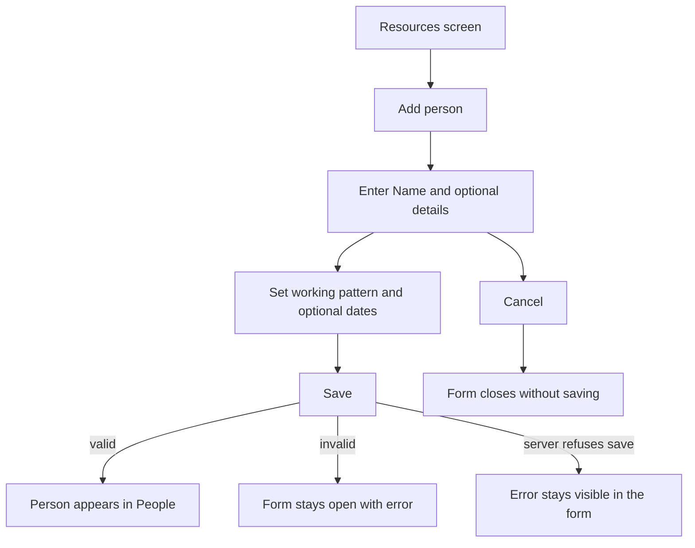
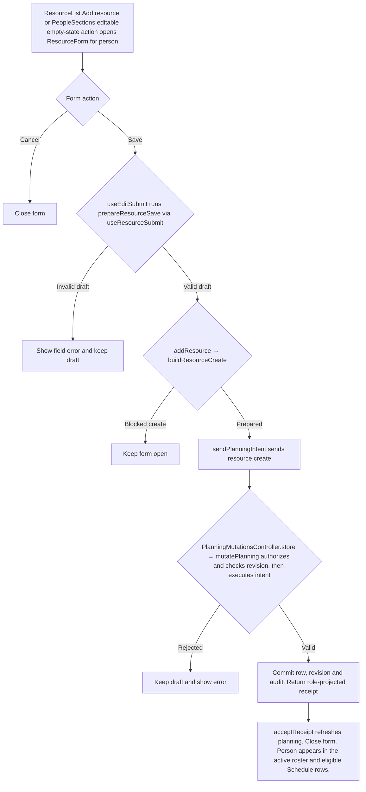

# US-RES-01 — Add a person resource

As an Editor, I want to add a person with a role, working pattern and optional team details so that the schedule reflects their capacity.

**Status:** Current
**Access:** Editor and above (Editor, Admin, Owner)
**Entry:** Resources screen → Add resource
**Documentation:** [Guide](../../docs-src/using/resources.md)
**Source:** [ResourceList.tsx](../../apps/frontend/src/components/resources/ResourceList.tsx) · [ResourceForm.tsx](../../apps/frontend/src/components/resources/ResourceForm.tsx)

## Acceptance criteria

| Field        | Control          | Required/default/conditions                                                                                                |
| ------------ | ---------------- | -------------------------------------------------------------------------------------------------------------------------- |
| Name         | Text field       | Required                                                                                                                   |
| Role         | Text field       | Optional                                                                                                                   |
| Discipline   | Picker           | Optional; "— None —" by default; shown when disciplines are enabled and at least one exists                                |
| Engagement   | Segmented choice | Studio or Supplementary; defaults to Studio                                                                                |
| Start date   | Date field       | Optional; unbounded when blank                                                                                             |
| End date     | Date field       | Optional; unbounded when blank; cannot be before Start date                                                                |
| Working days | Weekday picker   | Monday–Friday default Full day; Saturday and Sunday default Not working; at least one weekday must be Full day or Half day |

- **Save** adds the person to the People list; valid values are retained.

## User flow

## Code flow

Owner, Admin and Editor can write planning data. Viewer and view-as-member lack write authority. The write goes through `POST /api/companies/:companyId/planning/mutations` with admitted company access. The planning cache refreshes on a stale revision and reconciles an uncertain write before another attempt. Footer Cancel closes the form, including during a pending save. The dispatched save can still settle. The person form supplies Studio, permanent employment, fixed compatibility hours and the initial working pattern. It validates required Name, optional Job title, working days and date order. Discipline is conditional. `useResourceSubmit` fences form callbacks by the mounted dialog and submitted company. A late completion cannot close or mark a different company’s form.

**Code references:** [ResourceList.tsx](../../apps/frontend/src/components/resources/ResourceList.tsx#L15) · [ResourceListContent.tsx](../../apps/frontend/src/components/resources/ResourceListContent.tsx#L31) · [ResourceForm.tsx](../../apps/frontend/src/components/resources/ResourceForm.tsx#L197) · [ResourceForm.tsx](../../apps/frontend/src/components/resources/ResourceForm.tsx#L58) · [useResourceFormState.ts](../../apps/frontend/src/components/resources/useResourceFormState.ts#L48) · [useResourceSubmit.ts](../../apps/frontend/src/components/resources/useResourceSubmit.ts#L184) · [useResourceSubmit.ts](../../apps/frontend/src/components/resources/useResourceSubmit.ts#L116) · [useResourceSubmit.ts](../../apps/frontend/src/components/resources/useResourceSubmit.ts#L155) · [entity_rules.ts](../../apps/backend/app/services/planning/entity_rules.ts#L108) · [useResourceSubmit.ts](../../apps/frontend/src/components/resources/useResourceSubmit.ts#L52) · [ResourceAvailabilityFields.tsx](../../apps/frontend/src/components/resources/ResourceAvailabilityFields.tsx#L25) · [Write controls](../../apps/frontend/src/components/common/crudButtons.tsx#L7) · [Cancel button](../../apps/frontend/src/components/common/FormButtons.tsx#L17) · [useEditSubmit.ts](../../apps/frontend/src/hooks/useEditSubmit.ts#L44) · [Row checks](../../apps/backend/app/services/planning/entity_write.ts#L97) · [typedPlanningActions.ts](../../apps/frontend/src/store/typedPlanningActions.ts#L203) · [planningIntents.ts](../../apps/frontend/src/data/planning/planningIntents.ts#L310) · [sendPlanningIntent](../../apps/frontend/src/store/slices/planningSessionSlice.ts#L139) · [Planning transport](../../apps/frontend/src/data/planning/planningTransport.ts#L64) · [Planning route](../../apps/backend/start/planning_routes.ts#L16) · [Mutation controller](../../apps/backend/app/controllers/planning_mutations_controller.ts#L17) · [Planning transaction](../../apps/backend/app/services/planning.ts#L198) · [Company write authority](../../apps/backend/app/services/planning/access.ts#L17) · [Receipt and refresh](../../apps/frontend/src/data/planning/planningCache.ts#L469)
