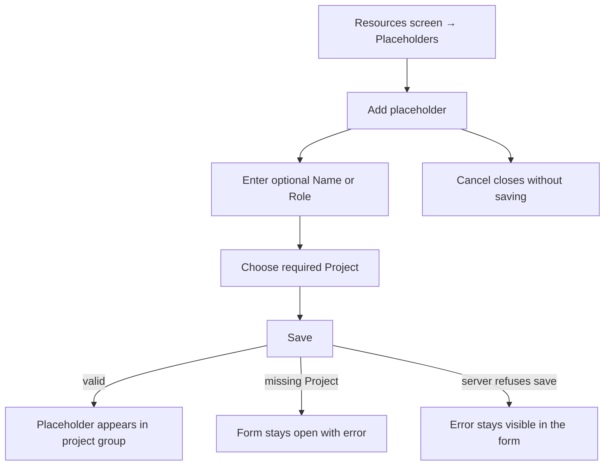
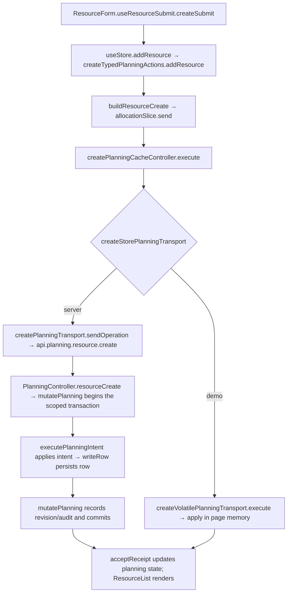

# US-RES-02 — Add a placeholder bound to a project

As an Editor, I want to add a placeholder bound to a project so that reserved capacity is visible before staffing.

**Status:** Current
**Access:** Editor and above (Editor, Admin, Owner)
**Entry:** Resources screen → Placeholders → Add placeholder
**Documentation:** [Guide](../../docs-src/using/resources.md)
**Source:** [ResourceList.tsx](../../apps/frontend/src/components/resources/ResourceList.tsx) · [ResourceForm.tsx](../../apps/frontend/src/components/resources/ResourceForm.tsx)

## Acceptance criteria

| Field           | Control    | Required/default/conditions                                                |
| --------------- | ---------- | -------------------------------------------------------------------------- |
| Name (optional) | Text field | Optional; role may identify the placeholder                                |
| Role            | Text field | Optional                                                                   |
| Discipline      | Picker     | Shown when disciplines are enabled and at least one is available; optional |
| Bound project   | Picker     | Required; active projects                                                  |

- **Save** adds the placeholder to its project and the Placeholder section. Placeholders have no Engagement, availability-date or working-day controls.

## User flow

## Code flow

**Code references:** [ResourceForm.tsx](../../apps/frontend/src/components/resources/ResourceForm.tsx) · [typedPlanningActions.ts](../../apps/frontend/src/store/typedPlanningActions.ts) · [allocationSlice.ts](../../apps/frontend/src/store/slices/allocationSlice.ts) · [planningCacheController.ts](../../apps/frontend/src/data/planning/planningCacheController.ts) · [storePlanningTransport.ts](../../apps/frontend/src/data/planning/storePlanningTransport.ts) · [planningTransport.ts](../../apps/frontend/src/data/planning/planningTransport.ts) · [volatilePlanningTransport.ts](../../apps/frontend/src/data/planning/volatilePlanningTransport.ts) · [planning_routes.ts](../../apps/backend/start/planning_routes.ts) · [planning_controller.ts](../../apps/backend/app/controllers/planning_controller.ts) · [planning.ts](../../apps/backend/app/services/planning.ts) · [execute.ts](../../apps/backend/app/services/planning/execute.ts) · [writer.ts](../../apps/backend/app/services/planning/writer.ts)
