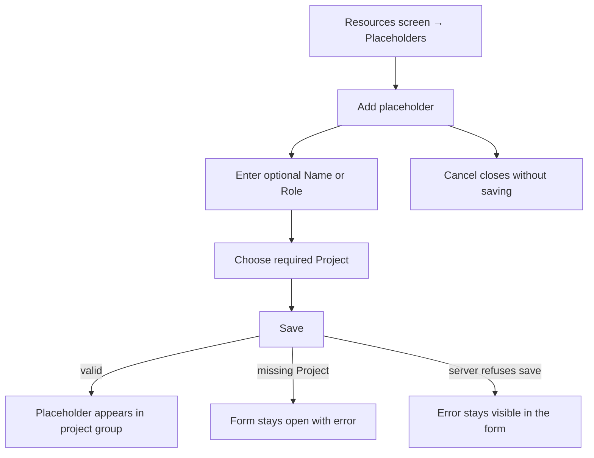
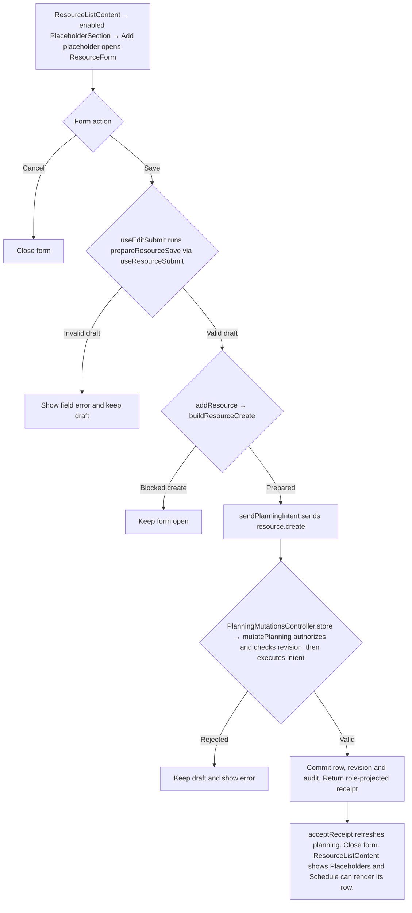

# US-RES-02 — Add a placeholder bound to a project

As an Editor, I want to add a placeholder bound to a project so that reserved capacity is visible before staffing.

**Status:** Current
**Access:** Editor and above (Editor, Admin, Owner)
**Entry:** Resources screen → Placeholders → Add placeholder
**Documentation:** [Guide](../../docs-src/using/resources.md)
**Source:** [ResourceList.tsx](../../apps/frontend/src/components/resources/ResourceList.tsx) · [ResourceForm.tsx](../../apps/frontend/src/components/resources/ResourceForm.tsx)

## Acceptance criteria

| Field           | Control    | Required/default/conditions                                                                 |
| --------------- | ---------- | ------------------------------------------------------------------------------------------- |
| Name (optional) | Text field | Optional; the role may identify the placeholder                                             |
| Role            | Text field | Optional                                                                                    |
| Discipline      | Picker     | Optional; "— None —" by default; shown when disciplines are enabled and at least one exists |
| Bound project   | Picker     | Required; active projects, labelled Client / Project                                        |

- The Placeholders section and **Add placeholder** appear only when the company enables Show placeholders. **Save** adds the placeholder, bound to its project, to the Placeholders section. Placeholders have no Engagement, availability-date or working-day controls.

## User flow

## Code flow

Owner, Admin and Editor can write planning data. Viewer and view-as-member lack write authority. The write goes through `POST /api/companies/:companyId/planning/mutations` with admitted company access. The planning cache refreshes on a stale revision and reconciles an uncertain write before another attempt. Footer Cancel closes the form, including during a pending save. The dispatched save can still settle. Show placeholders gates the section. `ResourceFields` uses active project options and requires a bound project. `buildResourcePatch` supplies placeholder defaults. The form omits personal dates and working pattern, and `resolveEffectiveWorkingWeek` uses company days. The server validates project scope and kind requirements.

**Code references:** [ResourceList.tsx](../../apps/frontend/src/components/resources/ResourceList.tsx#L15) · [ResourceListContent.tsx](../../apps/frontend/src/components/resources/ResourceListContent.tsx#L31) · [ResourceForm.tsx](../../apps/frontend/src/components/resources/ResourceForm.tsx#L197) · [ResourceForm.tsx](../../apps/frontend/src/components/resources/ResourceForm.tsx#L58) · [useResourceFormState.ts](../../apps/frontend/src/components/resources/useResourceFormState.ts#L48) · [useResourceSubmit.ts](../../apps/frontend/src/components/resources/useResourceSubmit.ts#L184) · [useResourceSubmit.ts](../../apps/frontend/src/components/resources/useResourceSubmit.ts#L116) · [useResourceSubmit.ts](../../apps/frontend/src/components/resources/useResourceSubmit.ts#L155) · [entity_rules.ts](../../apps/backend/app/services/planning/entity_rules.ts#L108) · [effectiveWorkingWeek.ts](../../packages/shared/src/lib/effectiveWorkingWeek.ts#L42) · [refs.ts](../../packages/shared/src/domain/assertions/refs.ts#L200) · [resources.db.spec.ts](../../e2e/resources.db.spec.ts#L188) · [Write controls](../../apps/frontend/src/components/common/crudButtons.tsx#L7) · [Cancel button](../../apps/frontend/src/components/common/FormButtons.tsx#L17) · [useEditSubmit.ts](../../apps/frontend/src/hooks/useEditSubmit.ts#L44) · [Row checks](../../apps/backend/app/services/planning/entity_write_service.ts#L91) · [typedPlanningActions.ts](../../apps/frontend/src/store/typedPlanningActions.ts#L203) · [planningIntents.ts](../../apps/frontend/src/data/planning/planningIntents.ts#L310) · [sendPlanningIntent](../../apps/frontend/src/store/slices/planningSessionSlice.ts#L139) · [Planning transport](../../apps/frontend/src/data/planning/planningTransport.ts#L64) · [Planning route](../../apps/backend/start/routes/planning.ts#L16) · [Mutation controller](../../apps/backend/app/controllers/planning_mutations_controller.ts#L19) · [Planning transaction](../../apps/backend/app/services/planning_service.ts#L222) · [Company write authority](../../apps/backend/app/services/planning/planning_access_service.ts#L31) · [Receipt and refresh](../../apps/frontend/src/data/planning/planningCache.ts#L469)
