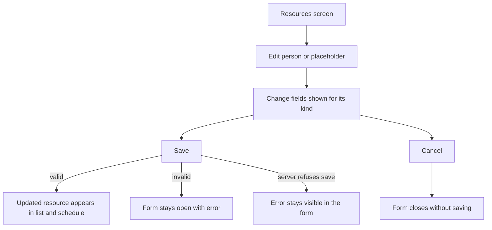
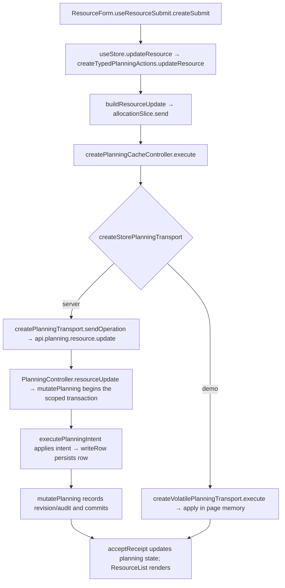

# US-RES-03 — Edit a resource's fields

As an Editor, I want to edit a resource’s details so that the roster and schedule stay accurate.

**Status:** Current
**Access:** Editor and above (Editor, Admin, Owner)
**Entry:** Resources screen → resource row → Edit
**Documentation:** [Guide](../../docs-src/using/resources.md)
**Source:** [ResourceList.tsx](../../apps/frontend/src/components/resources/ResourceList.tsx) · [ResourceForm.tsx](../../apps/frontend/src/components/resources/ResourceForm.tsx) · [ResourceAvailabilityFields.tsx](../../apps/frontend/src/components/resources/ResourceAvailabilityFields.tsx)

## Acceptance criteria

| Field                 | Control          | Required/default/conditions                                                          |
| --------------------- | ---------------- | ------------------------------------------------------------------------------------ |
| Name                  | Text field       | Current value prefilled; required for people, optional for placeholders              |
| Role                  | Text field       | Current value prefilled; optional                                                    |
| Discipline            | Picker           | Current value prefilled; shown when enabled and at least one discipline is available |
| Engagement            | Segmented choice | People only; current value prefilled, Studio or Supplementary                        |
| Project               | Picker           | Placeholder only; current project prefilled and required                             |
| Start date / End date | Date fields      | People only; current values prefilled; optional and inclusive                        |
| Working days          | Weekday picker   | People only; current values prefilled; at least one weekday Full day or Half day     |

- **Save** updates the resource with the selected kind-specific fields; invalid required values keep the form open with an error. **Cancel** closes without saving.

## User flow

## Code flow

**Code references:** [ResourceForm.tsx](../../apps/frontend/src/components/resources/ResourceForm.tsx) · [typedPlanningActions.ts](../../apps/frontend/src/store/typedPlanningActions.ts) · [allocationSlice.ts](../../apps/frontend/src/store/slices/allocationSlice.ts) · [planningCacheController.ts](../../apps/frontend/src/data/planning/planningCacheController.ts) · [storePlanningTransport.ts](../../apps/frontend/src/data/planning/storePlanningTransport.ts) · [planningTransport.ts](../../apps/frontend/src/data/planning/planningTransport.ts) · [volatilePlanningTransport.ts](../../apps/frontend/src/data/planning/volatilePlanningTransport.ts) · [planning_routes.ts](../../apps/backend/start/planning_routes.ts) · [planning_controller.ts](../../apps/backend/app/controllers/planning_controller.ts) · [planning.ts](../../apps/backend/app/services/planning.ts) · [execute.ts](../../apps/backend/app/services/planning/execute.ts) · [writer.ts](../../apps/backend/app/services/planning/writer.ts)
