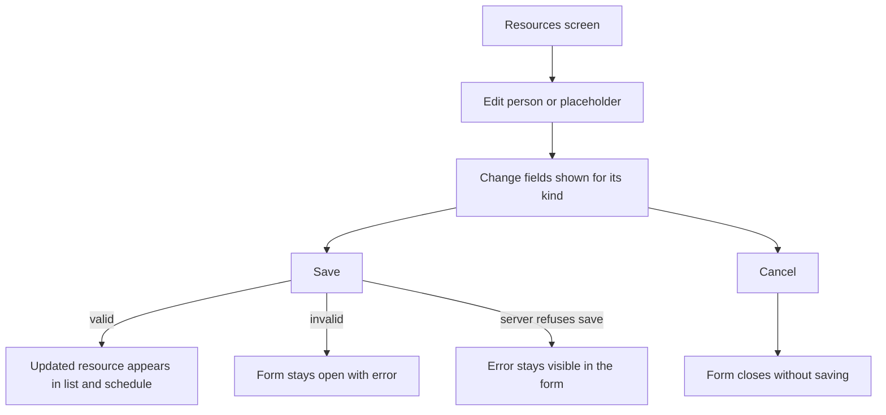
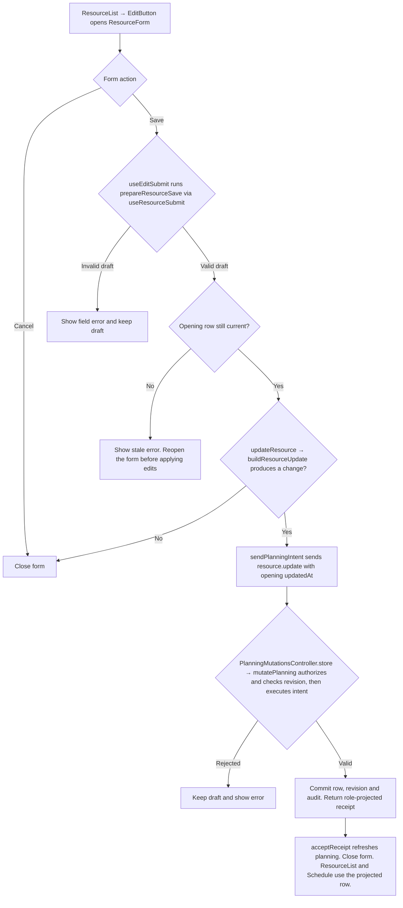

# US-RES-03 — Edit a resource's fields

As an Editor, I want to edit a resource’s details so that the roster and schedule stay accurate.

**Status:** Current
**Access:** Editor and above (Editor, Admin, Owner)
**Entry:** Resources screen → resource row → Edit
**Documentation:** [Guide](../../docs-src/using/resources.md)
**Source:** [ResourceList.tsx](../../apps/frontend/src/components/resources/ResourceList.tsx) · [ResourceForm.tsx](../../apps/frontend/src/components/resources/ResourceForm.tsx) · [ResourceAvailabilityFields.tsx](../../apps/frontend/src/components/resources/ResourceAvailabilityFields.tsx)

## Acceptance criteria

| Field                 | Control          | Required/default/conditions                                                                         |
| --------------------- | ---------------- | --------------------------------------------------------------------------------------------------- |
| Name                  | Text field       | Current value prefilled; required for people, optional for placeholders                             |
| Role                  | Text field       | Current value prefilled; optional                                                                   |
| Discipline            | Picker           | Current value prefilled; shown when disciplines are enabled and at least one exists                 |
| Engagement            | Segmented choice | People only; current value prefilled, Studio or Supplementary                                       |
| Bound project         | Picker           | Placeholders only; current project prefilled and required                                           |
| Start date / End date | Date fields      | People only; current values prefilled; optional and inclusive; End date cannot be before Start date |
| Working days          | Weekday picker   | People only; current values prefilled; at least one weekday Full day or Half day                    |

- **Save** updates the resource with the selected kind-specific fields; invalid required values keep the form open with an error. **Cancel** closes without saving.

## User flow

## Code flow

Owner, Admin and Editor can write planning data. Viewer and view-as-member lack write authority. The write goes through `POST /api/companies/:companyId/planning/mutations` with admitted company access. The planning cache refreshes on a stale revision and reconciles an uncertain write before another attempt. Footer Cancel closes the form, including during a pending save. The dispatched save can still settle. A person edits Engagement and availability. An enabled placeholder edits its required Bound project and has no personal availability controls. The active list excludes hidden ancestry. The form can show a disabled fallback if supplied a row with an unavailable current project. The server refuses a kind conversion or a bound-project change incompatible with existing bookings. Hidden compatibility hours, employment and person avatar are carried forward. `useResourceSubmit` fences form callbacks by the mounted dialog and submitted company. A late completion cannot close or mark a different company’s form.

**Code references:** [ResourceList.tsx](../../apps/frontend/src/components/resources/ResourceList.tsx#L15) · [ResourceListContent.tsx](../../apps/frontend/src/components/resources/ResourceListContent.tsx#L31) · [ResourceForm.tsx](../../apps/frontend/src/components/resources/ResourceForm.tsx#L197) · [ResourceForm.tsx](../../apps/frontend/src/components/resources/ResourceForm.tsx#L58) · [useResourceFormState.ts](../../apps/frontend/src/components/resources/useResourceFormState.ts#L48) · [useResourceSubmit.ts](../../apps/frontend/src/components/resources/useResourceSubmit.ts#L184) · [useResourceSubmit.ts](../../apps/frontend/src/components/resources/useResourceSubmit.ts#L116) · [useResourceSubmit.ts](../../apps/frontend/src/components/resources/useResourceSubmit.ts#L155) · [entity_rules.ts](../../apps/backend/app/services/planning/entity_rules.ts#L108) · [domain.ts](../../apps/backend/app/services/planning/entity_validation/domain.ts#L43) · [dependents.ts](../../packages/shared/src/domain/assertions/dependents.ts#L117) · [projectOptions.ts](../../apps/frontend/src/components/common/projectOptions.ts#L25) · [projection.ts](../../packages/shared/src/domain/lifecycle/projection.ts#L36) · [Write controls](../../apps/frontend/src/components/common/crudButtons.tsx#L7) · [Cancel button](../../apps/frontend/src/components/common/FormButtons.tsx#L17) · [useEditSubmit.ts](../../apps/frontend/src/hooks/useEditSubmit.ts#L44) · [Row checks](../../apps/backend/app/services/planning/entity_write_service.ts#L91) · [typedPlanningActions.ts](../../apps/frontend/src/store/typedPlanningActions.ts#L222) · [planningIntents.ts](../../apps/frontend/src/data/planning/planningIntents.ts#L364) · [sendPlanningIntent](../../apps/frontend/src/store/slices/planningSessionSlice.ts#L139) · [Planning transport](../../apps/frontend/src/data/planning/planningTransport.ts#L64) · [Planning route](../../apps/backend/start/planning_routes.ts#L16) · [Mutation controller](../../apps/backend/app/controllers/planning_mutations_controller.ts#L19) · [Planning transaction](../../apps/backend/app/services/planning_service.ts#L222) · [Company write authority](../../apps/backend/app/services/planning/planning_access_service.ts#L31) · [Receipt and refresh](../../apps/frontend/src/data/planning/planningCache.ts#L469)
