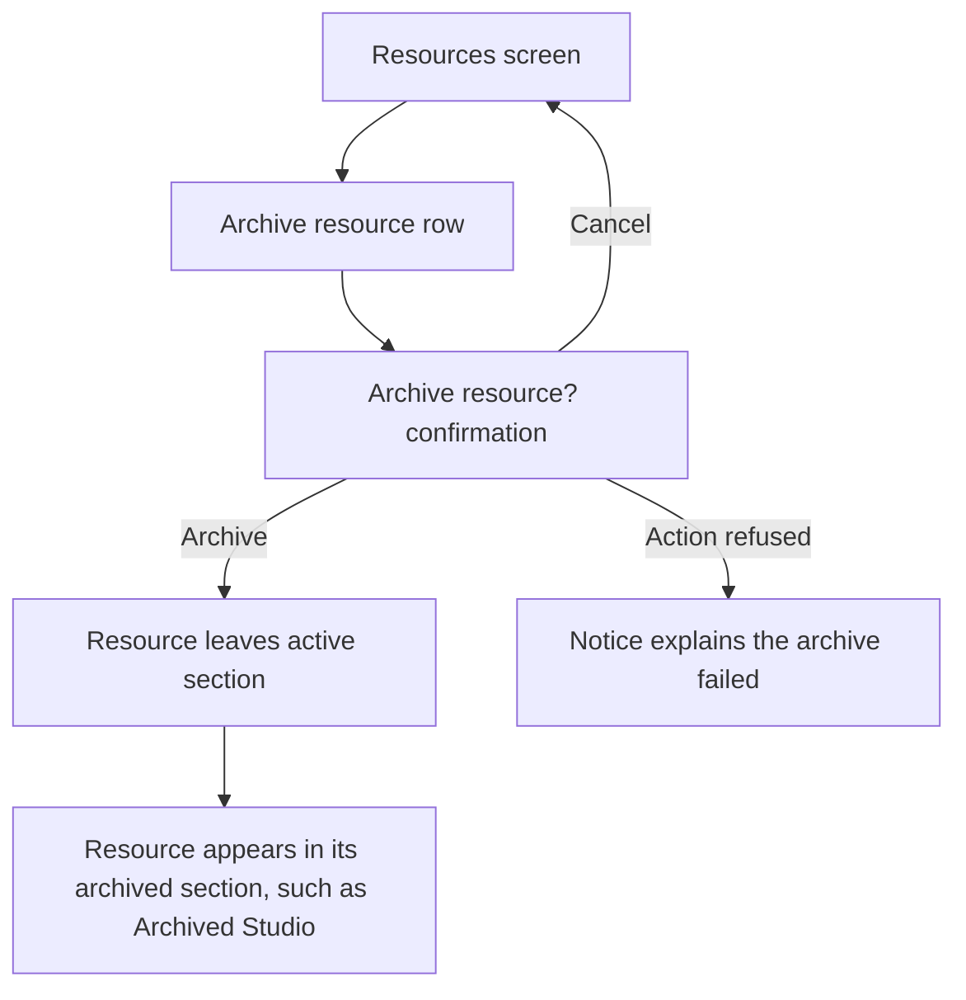
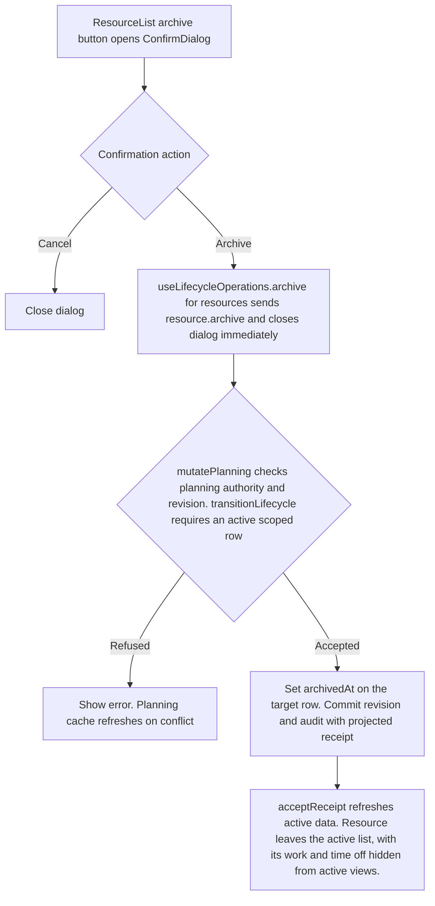

# US-RES-04 — Archive a resource

As an Editor, I want to archive a resource so that it leaves active views while its work remains retained.

**Status:** Current
**Access:** Editor and above (Editor, Admin, Owner)
**Entry:** Resources screen → resource row → Archive {resource name}
**Documentation:** [Guide](../../docs-src/using/resources.md)
**Source:** [ResourceList.tsx](../../apps/frontend/src/components/resources/ResourceList.tsx) · [ArchivedEntitySection.tsx](../../apps/frontend/src/components/common/ArchivedEntitySection.tsx)

## Acceptance criteria

- Selecting **Archive {name}** opens **Archive resource?** with **Archive** and **Cancel** controls.
- The dialog reads **Archive "{name}"? They will be hidden from the schedule.** and notes that Editors, Admins and Owners can restore them and only Owners and Admins can anonymise them. It shows no count of affected records.
- After confirmation, the resource leaves its active section and the Schedule. Its allocations and time off are kept, not deleted.
- **Cancel** closes the dialog without archiving. **Archive** archives the record.
- The archived record appears in its archived section with a **Restore** control.

## User flow

## Code flow

Owner, Admin and Editor can write planning data. Viewer and view-as-member lack write authority. Archive data is read through the Editor recovery section or the Owner/Admin inactive section. The active projection determines descendant visibility from retained links. `useLifecycleOperations` skips dispatch after a company change. `endsHistory` omits the history id and `notifyInactiveDataChanged` refreshes the inactive list. The list offers Restore for reversal. People, placeholders and external parties use the same resource archive intent. `transitionLifecycle` changes only the resource. The product preserves linked rows for recovery.

**Code references:** [ResourceList.tsx](../../apps/frontend/src/components/resources/ResourceList.tsx#L15) · [dialogs.tsx](../../apps/frontend/src/components/common/dialogs.tsx#L202) · [useLifecycleOperations.ts](../../apps/frontend/src/hooks/useLifecycleOperations.ts#L51) · [execute.ts](../../apps/backend/app/services/planning/execute.ts#L65) · [projection.ts](../../packages/shared/src/domain/lifecycle/projection.ts#L36) · [sendPlanningIntent](../../apps/frontend/src/store/slices/planningSessionSlice.ts#L139) · [Planning transport](../../apps/frontend/src/data/planning/planningTransport.ts#L64) · [Planning route](../../apps/backend/start/planning_routes.ts#L16) · [Mutation controller](../../apps/backend/app/controllers/planning_mutations_controller.ts#L9) · [Planning transaction](../../apps/backend/app/services/planning.ts#L198) · [Company write authority](../../apps/backend/app/services/planning/access.ts#L16) · [Receipt and refresh](../../apps/frontend/src/data/planning/planningCache.ts#L469) · [Archive access split](../../apps/frontend/src/components/common/ArchivedEntitySection.tsx#L250) · [Editor recovery controls](../../apps/frontend/src/components/common/ArchiveRecoverySection.tsx#L27) · [Editor recovery read](../../apps/backend/app/services/planning.ts#L135) · [useInactiveCompanyData.ts](../../apps/frontend/src/hooks/useInactiveCompanyData.ts#L17) · [Inactive state authority](../../apps/backend/app/controllers/company_state_controller.ts#L13) · [Ancestor lookup](../../apps/frontend/src/components/common/archivedEntityRows.ts#L73) · [Editor recovery projection](../../packages/shared/src/domain/lifecycle/archiveRecovery.ts#L25) · [ResourceList.tsx](../../apps/frontend/src/components/resources/ResourceList.tsx#L72) · [ExternalResourceSection.tsx](../../apps/frontend/src/components/resources/ExternalResourceSection.tsx#L24)
