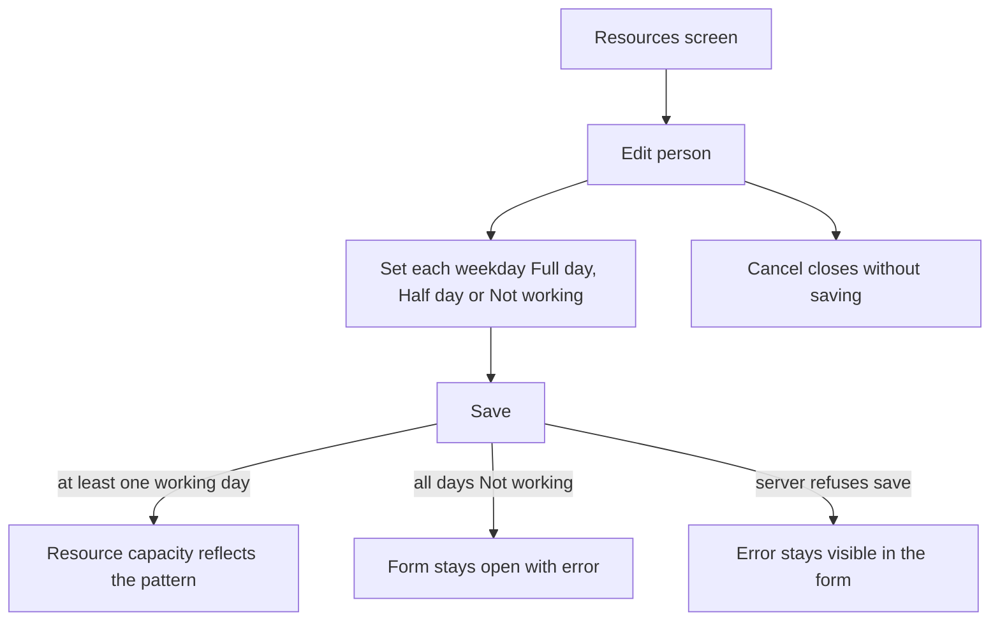
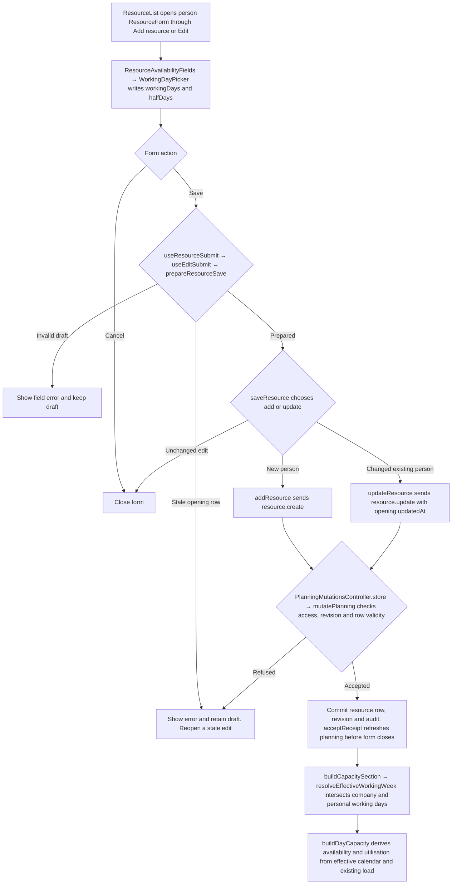

# US-RES-05 — Set a resource's working days

As an Editor, I want to set a person’s working days so that the schedule calculates capacity correctly.

**Status:** Current
**Access:** Editor and above (Editor, Admin, Owner)
**Entry:** Resources screen → person row → Edit → Working days
**Documentation:** [Guide](../../docs-src/using/resources.md)
**Source:** [ResourceForm.tsx](../../apps/frontend/src/components/resources/ResourceForm.tsx) · [ResourceAvailabilityFields.tsx](../../apps/frontend/src/components/resources/ResourceAvailabilityFields.tsx)

## Acceptance criteria

| Field        | Control        | Required/default/conditions                                    |
| ------------ | -------------- | -------------------------------------------------------------- |
| Working days | Weekday picker | People only; at least one weekday must be Full day or Half day |

- **Save** retains valid values; invalid values keep the form open with an error.

## User flow

## Code flow

Owner, Admin and Editor can write planning data. Viewer and view-as-member lack write authority. An unchanged edit yields no intent. Footer Cancel closes the form even when a dispatched save is pending. The planning cache refreshes conflicts and reconciles uncertain writes. The person form seeds weekdays as full days on create and saved states on edit. `validateWorkingDays` requires a working day, and the server enforces a nonempty working pattern with half-days within it. No company-day overlap yields an effective week with no working days. The resource write leaves existing bookings in place.

**Code references:** [ResourceList.tsx](../../apps/frontend/src/components/resources/ResourceList.tsx#L15) · [ResourceListContent.tsx](../../apps/frontend/src/components/resources/ResourceListContent.tsx#L31) · [ResourceForm.tsx](../../apps/frontend/src/components/resources/ResourceForm.tsx#L197) · [ResourceForm.tsx](../../apps/frontend/src/components/resources/ResourceForm.tsx#L58) · [useResourceFormState.ts](../../apps/frontend/src/components/resources/useResourceFormState.ts#L48) · [useResourceSubmit.ts](../../apps/frontend/src/components/resources/useResourceSubmit.ts#L184) · [useResourceSubmit.ts](../../apps/frontend/src/components/resources/useResourceSubmit.ts#L116) · [useResourceSubmit.ts](../../apps/frontend/src/components/resources/useResourceSubmit.ts#L155) · [entity_rules.ts](../../apps/backend/app/services/planning/entity_rules.ts#L108) · [useEditSubmit.ts](../../apps/frontend/src/hooks/useEditSubmit.ts#L44) · [typedPlanningActions.ts](../../apps/frontend/src/store/typedPlanningActions.ts#L203) · [typedPlanningActions.ts](../../apps/frontend/src/store/typedPlanningActions.ts#L222) · [planningIntents.ts](../../apps/frontend/src/data/planning/planningIntents.ts#L310) · [planningIntents.ts](../../apps/frontend/src/data/planning/planningIntents.ts#L364) · [sendPlanningIntent](../../apps/frontend/src/store/slices/planningSessionSlice.ts#L139) · [Planning transport](../../apps/frontend/src/data/planning/planningTransport.ts#L64) · [Planning route](../../apps/backend/start/routes/planning.ts#L15) · [Mutation controller](../../apps/backend/app/controllers/planning_mutations_controller.ts#L19) · [Planning transaction](../../apps/backend/app/services/planning_service.ts#L222) · [Company write authority](../../apps/backend/app/services/planning/planning_access_service.ts#L31) · [Receipt and refresh](../../apps/frontend/src/data/planning/planningCache.ts#L469) · [ResourceAvailabilityFields.tsx](../../apps/frontend/src/components/resources/ResourceAvailabilityFields.tsx#L25) · [WorkingDayPicker.tsx](../../apps/frontend/src/components/common/fields/WorkingDayPicker.tsx#L127) · [validation.ts](../../apps/frontend/src/lib/validation.ts#L77) · [capacity_section.ts](../../apps/backend/app/services/planning/capacity_section.ts#L57) · [effectiveWorkingWeek.ts](../../packages/shared/src/lib/effectiveWorkingWeek.ts#L42) · [capacity.ts](../../packages/shared/src/lib/capacity.ts#L56) · [ResourceForm.test.tsx](../../apps/frontend/src/components/resources/ResourceForm.test.tsx#L691)
