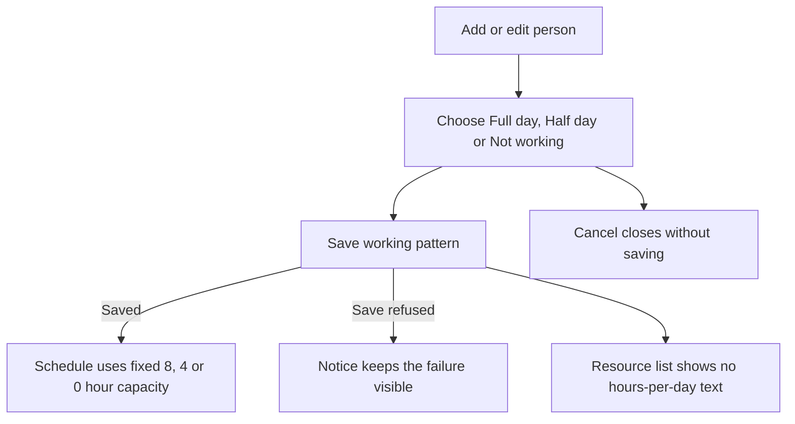
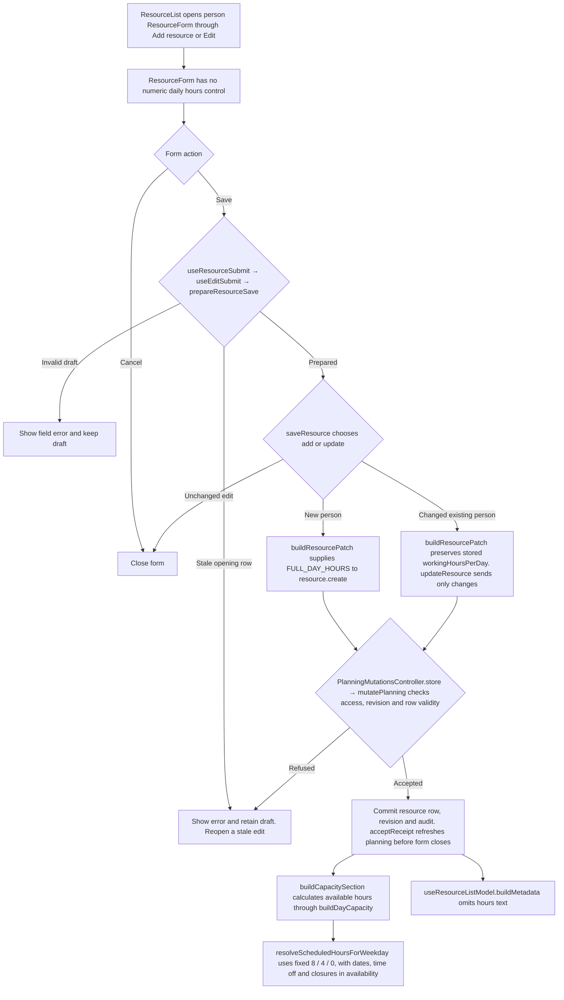

# US-RES-06 — Use fixed resource working hours

As an Editor, I want capacity to use fixed Full day, Half day and Not working values so that each working day contributes its defined capacity.

**Status:** Current — resource forms use fixed capacity through working-day choices; the legacy hours field is not editable.
**Access:** Editor and above (Editor, Admin, Owner)
**Entry:** Resources screen → Add person or Edit person
**Documentation:** [Guide](../../docs-src/using/resources.md)
**Source:** [ResourceList.tsx](../../apps/frontend/src/components/resources/ResourceList.tsx)

## Acceptance criteria

- No **Working hours / day** field appears in person forms, and the resource list shows no hours-per-day text.
- **Full day** represents 8 hours, **Half day** 4 hours and **Not working** 0 hours. The persisted compatibility value remains 8 after a person form save.

## User flow

## Code flow

Owner, Admin and Editor can write planning data. Viewer and view-as-member lack write authority. An unchanged edit yields no intent. Footer Cancel closes the form even when a dispatched save is pending. The planning cache refreshes conflicts and reconciles uncertain writes. The compatibility field is carried through the person edit even for a stored six-hour day. Available capacity follows the effective working week and fixed weekday values. The date-aware scheduled-hours helper is `resolveScheduledHoursOnDay`; capacity adds time off and closure rules through `resolveAvailableHoursForWeekday`.

**Code references:** [ResourceList.tsx](../../apps/frontend/src/components/resources/ResourceList.tsx#L15) · [ResourceListContent.tsx](../../apps/frontend/src/components/resources/ResourceListContent.tsx#L31) · [ResourceForm.tsx](../../apps/frontend/src/components/resources/ResourceForm.tsx#L197) · [ResourceForm.tsx](../../apps/frontend/src/components/resources/ResourceForm.tsx#L58) · [useResourceFormState.ts](../../apps/frontend/src/components/resources/useResourceFormState.ts#L48) · [useResourceSubmit.ts](../../apps/frontend/src/components/resources/useResourceSubmit.ts#L184) · [useResourceSubmit.ts](../../apps/frontend/src/components/resources/useResourceSubmit.ts#L116) · [useResourceSubmit.ts](../../apps/frontend/src/components/resources/useResourceSubmit.ts#L155) · [entity_rules.ts](../../apps/backend/app/services/planning/entity_rules.ts#L108) · [useEditSubmit.ts](../../apps/frontend/src/hooks/useEditSubmit.ts#L44) · [typedPlanningActions.ts](../../apps/frontend/src/store/typedPlanningActions.ts#L203) · [typedPlanningActions.ts](../../apps/frontend/src/store/typedPlanningActions.ts#L222) · [planningIntents.ts](../../apps/frontend/src/data/planning/planningIntents.ts#L310) · [planningIntents.ts](../../apps/frontend/src/data/planning/planningIntents.ts#L364) · [sendPlanningIntent](../../apps/frontend/src/store/slices/planningSessionSlice.ts#L139) · [Planning transport](../../apps/frontend/src/data/planning/planningTransport.ts#L64) · [Planning route](../../apps/backend/start/routes/planning.ts#L15) · [Mutation controller](../../apps/backend/app/controllers/planning_mutations_controller.ts#L19) · [Planning transaction](../../apps/backend/app/services/planning_service.ts#L222) · [Company write authority](../../apps/backend/app/services/planning/planning_access_service.ts#L31) · [Receipt and refresh](../../apps/frontend/src/data/planning/planningCache.ts#L469) · [availability.ts](../../packages/shared/src/lib/capacity/availability.ts#L43) · [effectiveWorkingWeek.ts](../../packages/shared/src/lib/effectiveWorkingWeek.ts#L42) · [capacity.ts](../../packages/shared/src/lib/capacity.ts#L183) · [availability.ts](../../packages/shared/src/lib/capacity/availability.ts#L113) · [useResourceListModel.ts](../../apps/frontend/src/components/resources/useResourceListModel.ts#L71) · [ResourceForm.test.tsx](../../apps/frontend/src/components/resources/ResourceForm.test.tsx#L669)
