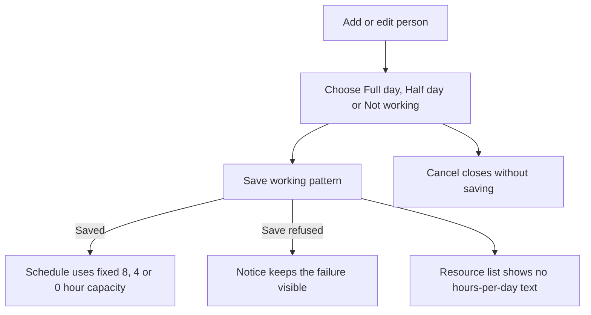
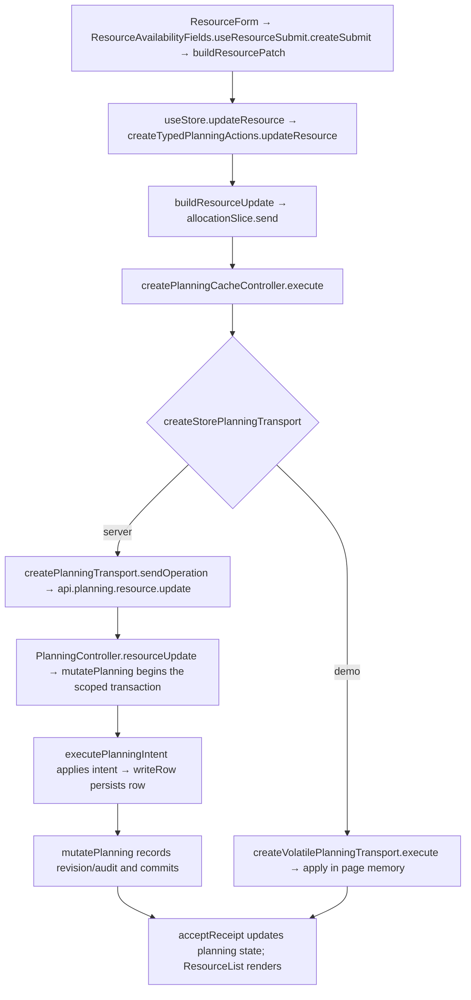

# US-RES-06 — Use fixed resource working hours

As an Editor, I want capacity to use fixed Full day, Half day and Not working values so that each working day contributes its defined capacity.

**Status:** Current — resource forms use fixed capacity through working-day choices; the legacy hours field is not editable.
**Access:** Editor and above (Editor, Admin, Owner)
**Entry:** Resources screen → Add person or Edit person
**Documentation:** [Guide](../../docs-src/using/resources.md)
**Source:** [ResourceList.tsx](../../apps/frontend/src/components/resources/ResourceList.tsx)

## Acceptance criteria

- No **Working hours / day** field appears in person forms, and the resource list shows no hours-per-day text.
- **Full day** represents 8 hours, **Half day** 4 hours and **Not working** 0 hours. The persisted compatibility value remains 8 after a person form save.

## User flow

## Code flow

**Code references:** [ResourceForm.tsx](../../apps/frontend/src/components/resources/ResourceForm.tsx) · [ResourceAvailabilityFields.tsx](../../apps/frontend/src/components/resources/ResourceAvailabilityFields.tsx) · [typedPlanningActions.ts](../../apps/frontend/src/store/typedPlanningActions.ts) · [allocationSlice.ts](../../apps/frontend/src/store/slices/allocationSlice.ts) · [planningCacheController.ts](../../apps/frontend/src/data/planning/planningCacheController.ts) · [storePlanningTransport.ts](../../apps/frontend/src/data/planning/storePlanningTransport.ts) · [planningTransport.ts](../../apps/frontend/src/data/planning/planningTransport.ts) · [volatilePlanningTransport.ts](../../apps/frontend/src/data/planning/volatilePlanningTransport.ts) · [planning_routes.ts](../../apps/backend/start/planning_routes.ts) · [planning_controller.ts](../../apps/backend/app/controllers/planning_controller.ts) · [planning.ts](../../apps/backend/app/services/planning.ts) · [execute.ts](../../apps/backend/app/services/planning/execute.ts) · [writer.ts](../../apps/backend/app/services/planning/writer.ts)
