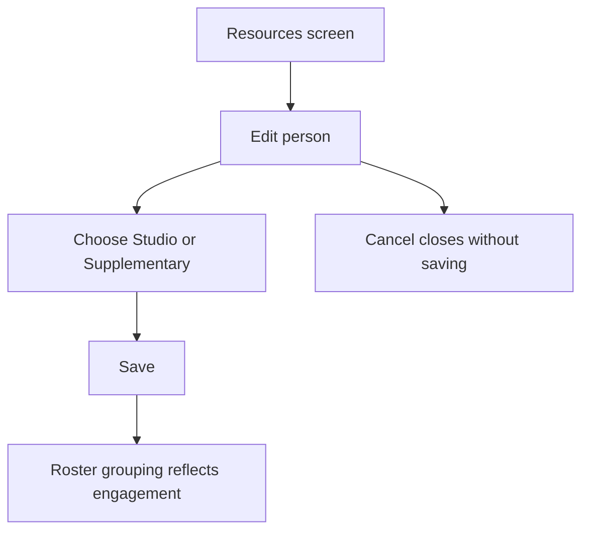
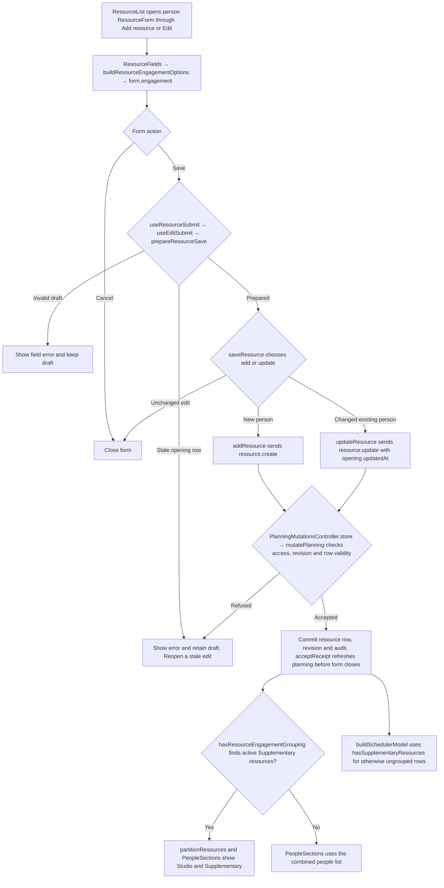

# US-RES-07 — Studio or Supplementary engagement

As an Editor, I want to classify a person as Studio or Supplementary so that the roster groups them correctly.

**Status:** Current
**Access:** Editor and above (Editor, Admin, Owner)
**Entry:** Resources screen → person row → Edit → Engagement
**Documentation:** [Guide](../../docs-src/using/resources.md)
**Source:** [ResourceForm.tsx](../../apps/frontend/src/components/resources/ResourceForm.tsx)

## Acceptance criteria

| Field      | Control          | Required/default/conditions                              |
| ---------- | ---------------- | -------------------------------------------------------- |
| Engagement | Segmented choice | People only; Studio or Supplementary; defaults to Studio |

- **Save** retains valid values; invalid values keep the form open with an error.

## User flow

## Code flow

Owner, Admin and Editor can write planning data. Viewer and view-as-member lack write authority. An unchanged edit yields no intent. Footer Cancel closes the form even when a dispatched save is pending. The planning cache refreshes conflicts and reconciles uncertain writes. The person form defaults to Studio and preselects saved engagement on edit. `buildResourcePatch` keeps stored Employment. Placeholder and external forms omit Engagement and use Studio in their writes. Schedule still forms applicable discipline bands.

**Code references:** [ResourceList.tsx](../../apps/frontend/src/components/resources/ResourceList.tsx#L15) · [ResourceListContent.tsx](../../apps/frontend/src/components/resources/ResourceListContent.tsx#L31) · [ResourceForm.tsx](../../apps/frontend/src/components/resources/ResourceForm.tsx#L197) · [ResourceForm.tsx](../../apps/frontend/src/components/resources/ResourceForm.tsx#L58) · [useResourceFormState.ts](../../apps/frontend/src/components/resources/useResourceFormState.ts#L48) · [useResourceSubmit.ts](../../apps/frontend/src/components/resources/useResourceSubmit.ts#L184) · [useResourceSubmit.ts](../../apps/frontend/src/components/resources/useResourceSubmit.ts#L116) · [useResourceSubmit.ts](../../apps/frontend/src/components/resources/useResourceSubmit.ts#L155) · [entity_rules.ts](../../apps/backend/app/services/planning/entity_rules.ts#L108) · [useEditSubmit.ts](../../apps/frontend/src/hooks/useEditSubmit.ts#L44) · [typedPlanningActions.ts](../../apps/frontend/src/store/typedPlanningActions.ts#L203) · [typedPlanningActions.ts](../../apps/frontend/src/store/typedPlanningActions.ts#L222) · [planningIntents.ts](../../apps/frontend/src/data/planning/planningIntents.ts#L310) · [planningIntents.ts](../../apps/frontend/src/data/planning/planningIntents.ts#L364) · [sendPlanningIntent](../../apps/frontend/src/store/slices/planningSessionSlice.ts#L139) · [Planning transport](../../apps/frontend/src/data/planning/planningTransport.ts#L64) · [Planning route](../../apps/backend/start/planning_routes.ts#L16) · [Mutation controller](../../apps/backend/app/controllers/planning_mutations_controller.ts#L9) · [Planning transaction](../../apps/backend/app/services/planning.ts#L198) · [Company write authority](../../apps/backend/app/services/planning/access.ts#L16) · [Receipt and refresh](../../apps/frontend/src/data/planning/planningCache.ts#L469) · [metadata.ts](../../apps/frontend/src/lib/metadata.ts#L125) · [selectors.ts](../../apps/frontend/src/store/selectors.ts#L57) · [useResourceListModel.ts](../../apps/frontend/src/components/resources/useResourceListModel.ts#L16) · [schedulerModel.ts](../../apps/frontend/src/components/scheduler/schedulerModel.ts#L132) · [ResourceForm.test.tsx](../../apps/frontend/src/components/resources/ResourceForm.test.tsx#L626) · [ResourceList.test.tsx](../../apps/frontend/src/components/resources/ResourceList.test.tsx#L179)
