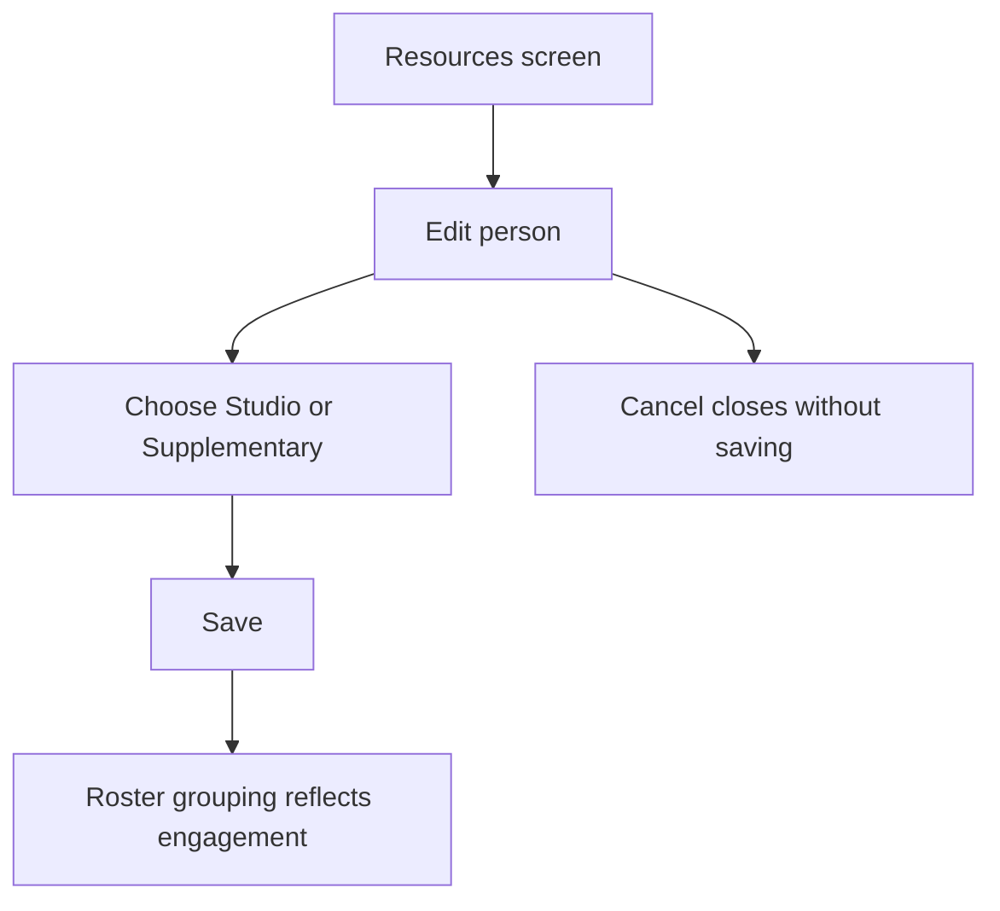
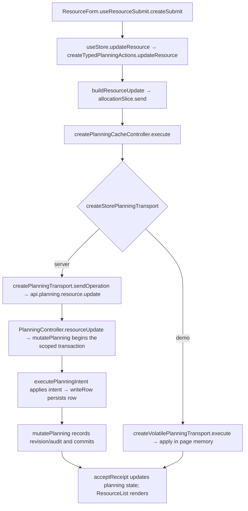

# US-RES-07 — Studio or Supplementary engagement

As an Editor, I want to classify a person as Studio or Supplementary so that the roster groups them correctly.

**Status:** Current
**Access:** Editor and above (Editor, Admin, Owner)
**Entry:** Resources screen → person row → Edit → Engagement
**Documentation:** [Guide](../../docs-src/using/resources.md)
**Source:** [ResourceForm.tsx](../../apps/frontend/src/components/resources/ResourceForm.tsx)

## Acceptance criteria

| Field      | Control          | Required/default/conditions                              |
| ---------- | ---------------- | -------------------------------------------------------- |
| Engagement | Segmented choice | People only; Studio or Supplementary; defaults to Studio |

- **Save** retains valid values; invalid values keep the form open with an error.

## User flow

## Code flow

**Code references:** [ResourceForm.tsx](../../apps/frontend/src/components/resources/ResourceForm.tsx) · [typedPlanningActions.ts](../../apps/frontend/src/store/typedPlanningActions.ts) · [allocationSlice.ts](../../apps/frontend/src/store/slices/allocationSlice.ts) · [planningCacheController.ts](../../apps/frontend/src/data/planning/planningCacheController.ts) · [storePlanningTransport.ts](../../apps/frontend/src/data/planning/storePlanningTransport.ts) · [planningTransport.ts](../../apps/frontend/src/data/planning/planningTransport.ts) · [volatilePlanningTransport.ts](../../apps/frontend/src/data/planning/volatilePlanningTransport.ts) · [planning_routes.ts](../../apps/backend/start/planning_routes.ts) · [planning_controller.ts](../../apps/backend/app/controllers/planning_controller.ts) · [planning.ts](../../apps/backend/app/services/planning.ts) · [execute.ts](../../apps/backend/app/services/planning/execute.ts) · [writer.ts](../../apps/backend/app/services/planning/writer.ts)
