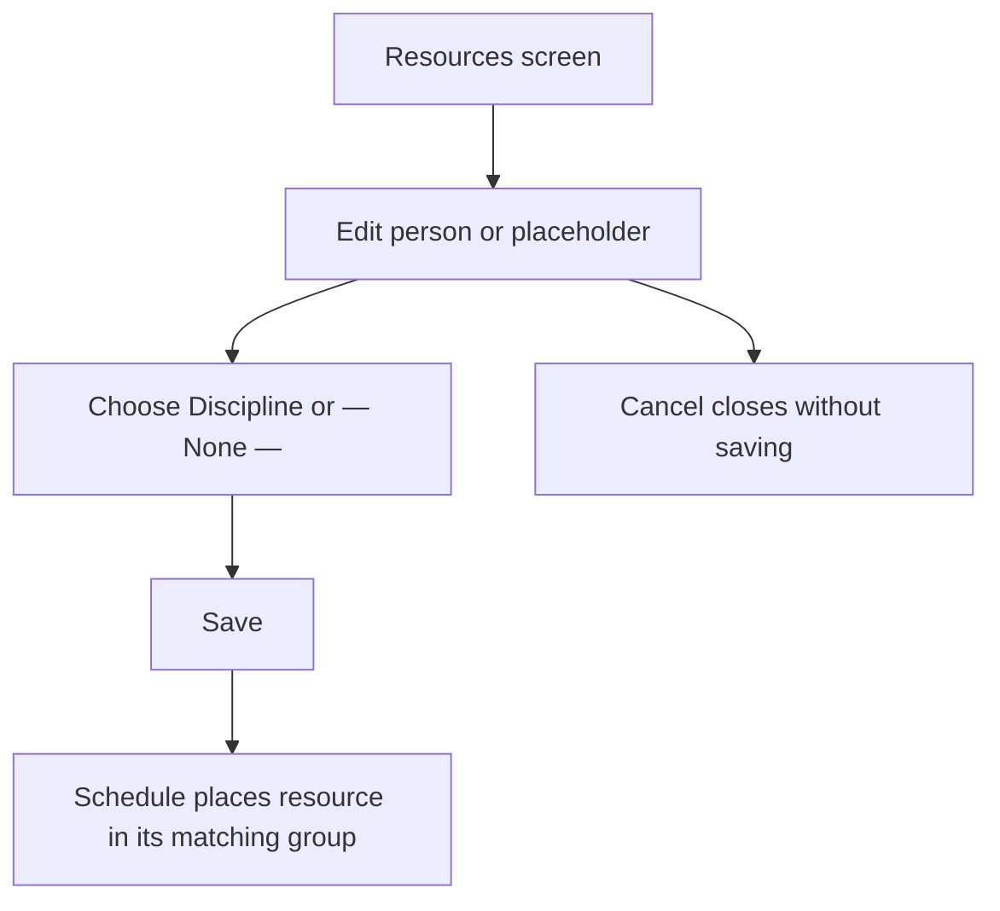
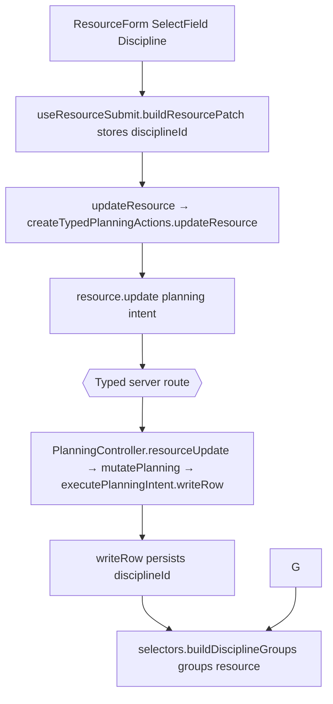

# US-RES-08 — Group a resource under a discipline

As an Editor, I want to assign a resource to a discipline or leave it unassigned so that schedule grouping reflects the team.

**Status:** Current
**Access:** Editor and above (Editor, Admin, Owner)
**Entry:** Resources screen → person row → Edit → Discipline
**Documentation:** [Guide](../../docs-src/using/resources.md)
**Source:** [ResourceForm.tsx](../../apps/frontend/src/components/resources/ResourceForm.tsx) · [selectors.ts](../../apps/frontend/src/store/selectors.ts)

## Acceptance criteria

- In Add/Edit person, the **Discipline** picker offers **— None —** and available disciplines.
- With disciplines enabled, saving a discipline places the person under that discipline’s group on the Schedule; **— None —** places them in **Unassigned**, which is split into **Studio** and **Supplementary** when the company has an active Supplementary person.

## User flow

## Code flow

**Code references:** [ResourceForm.tsx](../../apps/frontend/src/components/resources/ResourceForm.tsx) · [useResourceSubmit.ts](../../apps/frontend/src/components/resources/useResourceSubmit.ts) · [typedPlanningActions.ts](../../apps/frontend/src/store/typedPlanningActions.ts) · [planningTransport.ts](../../apps/frontend/src/data/planning/planningTransport.ts) · [selectors.ts](../../apps/frontend/src/store/selectors.ts) · [planning_routes.ts](../../apps/backend/start/planning_routes.ts) · [planning_controller.ts](../../apps/backend/app/controllers/planning_controller.ts) · [planning.ts](../../apps/backend/app/services/planning.ts) · [writer.ts](../../apps/backend/app/services/planning/writer.ts)
