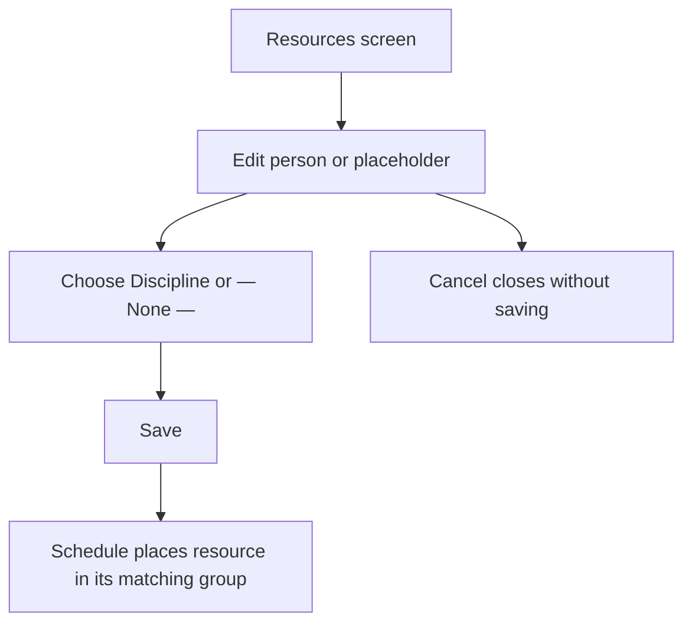
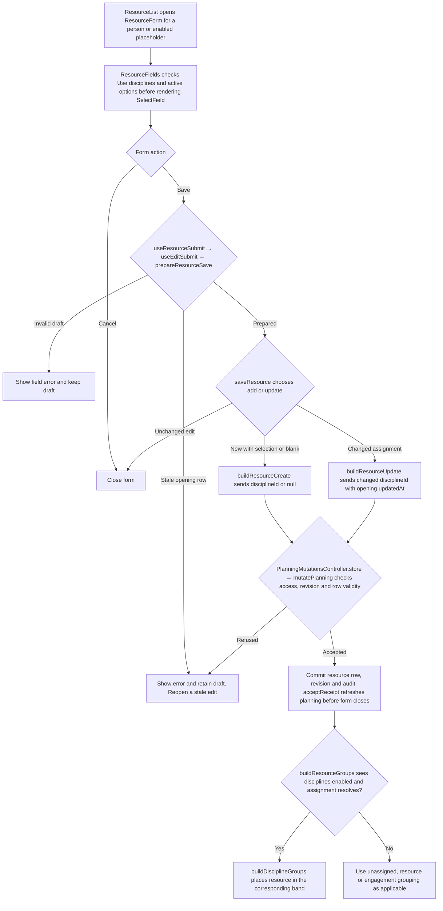

# US-RES-08 — Group a resource under a discipline

As an Editor, I want to assign a resource to a discipline or leave it unassigned so that schedule grouping reflects the team.

**Status:** Current
**Access:** Editor and above (Editor, Admin, Owner)
**Entry:** Resources screen → person row → Edit → Discipline
**Documentation:** [Guide](../../docs-src/using/resources.md)
**Source:** [ResourceForm.tsx](../../apps/frontend/src/components/resources/ResourceForm.tsx) · [selectors.ts](../../apps/frontend/src/store/selectors.ts)

## Acceptance criteria

- In Add/Edit person, the **Discipline** picker offers **— None —** and available disciplines.
- With disciplines enabled, saving a discipline places the person under that discipline’s group on the Schedule; **— None —** places them in **Unassigned**, which is split into **Studio** and **Supplementary** when the company has an active Supplementary person.

## User flow

## Code flow

Owner, Admin and Editor can write planning data. Viewer and view-as-member lack write authority. An unchanged edit yields no intent. Footer Cancel closes the form even when a dispatched save is pending. The planning cache refreshes conflicts and reconciles uncertain writes. The picker offers discipline ids. None is a blank placeholder on an unassigned draft, and there is no clear item for an existing assignment. A hidden control preserves the opening assignment. The API accepts a nullable discipline id and validates scoped references on write.

**Code references:** [ResourceList.tsx](../../apps/frontend/src/components/resources/ResourceList.tsx#L15) · [ResourceListContent.tsx](../../apps/frontend/src/components/resources/ResourceListContent.tsx#L31) · [ResourceForm.tsx](../../apps/frontend/src/components/resources/ResourceForm.tsx#L197) · [ResourceForm.tsx](../../apps/frontend/src/components/resources/ResourceForm.tsx#L58) · [useResourceFormState.ts](../../apps/frontend/src/components/resources/useResourceFormState.ts#L48) · [useResourceSubmit.ts](../../apps/frontend/src/components/resources/useResourceSubmit.ts#L184) · [useResourceSubmit.ts](../../apps/frontend/src/components/resources/useResourceSubmit.ts#L116) · [useResourceSubmit.ts](../../apps/frontend/src/components/resources/useResourceSubmit.ts#L155) · [entity_rules.ts](../../apps/backend/app/services/planning/entity_rules.ts#L108) · [useEditSubmit.ts](../../apps/frontend/src/hooks/useEditSubmit.ts#L44) · [typedPlanningActions.ts](../../apps/frontend/src/store/typedPlanningActions.ts#L203) · [typedPlanningActions.ts](../../apps/frontend/src/store/typedPlanningActions.ts#L222) · [planningIntents.ts](../../apps/frontend/src/data/planning/planningIntents.ts#L310) · [planningIntents.ts](../../apps/frontend/src/data/planning/planningIntents.ts#L364) · [sendPlanningIntent](../../apps/frontend/src/store/slices/planningSessionSlice.ts#L139) · [Planning transport](../../apps/frontend/src/data/planning/planningTransport.ts#L64) · [Planning route](../../apps/backend/start/planning_routes.ts#L16) · [Mutation controller](../../apps/backend/app/controllers/planning_mutations_controller.ts#L17) · [Planning transaction](../../apps/backend/app/services/planning.ts#L198) · [Company write authority](../../apps/backend/app/services/planning/access.ts#L17) · [Receipt and refresh](../../apps/frontend/src/data/planning/planningCache.ts#L469) · [selectors.ts](../../apps/frontend/src/store/selectors.ts#L147) · [schedulerModel.ts](../../apps/frontend/src/components/scheduler/schedulerModel.ts#L132) · [refs.ts](../../packages/shared/src/domain/assertions/refs.ts#L200)
