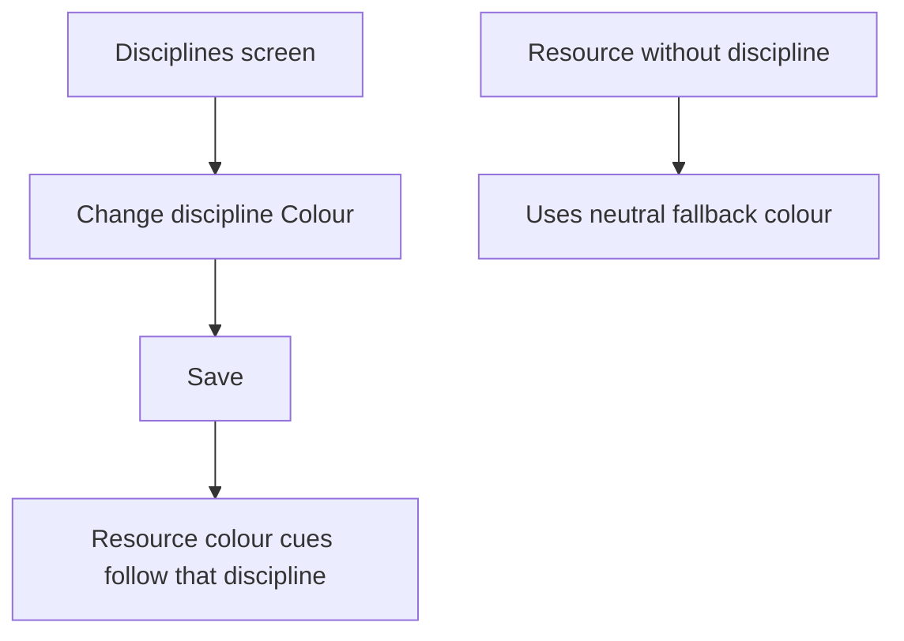
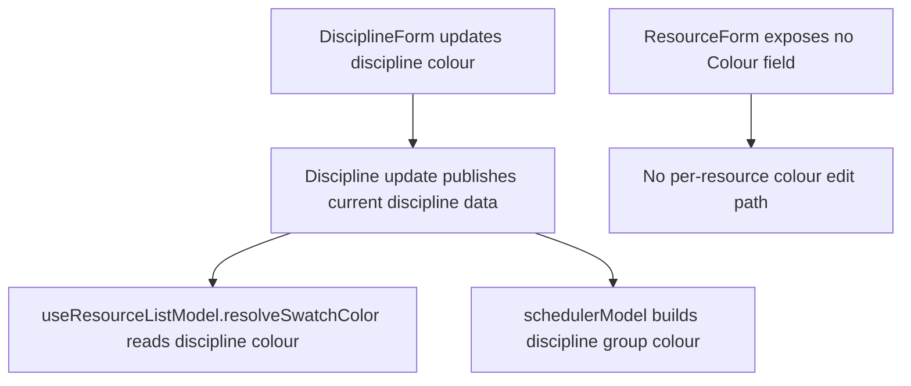

# US-RES-09 — A resource's colour comes from its discipline

As an Editor, I want resource colour to follow its discipline so that the schedule uses consistent group colours.

**Status:** Current
**Access:** Viewer, Editor, Admin or Owner
**Entry:** Disciplines screen → Edit discipline → Colour; Schedule → resource row
**Documentation:** [Guide](../../docs-src/using/resources.md)
**Source:** [useResourceListModel.ts](../../apps/frontend/src/components/resources/useResourceListModel.ts) · [schedulerModel.ts](../../apps/frontend/src/components/scheduler/schedulerModel.ts)

## Acceptance criteria

- Add/Edit resource has no Colour control.
- With disciplines enabled, the Resources list swatch and the Schedule group use the assigned discipline’s colour; a person with no discipline uses neutral grey. With disciplines off, the list uses the resource’s stored colour.

## User flow

## Code flow

**Code references:** [DisciplineForm.tsx](../../apps/frontend/src/components/disciplines/DisciplineForm.tsx) · [ResourceForm.tsx](../../apps/frontend/src/components/resources/ResourceForm.tsx) · [useResourceListModel.ts](../../apps/frontend/src/components/resources/useResourceListModel.ts) · [schedulerModel.ts](../../apps/frontend/src/components/scheduler/schedulerModel.ts)
