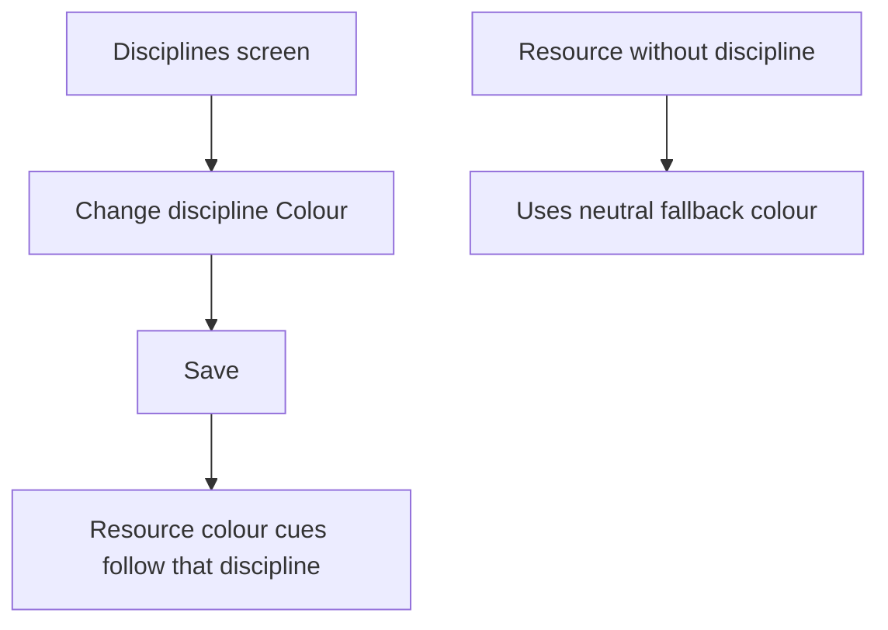
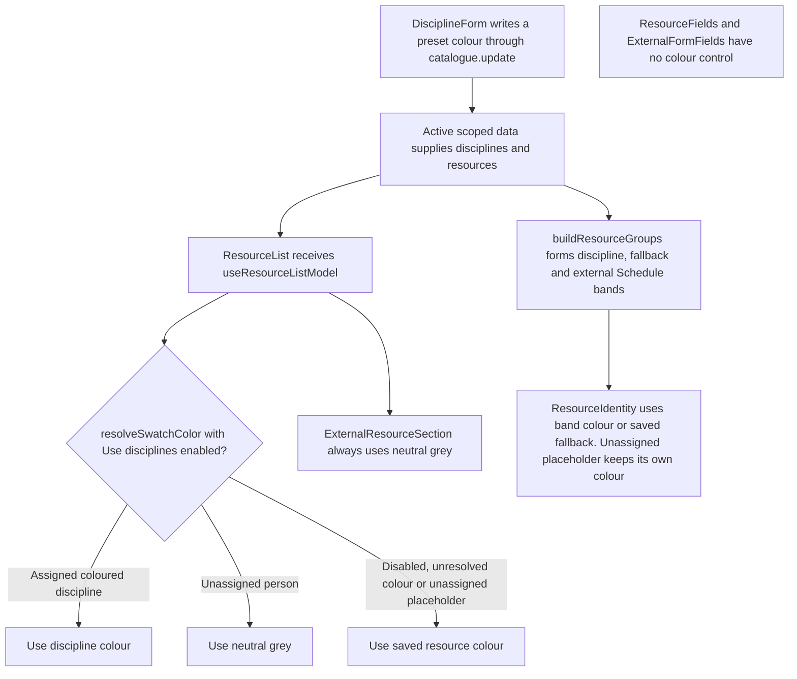

# US-RES-09 — A resource's colour comes from its discipline

As an Editor, I want resource colour to follow its discipline so that the schedule uses consistent group colours.

**Status:** Current
**Access:** Viewer, Editor, Admin or Owner
**Entry:** Disciplines screen → Edit discipline → Colour; Schedule → resource row
**Documentation:** [Guide](../../docs-src/using/resources.md)
**Source:** [useResourceListModel.ts](../../apps/frontend/src/components/resources/useResourceListModel.ts) · [schedulerModel.ts](../../apps/frontend/src/components/scheduler/schedulerModel.ts)

## Acceptance criteria

- Add/Edit resource has no Colour control.
- With disciplines enabled, the Resources list swatch and the Schedule group use the assigned discipline’s colour; a person with no discipline uses neutral grey. With disciplines off, the list uses the resource’s stored colour.

## User flow

## Code flow

Company readers see these cues. The discipline edit is available to Owner, Admin and Editor with Use disciplines enabled. The typed resource write contract still has a `color` field. Schedule’s fallback groups depend on discipline setting and engagement and the roster’s swatch resolves its own fallback.

**Code references:** [ResourceList.tsx](../../apps/frontend/src/components/resources/ResourceList.tsx#L15) · [useResourceListModel.ts](../../apps/frontend/src/components/resources/useResourceListModel.ts#L64) · [ExternalResourceSection.tsx](../../apps/frontend/src/components/resources/ExternalResourceSection.tsx#L68) · [schedulerModel.ts](../../apps/frontend/src/components/scheduler/schedulerModel.ts#L132) · [selectors.ts](../../apps/frontend/src/store/selectors.ts#L147) · [SchedulerGridRow.tsx](../../apps/frontend/src/components/scheduler/SchedulerGridRow.tsx#L61) · [ResourceForm.tsx](../../apps/frontend/src/components/resources/ResourceForm.tsx#L58) · [ExternalForm.tsx](../../apps/frontend/src/components/external/ExternalForm.tsx#L25) · [resource.ts](../../apps/backend/app/validators/planning/resource.ts#L54) · [DisciplineList.tsx](../../apps/frontend/src/components/disciplines/DisciplineList.tsx#L23) · [DisciplineForm.tsx](../../apps/frontend/src/components/disciplines/DisciplineForm.tsx#L44) · [router.tsx](../../apps/frontend/src/router.tsx#L115) · [useResourceListModel.test.tsx](../../apps/frontend/src/components/resources/useResourceListModel.test.tsx#L30)
