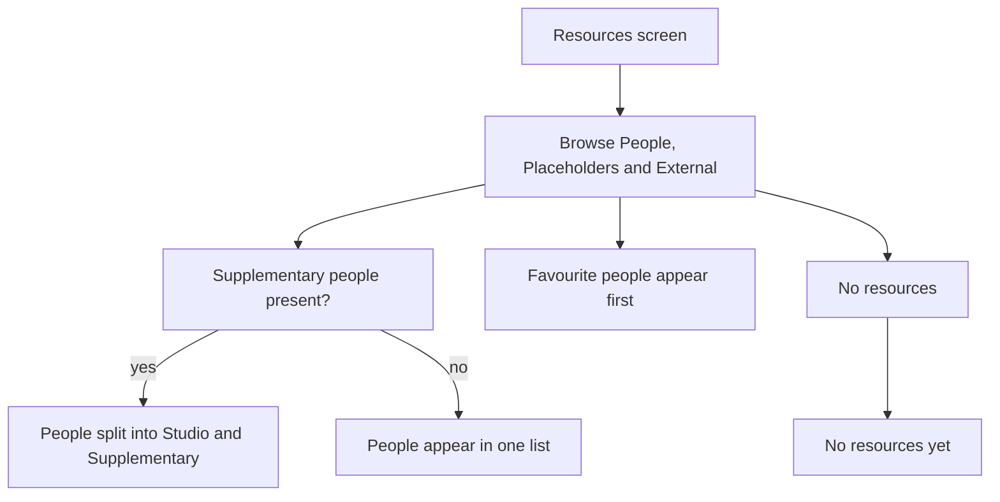
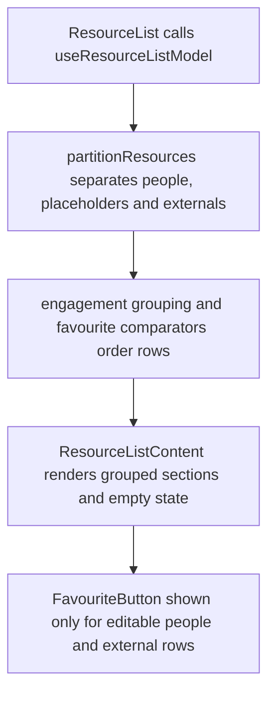

# US-RES-10 — The resource list display

As an Editor, I want a scannable resource roster so that I can find people and priority resources quickly.

**Status:** Current
**Access:** Viewer, Editor, Admin or Owner; editing actions require Editor or higher
**Entry:** Resources screen → resource lists
**Documentation:** [Guide](../../docs-src/using/resources.md)
**Source:** [ResourceListContent.tsx](../../apps/frontend/src/components/resources/ResourceListContent.tsx) · [useResourceListModel.ts](../../apps/frontend/src/components/resources/useResourceListModel.ts)

## Acceptance criteria

- The Resources screen shows people, placeholders and external parties in their separate sections; Studio/Supplementary sections appear when Supplementary people exist.
- People and external-party rows show **Favourite**; placeholders do not. Favourites sort first in their eligible section.
- With no resources, the list shows **No resources yet.**

## User flow

## Code flow

**Code references:** [ResourceList.tsx](../../apps/frontend/src/components/resources/ResourceList.tsx) · [useResourceListModel.ts](../../apps/frontend/src/components/resources/useResourceListModel.ts) · [ResourceListContent.tsx](../../apps/frontend/src/components/resources/ResourceListContent.tsx) · [FavouriteButton.tsx](../../apps/frontend/src/components/resources/FavouriteButton.tsx)
