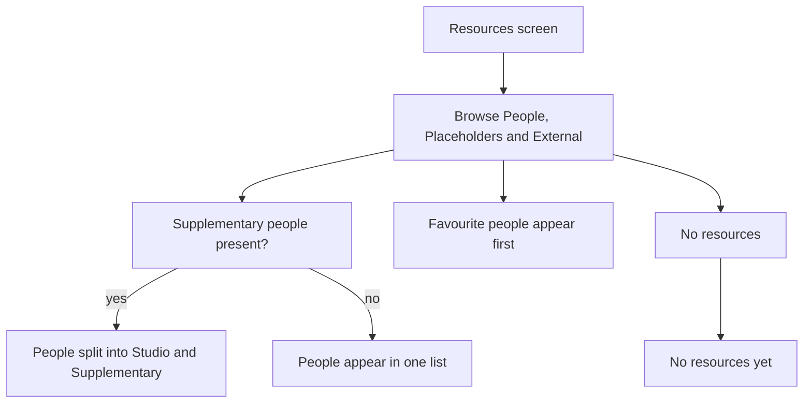
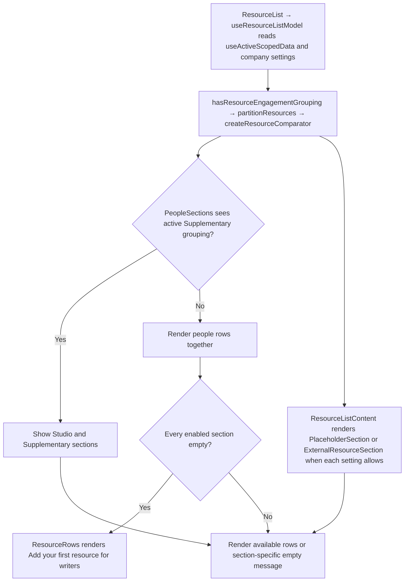

# US-RES-10 — The resource list display

As an Editor, I want a scannable resource roster so that I can find people and priority resources quickly.

**Status:** Current
**Access:** Viewer, Editor, Admin or Owner; editing actions require Editor or higher
**Entry:** Resources screen → resource lists
**Documentation:** [Guide](../../docs-src/using/resources.md)
**Source:** [ResourceListContent.tsx](../../apps/frontend/src/components/resources/ResourceListContent.tsx) · [useResourceListModel.ts](../../apps/frontend/src/components/resources/useResourceListModel.ts)

## Acceptance criteria

- The Resources screen lists people first; **Placeholders** appears only when Show placeholders is on and **External** only when Show external resources is on. People split into **Studio** and **Supplementary** when an active Supplementary person exists.
- For Editors, Admins and Owners, people and external-party rows show a favourite toggle; placeholders do not. Favourites sort first within People (or Studio and Supplementary) and within External.
- With no people, the list shows **No resources yet.**; when no resources of any kind are visible it adds **Add your first resource** for Editors and above.

## User flow

## Code flow

Viewer and view-as-member can read the same roster and ordering. Edit authority gates row mutations and empty-state create actions. `ResourceRow` renders the resolved name, placeholder badge and available job title or discipline metadata. External rows show their company and descriptor. People and external rows rank favourites before display name within the applicable section. Placeholder sorting does not use favourites.

**Code references:** [ResourceList.tsx](../../apps/frontend/src/components/resources/ResourceList.tsx#L15) · [ResourceListContent.tsx](../../apps/frontend/src/components/resources/ResourceListContent.tsx#L31) · [ResourceListContent.tsx](../../apps/frontend/src/components/resources/ResourceListContent.tsx#L48) · [ResourceListContent.tsx](../../apps/frontend/src/components/resources/ResourceListContent.tsx#L172) · [useResourceListModel.ts](../../apps/frontend/src/components/resources/useResourceListModel.ts#L16) · [selectors.ts](../../apps/frontend/src/store/selectors.ts#L57) · [resourceGrouping.ts](../../apps/frontend/src/lib/resourceGrouping.ts#L117) · [ExternalResourceSection.tsx](../../apps/frontend/src/components/resources/ExternalResourceSection.tsx#L28) · [ResourceList.test.tsx](../../apps/frontend/src/components/resources/ResourceList.test.tsx#L213)
