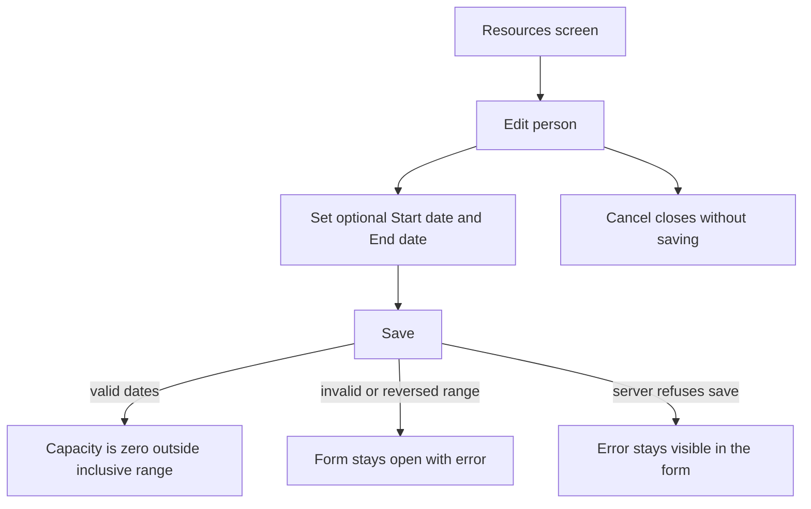
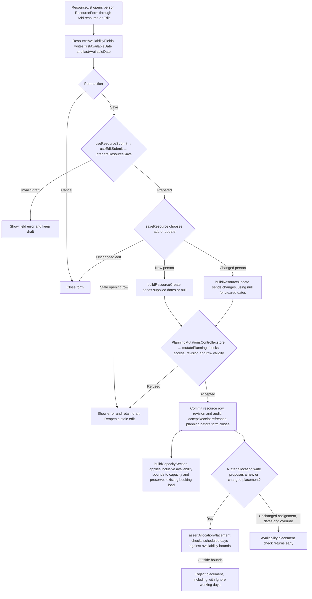

# US-RES-11 — Set a person's availability dates

As an Editor, I want to set a person’s availability dates so that capacity is zero outside their available period.

**Status:** Current
**Access:** Editor and above (Editor, Admin, Owner)
**Entry:** Resources screen → person row → Edit → Start date / End date
**Documentation:** [Guide](../../docs-src/using/resources.md)
**Source:** [ResourceForm.tsx](../../apps/frontend/src/components/resources/ResourceForm.tsx) · [ResourceAvailabilityFields.tsx](../../apps/frontend/src/components/resources/ResourceAvailabilityFields.tsx)

## Acceptance criteria

| Field      | Control    | Required/default/conditions         |
| ---------- | ---------- | ----------------------------------- |
| Start date | Date field | People only; optional and inclusive |
| End date   | Date field | People only; optional and inclusive |

- **Save** retains valid values; invalid values keep the form open with an error.

## User flow

## Code flow

Owner, Admin and Editor can write planning data. Viewer and view-as-member lack write authority. An unchanged edit yields no intent. Footer Cancel closes the form even when a dispatched save is pending. The planning cache refreshes conflicts and reconciles uncertain writes. Dates default to blank on create and use the saved values on edit. `prepareResourceSave` rejects reversed dates, and the server verifies valid ISO calendar dates and ordering. Resource edits do not rewrite existing allocations. With Ignore working days, the placement check considers all calendar days.

**Code references:** [ResourceList.tsx](../../apps/frontend/src/components/resources/ResourceList.tsx#L15) · [ResourceListContent.tsx](../../apps/frontend/src/components/resources/ResourceListContent.tsx#L31) · [ResourceForm.tsx](../../apps/frontend/src/components/resources/ResourceForm.tsx#L197) · [ResourceForm.tsx](../../apps/frontend/src/components/resources/ResourceForm.tsx#L58) · [useResourceFormState.ts](../../apps/frontend/src/components/resources/useResourceFormState.ts#L48) · [useResourceSubmit.ts](../../apps/frontend/src/components/resources/useResourceSubmit.ts#L184) · [useResourceSubmit.ts](../../apps/frontend/src/components/resources/useResourceSubmit.ts#L116) · [useResourceSubmit.ts](../../apps/frontend/src/components/resources/useResourceSubmit.ts#L155) · [entity_rules.ts](../../apps/backend/app/services/planning/entity_rules.ts#L108) · [useEditSubmit.ts](../../apps/frontend/src/hooks/useEditSubmit.ts#L44) · [typedPlanningActions.ts](../../apps/frontend/src/store/typedPlanningActions.ts#L203) · [typedPlanningActions.ts](../../apps/frontend/src/store/typedPlanningActions.ts#L222) · [planningIntents.ts](../../apps/frontend/src/data/planning/planningIntents.ts#L310) · [planningIntents.ts](../../apps/frontend/src/data/planning/planningIntents.ts#L364) · [sendPlanningIntent](../../apps/frontend/src/store/slices/planningSessionSlice.ts#L139) · [Planning transport](../../apps/frontend/src/data/planning/planningTransport.ts#L64) · [Planning route](../../apps/backend/start/routes/planning.ts#L16) · [Mutation controller](../../apps/backend/app/controllers/planning_mutations_controller.ts#L19) · [Planning transaction](../../apps/backend/app/services/planning_service.ts#L222) · [Company write authority](../../apps/backend/app/services/planning/planning_access_service.ts#L31) · [Receipt and refresh](../../apps/frontend/src/data/planning/planningCache.ts#L469) · [ResourceAvailabilityFields.tsx](../../apps/frontend/src/components/resources/ResourceAvailabilityFields.tsx#L25) · [domain.ts](../../apps/backend/app/services/planning/entity_validation/domain.ts#L43) · [capacity_section.ts](../../apps/backend/app/services/planning/capacity_section.ts#L57) · [availability.ts](../../packages/shared/src/lib/capacity/availability.ts#L113) · [placement.ts](../../packages/shared/src/domain/placement.ts#L20) · [resourceAvailability.ts](../../packages/shared/src/domain/resourceAvailability.ts#L24) · [availability.spec.ts](../../apps/backend/tests/functional/planning/availability.spec.ts#L102)
