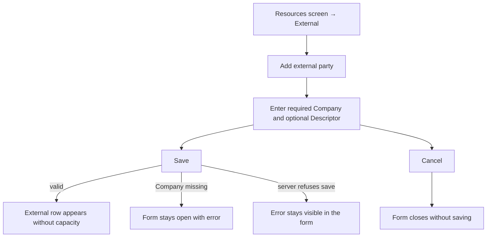
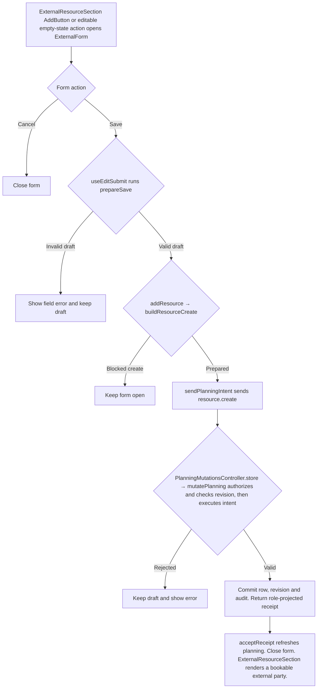

# US-RES-12 — Add an external party

As an Editor, I want to add an external party so that collaborators without capacity can be listed for the team.

**Status:** Current
**Access:** Editor and above (Editor, Admin, Owner)
**Entry:** Resources screen → External section → Add external party
**Documentation:** [Resources guide](../../docs-src/using/resources.md)
**Source:** [ExternalResourceSection.tsx](../../apps/frontend/src/components/resources/ExternalResourceSection.tsx) · [ExternalForm.tsx](../../apps/frontend/src/components/external/ExternalForm.tsx)

## Acceptance criteria

| Field      | Control    | Required/default/conditions |
| ---------- | ---------- | --------------------------- |
| Company    | Text field | Required                    |
| Descriptor | Text field | Optional                    |

- **Save** adds the external party to the External section. External parties have no schedule capacity.

## User flow

## Code flow

Owner, Admin and Editor can write planning data. Viewer and view-as-member lack write authority. The write goes through `POST /api/companies/:companyId/planning/mutations` with admitted company access. The planning cache refreshes on a stale revision and reconciles an uncertain write before another attempt. Footer Cancel closes the form, including during a pending save. The dispatched save can still settle. Show external resources gates this section. Company maps to name and Descriptor maps to jobTitle. `prepareSave` supplies kind external, neutral grey and inert capacity defaults. The server enforces external kind fields. `buildCapacitySection` excludes external parties from tracked capacity.

**Code references:** [ResourceList.tsx](../../apps/frontend/src/components/resources/ResourceList.tsx#L15) · [ResourceListContent.tsx](../../apps/frontend/src/components/resources/ResourceListContent.tsx#L31) · [ExternalResourceSection.tsx](../../apps/frontend/src/components/resources/ExternalResourceSection.tsx#L28) · [ExternalForm.tsx](../../apps/frontend/src/components/external/ExternalForm.tsx#L76) · [entity_rules.ts](../../apps/backend/app/services/planning/entity_rules.ts#L108) · [capacity_section.ts](../../apps/backend/app/services/planning/capacity_section.ts#L57) · [Write controls](../../apps/frontend/src/components/common/crudButtons.tsx#L7) · [Cancel button](../../apps/frontend/src/components/common/FormButtons.tsx#L17) · [useEditSubmit.ts](../../apps/frontend/src/hooks/useEditSubmit.ts#L44) · [Row checks](../../apps/backend/app/services/planning/entity_write_service.ts#L91) · [typedPlanningActions.ts](../../apps/frontend/src/store/typedPlanningActions.ts#L203) · [planningIntents.ts](../../apps/frontend/src/data/planning/planningIntents.ts#L310) · [sendPlanningIntent](../../apps/frontend/src/store/slices/planningSessionSlice.ts#L139) · [Planning transport](../../apps/frontend/src/data/planning/planningTransport.ts#L64) · [Planning route](../../apps/backend/start/routes/planning.ts#L16) · [Mutation controller](../../apps/backend/app/controllers/planning_mutations_controller.ts#L19) · [Planning transaction](../../apps/backend/app/services/planning_service.ts#L222) · [Company write authority](../../apps/backend/app/services/planning/planning_access_service.ts#L31) · [Receipt and refresh](../../apps/frontend/src/data/planning/planningCache.ts#L469)
