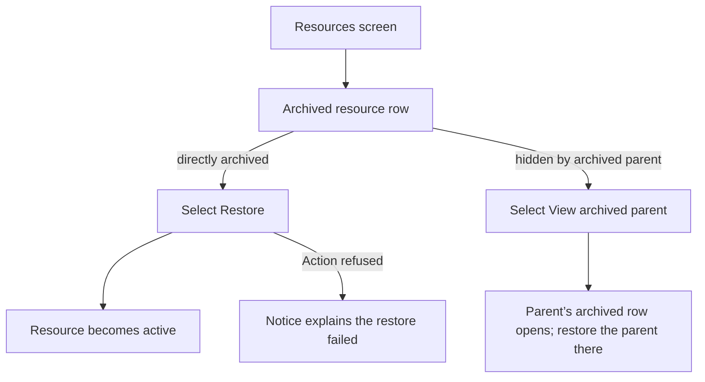
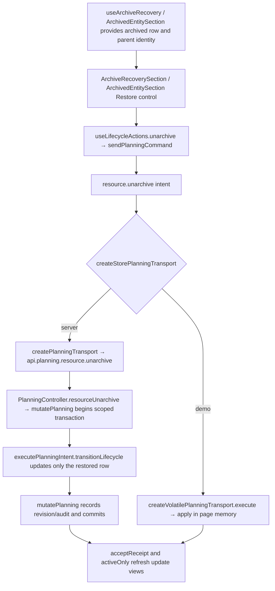

# US-RES-13 — Restore an archived resource

As an Editor, I want to restore an archived resource so that it returns to active resource views.

**Status:** Current
**Access:** Editor and above (Editor, Admin, Owner); only Owner/Admin see full inactive data
**Entry:** Resources screen → archived resource row → Restore
**Documentation:** [Resources guide](../../docs-src/using/resources.md)
**Source:** [ResourceList.tsx](../../apps/frontend/src/components/resources/ResourceList.tsx) · [ArchivedEntitySection.tsx](../../apps/frontend/src/components/common/ArchivedEntitySection.tsx)

## Acceptance criteria

- A directly archived resource has an accessible **Restore** control. Selecting it returns the resource to active status and active views.
- A row hidden only by an archived parent reads **Hidden because {type} {name} is archived.** and offers **View archived parent**, which opens the parent’s archived row; restoring the parent reveals descendants that remain active. A row whose parent was permanently deleted reads **Hidden because {type} {name} is deleted.** with no link.

## User flow

## Code flow

**Code references:** [ResourceList.tsx](../../apps/frontend/src/components/resources/ResourceList.tsx) · [ArchivedEntitySection.tsx](../../apps/frontend/src/components/common/ArchivedEntitySection.tsx) · [ArchiveRecoverySection.tsx](../../apps/frontend/src/components/common/ArchiveRecoverySection.tsx) · [useArchiveRecovery.ts](../../apps/frontend/src/hooks/useArchiveRecovery.ts) · [useLifecycleActions.ts](../../apps/frontend/src/hooks/useLifecycleActions.ts) · [allocationSlice.ts](../../apps/frontend/src/store/slices/allocationSlice.ts) · [planningCacheController.ts](../../apps/frontend/src/data/planning/planningCacheController.ts) · [storePlanningTransport.ts](../../apps/frontend/src/data/planning/storePlanningTransport.ts) · [planningTransport.ts](../../apps/frontend/src/data/planning/planningTransport.ts) · [volatilePlanningTransport.ts](../../apps/frontend/src/data/planning/volatilePlanningTransport.ts) · [planning_routes.ts](../../apps/backend/start/planning_routes.ts) · [planning_controller.ts](../../apps/backend/app/controllers/planning_controller.ts) · [planning.ts](../../apps/backend/app/services/planning.ts) · [execute.ts](../../apps/backend/app/services/planning/execute.ts)
