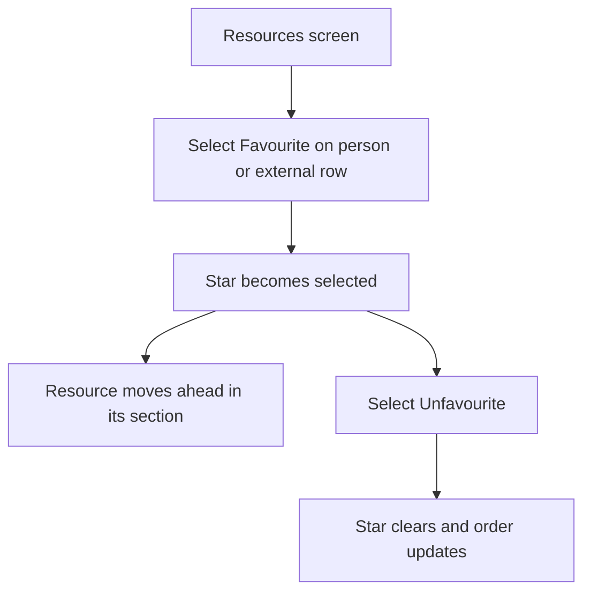
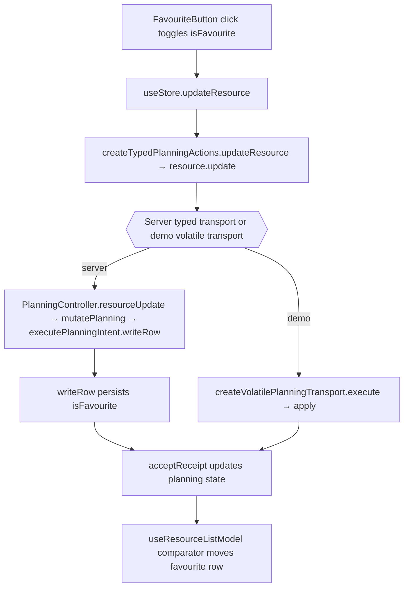

# US-RES-14 — Favourite a resource

As an Editor, I want to favourite or unfavourite a resource so that priority people stay prominent in the roster.

**Status:** Current
**Access:** Editor and above (Editor, Admin, Owner)
**Entry:** Resources screen → resource row → favourite button
**Documentation:** [Resources guide](../../docs-src/using/resources.md)
**Source:** [FavouriteButton.tsx](../../apps/frontend/src/components/resources/FavouriteButton.tsx) · [ResourceList.tsx](../../apps/frontend/src/components/resources/ResourceList.tsx) · [ExternalResourceSection.tsx](../../apps/frontend/src/components/resources/ExternalResourceSection.tsx)

## Acceptance criteria

- The accessible favourite button toggles the selected resource's favourite state.
- The toggle reads **Add {name} to favourites** or **Remove {name} from favourites**. Favourites sort first within People (or Studio and Supplementary) and within External; favouriting does not change capacity.
- The button is not shown for placeholders or viewers.

## User flow

## Code flow

**Code references:** [FavouriteButton.tsx](../../apps/frontend/src/components/resources/FavouriteButton.tsx) · [useResourceListModel.ts](../../apps/frontend/src/components/resources/useResourceListModel.ts) · [typedPlanningActions.ts](../../apps/frontend/src/store/typedPlanningActions.ts) · [allocationSlice.ts](../../apps/frontend/src/store/slices/allocationSlice.ts) · [planningCacheController.ts](../../apps/frontend/src/data/planning/planningCacheController.ts) · [storePlanningTransport.ts](../../apps/frontend/src/data/planning/storePlanningTransport.ts) · [planningTransport.ts](../../apps/frontend/src/data/planning/planningTransport.ts) · [volatilePlanningTransport.ts](../../apps/frontend/src/data/planning/volatilePlanningTransport.ts) · [planning_routes.ts](../../apps/backend/start/planning_routes.ts) · [planning_controller.ts](../../apps/backend/app/controllers/planning_controller.ts) · [planning.ts](../../apps/backend/app/services/planning.ts) · [writer.ts](../../apps/backend/app/services/planning/writer.ts)
