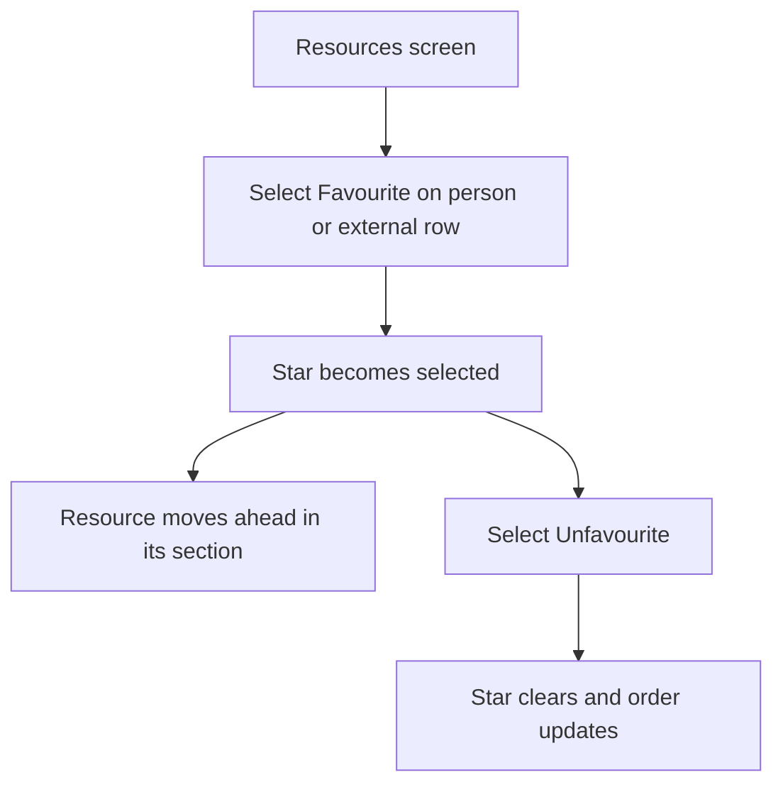
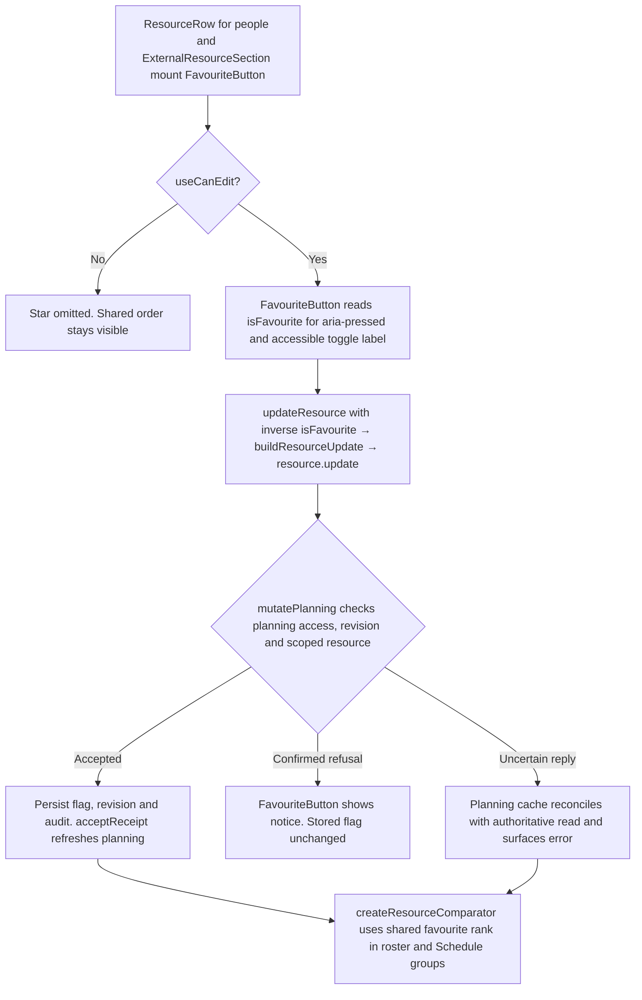

# US-RES-14 — Favourite a resource

As an Editor, I want to favourite or unfavourite a resource so that priority people stay prominent in the roster.

**Status:** Current
**Access:** Editor and above (Editor, Admin, Owner)
**Entry:** Resources screen → resource row → favourite button
**Documentation:** [Resources guide](../../docs-src/using/resources.md)
**Source:** [FavouriteButton.tsx](../../apps/frontend/src/components/resources/FavouriteButton.tsx) · [ResourceList.tsx](../../apps/frontend/src/components/resources/ResourceList.tsx) · [ExternalResourceSection.tsx](../../apps/frontend/src/components/resources/ExternalResourceSection.tsx)

## Acceptance criteria

- The accessible favourite button toggles the selected resource's favourite state.
- The toggle reads **Add {name} to favourites** or **Remove {name} from favourites**. Favourites sort first within People (or Studio and Supplementary) and within External; favouriting does not change capacity.
- The button is not shown for placeholders or viewers.

## User flow

## Code flow

Only Owner, Admin and Editor see the star. Placeholder rows omit it. This is a company-wide persisted flag; every reader sees the projected order. A stale revision triggers a planning refresh. An uncertain reply can have committed, so the canonical read, when available, determines the resulting flag.

**Code references:** [FavouriteButton.tsx](../../apps/frontend/src/components/resources/FavouriteButton.tsx#L12) · [ResourceListContent.tsx](../../apps/frontend/src/components/resources/ResourceListContent.tsx#L193) · [ExternalResourceSection.tsx](../../apps/frontend/src/components/resources/ExternalResourceSection.tsx#L75) · [typedPlanningActions.ts](../../apps/frontend/src/store/typedPlanningActions.ts#L222) · [planningIntents.ts](../../apps/frontend/src/data/planning/planningIntents.ts#L364) · [resourceGrouping.ts](../../apps/frontend/src/lib/resourceGrouping.ts#L117) · [schedulerModel.ts](../../apps/frontend/src/components/scheduler/schedulerModel.ts#L213) · [planningCache.ts](../../apps/frontend/src/data/planning/planningCache.ts#L547) · [sendPlanningIntent](../../apps/frontend/src/store/slices/planningSessionSlice.ts#L139) · [Planning transport](../../apps/frontend/src/data/planning/planningTransport.ts#L64) · [Planning route](../../apps/backend/start/planning_routes.ts#L16) · [Mutation controller](../../apps/backend/app/controllers/planning_mutations_controller.ts#L19) · [Planning transaction](../../apps/backend/app/services/planning_service.ts#L222) · [Company write authority](../../apps/backend/app/services/planning/planning_access_service.ts#L31) · [Receipt and refresh](../../apps/frontend/src/data/planning/planningCache.ts#L469) · [ResourceList.test.tsx](../../apps/frontend/src/components/resources/ResourceList.test.tsx#L136)
