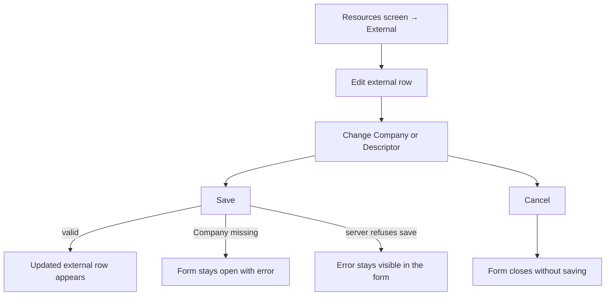
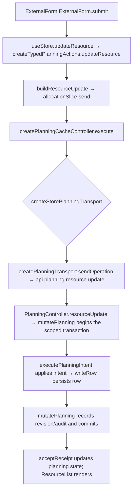

# US-RES-15 — Edit an external party

As an Editor, I want to edit an external party’s company name and descriptor so that the team sees current collaborator details.

**Status:** Current
**Access:** Editor and above (Editor, Admin, Owner)
**Entry:** Resources screen → External row → Edit
**Documentation:** [Resources guide](../../docs-src/using/resources.md#add-an-external-party)
**Source:** [ExternalResourceSection.tsx](../../apps/frontend/src/components/resources/ExternalResourceSection.tsx) · [ExternalForm.tsx](../../apps/frontend/src/components/external/ExternalForm.tsx)

## Acceptance criteria

| Field      | Control    | Required/default/conditions                   |
| ---------- | ---------- | --------------------------------------------- |
| Company    | Text field | Required; prefilled with current company name |
| Descriptor | Text field | Optional; prefilled with current descriptor   |

- **Save** updates the External row; **Cancel** closes the form without saving.

## User flow

## Code flow

**Code references:** [ExternalForm.tsx](../../apps/frontend/src/components/external/ExternalForm.tsx) · [ExternalResourceSection.tsx](../../apps/frontend/src/components/resources/ExternalResourceSection.tsx) · [typedPlanningActions.ts](../../apps/frontend/src/store/typedPlanningActions.ts) · [allocationSlice.ts](../../apps/frontend/src/store/slices/allocationSlice.ts) · [planningCacheController.ts](../../apps/frontend/src/data/planning/planningCacheController.ts) · [storePlanningTransport.ts](../../apps/frontend/src/data/planning/storePlanningTransport.ts) · [planningTransport.ts](../../apps/frontend/src/data/planning/planningTransport.ts) · [planning_routes.ts](../../apps/backend/start/planning_routes.ts) · [planning_controller.ts](../../apps/backend/app/controllers/planning_controller.ts) · [planning.ts](../../apps/backend/app/services/planning.ts) · [execute.ts](../../apps/backend/app/services/planning/execute.ts) · [writer.ts](../../apps/backend/app/services/planning/writer.ts)
