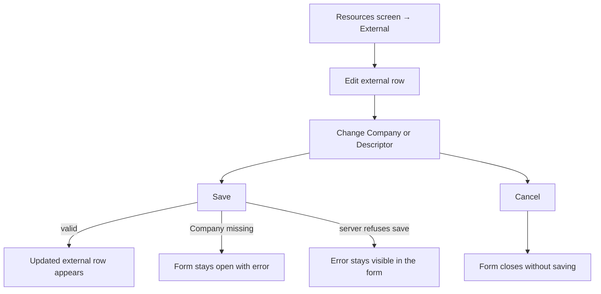
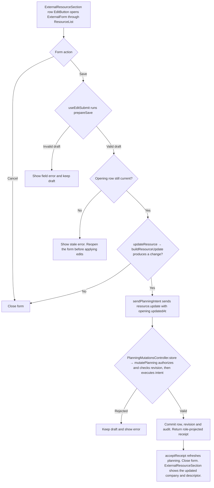

# US-RES-15 — Edit an external party

As an Editor, I want to edit an external party’s company name and descriptor so that the team sees current collaborator details.

**Status:** Current
**Access:** Editor and above (Editor, Admin, Owner)
**Entry:** Resources screen → External row → Edit
**Documentation:** [Resources guide](../../docs-src/using/resources.md#add-an-external-party)
**Source:** [ExternalResourceSection.tsx](../../apps/frontend/src/components/resources/ExternalResourceSection.tsx) · [ExternalForm.tsx](../../apps/frontend/src/components/external/ExternalForm.tsx)

## Acceptance criteria

| Field      | Control    | Required/default/conditions                   |
| ---------- | ---------- | --------------------------------------------- |
| Company    | Text field | Required; prefilled with current company name |
| Descriptor | Text field | Optional; prefilled with current descriptor   |

- **Save** updates the External row; **Cancel** closes the form without saving.

## User flow

## Code flow

Owner, Admin and Editor can write planning data. Viewer and view-as-member lack write authority. The write goes through `POST /api/companies/:companyId/planning/mutations` with admitted company access. The planning cache refreshes on a stale revision and reconciles an uncertain write before another attempt. Footer Cancel closes the form, including during a pending save. The dispatched save can still settle. Show external resources gates the row entry. The form prefills Company from name and Descriptor from jobTitle, including an optional blank descriptor. `prepareSave` supplies neutral colour and external capacity defaults. The server independently forbids a type conversion and validates external fields.

**Code references:** [ResourceList.tsx](../../apps/frontend/src/components/resources/ResourceList.tsx#L15) · [ResourceListContent.tsx](../../apps/frontend/src/components/resources/ResourceListContent.tsx#L31) · [ExternalResourceSection.tsx](../../apps/frontend/src/components/resources/ExternalResourceSection.tsx#L28) · [ExternalForm.tsx](../../apps/frontend/src/components/external/ExternalForm.tsx#L76) · [entity_rules.ts](../../apps/backend/app/services/planning/entity_rules.ts#L108) · [capacity_section.ts](../../apps/backend/app/services/planning/capacity_section.ts#L57) · [entity_rules.ts](../../apps/backend/app/services/planning/entity_rules.ts#L187) · [Write controls](../../apps/frontend/src/components/common/crudButtons.tsx#L7) · [Cancel button](../../apps/frontend/src/components/common/FormButtons.tsx#L17) · [useEditSubmit.ts](../../apps/frontend/src/hooks/useEditSubmit.ts#L44) · [Row checks](../../apps/backend/app/services/planning/entity_write.ts#L97) · [typedPlanningActions.ts](../../apps/frontend/src/store/typedPlanningActions.ts#L222) · [planningIntents.ts](../../apps/frontend/src/data/planning/planningIntents.ts#L364) · [sendPlanningIntent](../../apps/frontend/src/store/slices/planningSessionSlice.ts#L139) · [Planning transport](../../apps/frontend/src/data/planning/planningTransport.ts#L64) · [Planning route](../../apps/backend/start/planning_routes.ts#L16) · [Mutation controller](../../apps/backend/app/controllers/planning_mutations_controller.ts#L17) · [Planning transaction](../../apps/backend/app/services/planning.ts#L198) · [Company write authority](../../apps/backend/app/services/planning/access.ts#L17) · [Receipt and refresh](../../apps/frontend/src/data/planning/planningCache.ts#L469)
