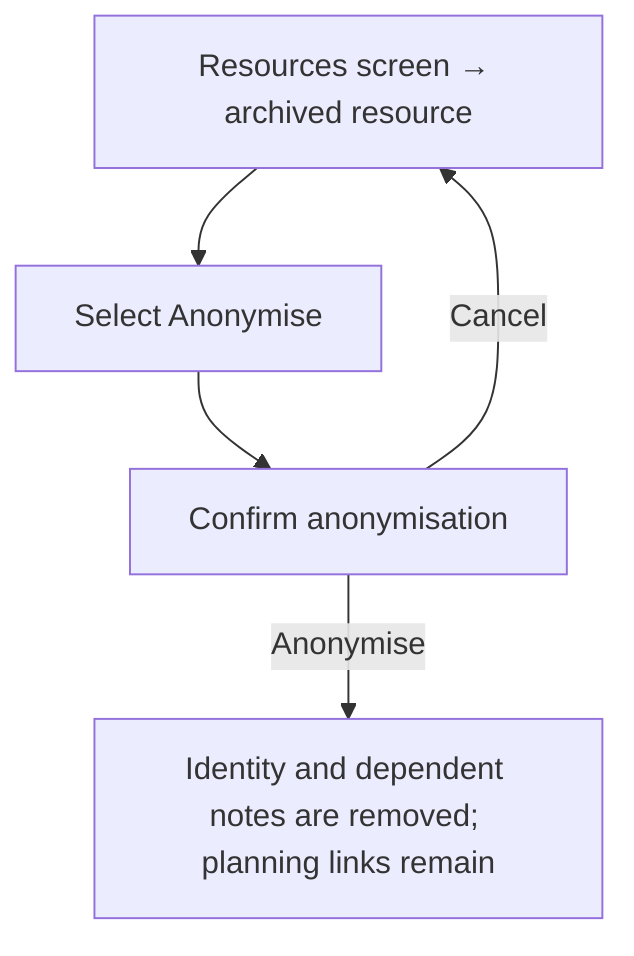
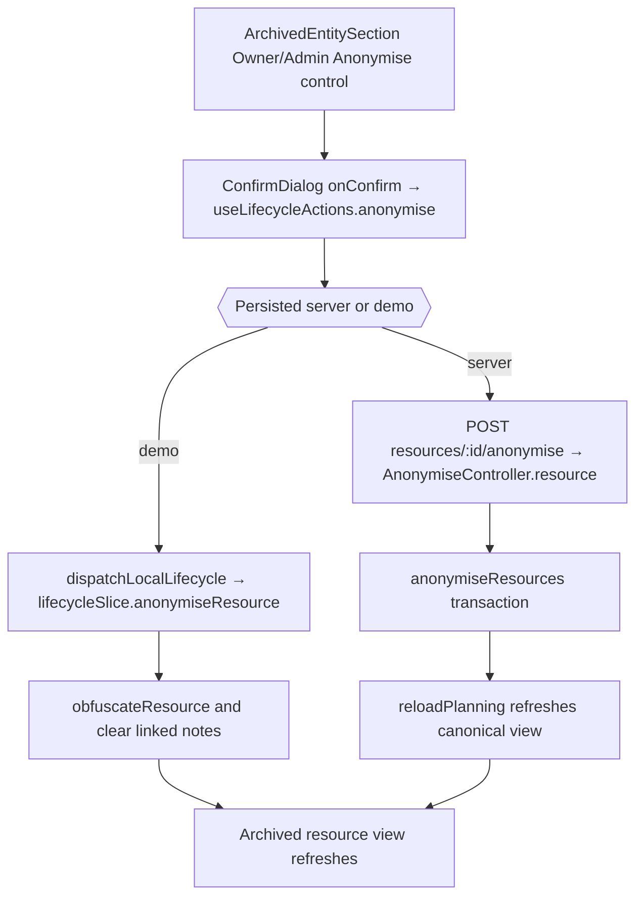

# US-RES-16 — Anonymise an archived resource

As an Owner or Admin, I want to anonymise an archived resource so that identifying details and dependent notes are removed while its planning links remain.

**Status:** Current
**Access:** Owner and Admin
**Entry:** Resources screen → archived resource row → Anonymise
**Documentation:** [Resources guide](../../docs-src/using/resources.md#archive-someone-who-leaves)
**Source:** [ArchivedEntitySection.tsx](../../apps/frontend/src/components/common/ArchivedEntitySection.tsx) · [DECISIONS.md](../../DECISIONS.md)

## Acceptance criteria

- Selecting **Anonymise** opens a confirmation dialog with **Anonymise** and **Cancel** controls; no action-specific password proof is requested.
- **Cancel** leaves the resource unchanged. **Anonymise** removes identifying details and dependent notes while retaining the resource and its links. The dialog asks for ordinary confirmation only; it does not ask for a password.
- The action appears only for Owner/Admin and only for archived resources.

## User flow

## Code flow

**Code references:** [ArchivedEntitySection.tsx](../../apps/frontend/src/components/common/ArchivedEntitySection.tsx) · [useLifecycleActions.ts](../../apps/frontend/src/hooks/useLifecycleActions.ts) · [lifecycleSlice.ts](../../apps/frontend/src/store/slices/lifecycleSlice.ts) · [anonymise_routes.ts](../../apps/backend/start/anonymise_routes.ts) · [anonymise_controller.ts](../../apps/backend/app/controllers/anonymise_controller.ts) · [anonymise.ts](../../apps/backend/app/services/anonymise.ts)
