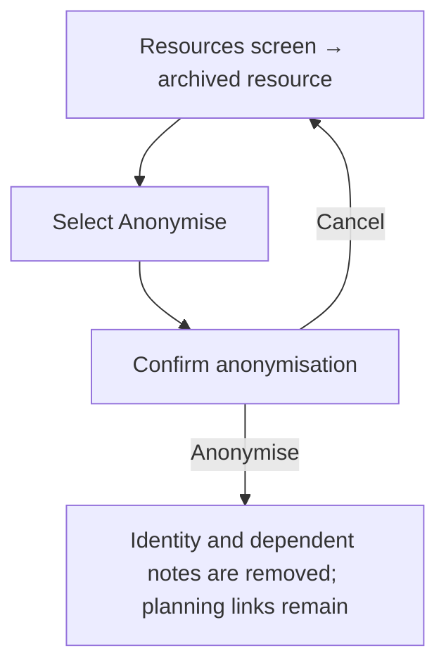
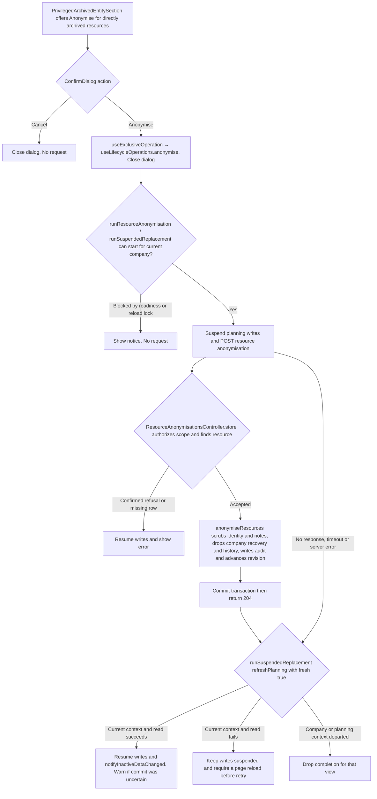

# US-RES-16 — Anonymise an archived resource

As an Owner or Admin, I want to anonymise an archived resource so that identifying details and dependent notes are removed while its planning links remain.

**Status:** Current
**Access:** Owner and Admin
**Entry:** Resources screen → archived resource row → Anonymise
**Documentation:** [Resources guide](../../docs-src/using/resources.md#archive-someone-who-leaves)
**Source:** [ArchivedEntitySection.tsx](../../apps/frontend/src/components/common/ArchivedEntitySection.tsx) · [DECISIONS.md](../../DECISIONS.md)

## Acceptance criteria

- Selecting **Anonymise** opens **Anonymise resource?** (“Anonymise {name} and remove their personal details? This cannot be undone.”) with **Anonymise** and **Cancel**; no password is requested.
- **Cancel** leaves the resource unchanged. **Anonymise** replaces the name with **Removed person #{id tag}** and the role with **Removed resource**, clears the avatar and clears the notes on its allocations and time off, while keeping the resource and its links.
- The action appears only for Owners and Admins, and only on a directly archived resource row.

## User flow

## Code flow

Owner and Admin can use this action with ordinary confirmation. The server also checks admitted membership, `resources:anonymise` and view-as-member refusal. It looks up a resource by company and id, so the endpoint can also scrub an active resource even though the UI entry is archive-only. The scrub replaces the name with a deterministic masked name and resets the job title, clears the avatar URL and linked allocation and time-off notes including retained rows, and preserves the resource and its relationships. Uncertain outcomes are reconciled by a fresh read before another attempt.

**Code references:** [ArchivedEntitySection.tsx](../../apps/frontend/src/components/common/ArchivedEntitySection.tsx#L182) · [ArchivedEntitySection.tsx](../../apps/frontend/src/components/common/ArchivedEntitySection.tsx#L79) · [ArchivedEntitySection.tsx](../../apps/frontend/src/components/common/ArchivedEntitySection.tsx#L232) · [useLifecycleOperations.ts](../../apps/frontend/src/hooks/useLifecycleOperations.ts#L36) · [resourceAnonymisation.ts](../../apps/frontend/src/store/resourceAnonymisation.ts#L26) · [suspendedReplacement.ts](../../apps/frontend/src/store/suspendedReplacement.ts#L54) · [companyDataRequests.ts](../../apps/frontend/src/data/companyDataRequests.ts#L136) · [anonymise.ts](../../apps/backend/start/routes/anonymise.ts#L11) · [resource_anonymisations_controller.ts](../../apps/backend/app/controllers/resource_anonymisations_controller.ts#L26) · [anonymisation_service.ts](../../apps/backend/app/services/anonymisation_service.ts#L18) · [transitions.ts](../../packages/shared/src/domain/lifecycle/transitions.ts#L107) · [anonymise.spec.ts](../../apps/backend/tests/functional/anonymise.spec.ts#L124)
