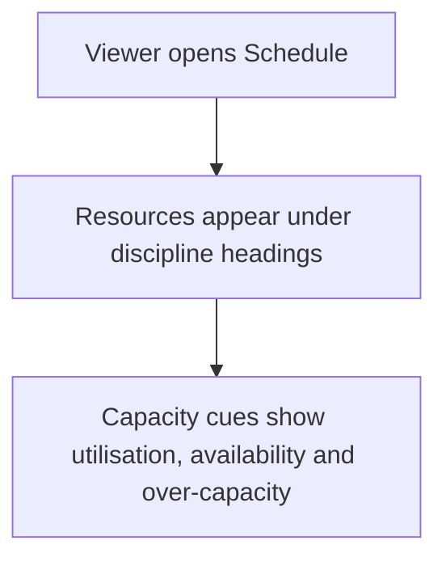
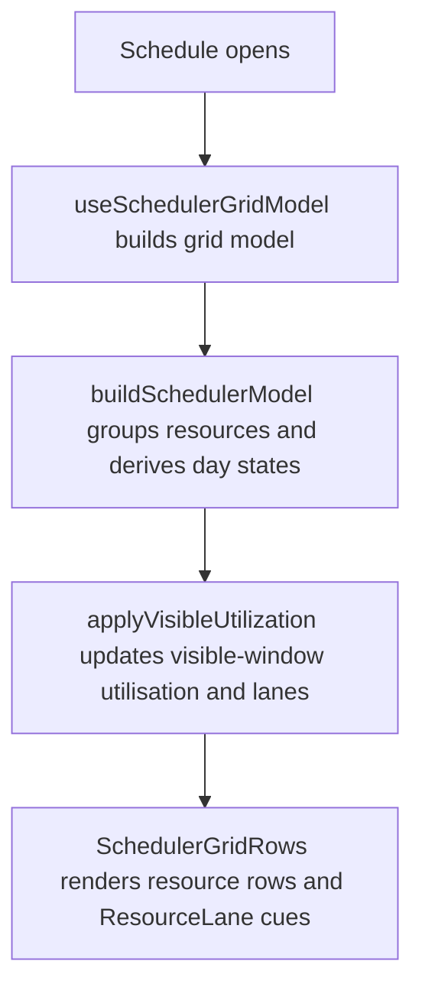

# US-SCH-01 — Resources grouped by discipline, with capacity cues

As an Editor, I want resources grouped by discipline with capacity cues so that I can spot workload and availability while planning.

**Status:** Current

**Access:** Viewer, Editor, Admin or Owner; editing actions require Editor or higher

**Entry:** Schedule (`/`)

**Documentation:** [schedule-work.md](../../docs-src/using/schedule-work.md)

**Source:** [SchedulerGrid.tsx](../../apps/frontend/src/components/scheduler/SchedulerGrid.tsx)

## Acceptance criteria

- With disciplines enabled, the Schedule groups resources by discipline, with people who have none under **Unassigned**; otherwise they appear under **Resources**. Either fallback splits into **Studio** and **Supplementary** when an active Supplementary person exists, and external parties appear under **External / 3rd party**.
- With Show Personal Utilisation on, each tracked resource’s row shows its utilisation for the visible window.
- Over-capacity and unavailable days are visibly marked.

## User flow

## Code flow

**Code references:** [SchedulerGrid.tsx](../../apps/frontend/src/components/scheduler/SchedulerGrid.tsx), [useSchedulerGridModel.ts](../../apps/frontend/src/components/scheduler/useSchedulerGridModel.ts), [schedulerModel.ts](../../apps/frontend/src/components/scheduler/schedulerModel.ts), [SchedulerGridRows.tsx](../../apps/frontend/src/components/scheduler/SchedulerGridRows.tsx), [ResourceLane.tsx](../../apps/frontend/src/components/scheduler/ResourceLane.tsx)
