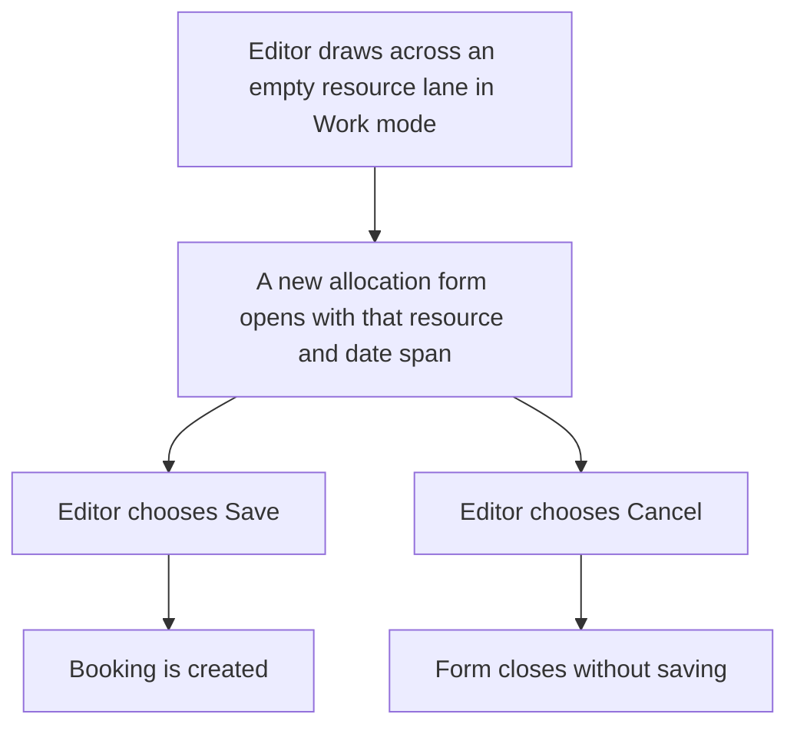
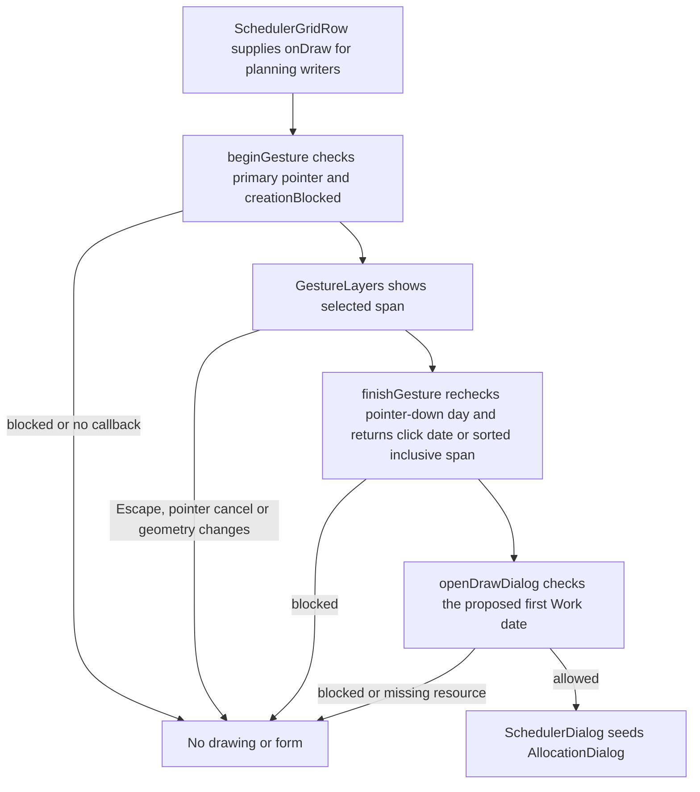

# US-SCH-02 — Draw a new allocation across empty lane space

As an Editor, I want to draw a date range on an empty resource lane so that I can start an allocation with its resource and dates filled in.

**Status:** Current

**Access:** Editor, Admin or Owner

**Entry:** Schedule (`/`)

**Documentation:** [schedule-work.md](../../docs-src/using/schedule-work.md)

**Source:** [SchedulerGrid.tsx](../../apps/frontend/src/components/scheduler/SchedulerGrid.tsx)

## Acceptance criteria

- In Work mode, drawing across an empty resource lane opens a prefilled allocation form.
- The form uses that resource and the drawn date range.

## User flow

## Code flow

This flow ends at the seeded `AllocationDialog`. [US-ALL-01](../allocation/US-ALL-01-create.md) traces Save, field and server refusal, and dismissal.

**Code references:**

- [SchedulerGridRow.tsx](../../apps/frontend/src/components/scheduler/SchedulerGridRow.tsx#L260)
- [useResourceLaneInteraction.ts](../../apps/frontend/src/components/scheduler/useResourceLaneInteraction.ts#L34)
- [useResourceLaneInteraction.ts](../../apps/frontend/src/components/scheduler/useResourceLaneInteraction.ts#L53)
- [ResourceLane.tsx](../../apps/frontend/src/components/scheduler/ResourceLane.tsx#L138)
- [SchedulerGrid.tsx](../../apps/frontend/src/components/scheduler/SchedulerGrid.tsx#L116)
- [SchedulerGrid.tsx](../../apps/frontend/src/components/scheduler/SchedulerGrid.tsx#L39)
- [ResourceLane.test.tsx](../../apps/frontend/src/components/scheduler/ResourceLane.test.tsx#L218)
