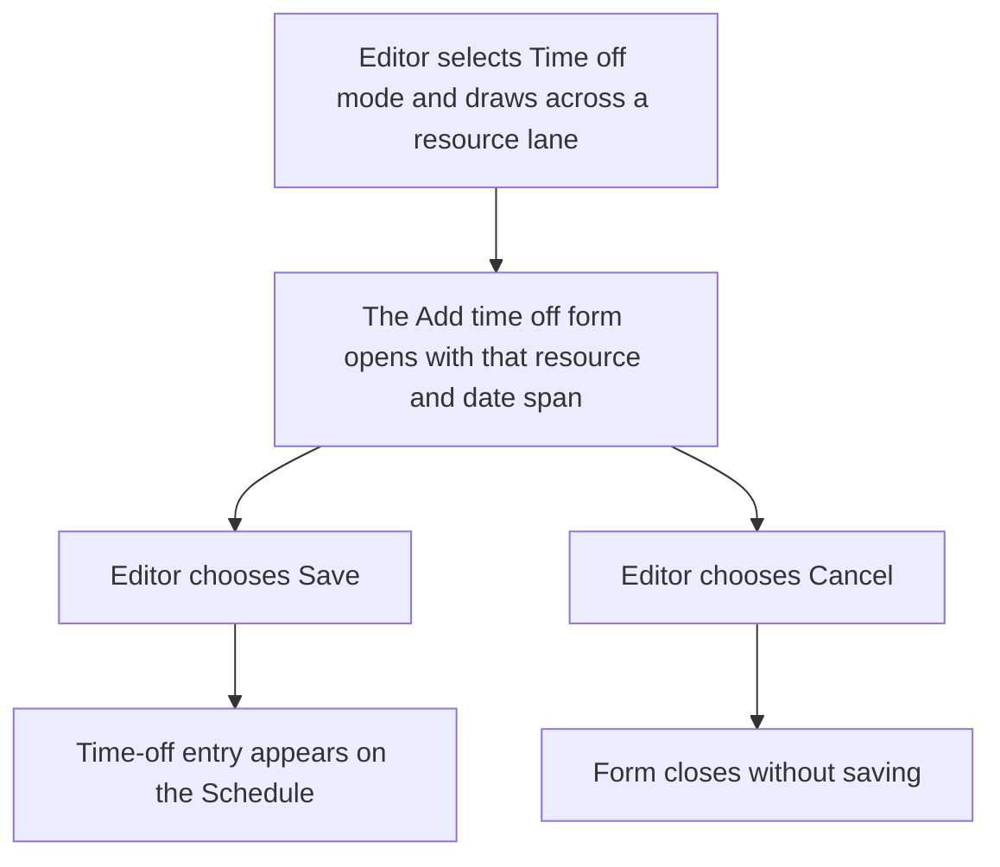
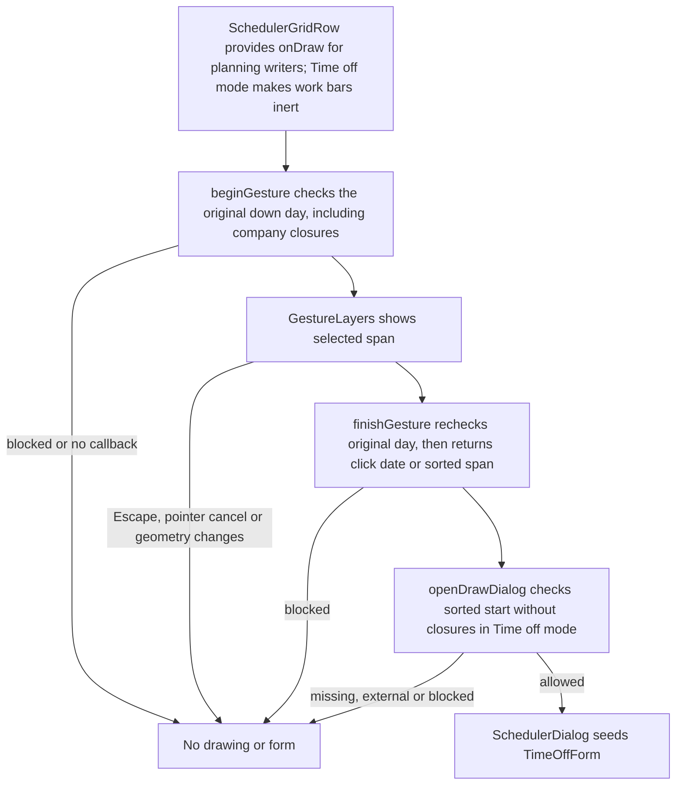

# US-SCH-03 — Draw time off directly on a lane

As an Editor, I want to draw a date range in Time off mode so that I can start a time-off entry for the resource on that lane.

**Status:** Current

**Access:** Editor, Admin or Owner

**Entry:** Schedule (`/`)

**Documentation:** [schedule-work.md](../../docs-src/using/schedule-work.md)

**Source:** [SchedulerGrid.tsx](../../apps/frontend/src/components/scheduler/SchedulerGrid.tsx)

## Acceptance criteria

- In Time off mode, drawing on a resource lane opens a prefilled time-off form.
- The lane’s work bars do not intercept the time-off draw.

## User flow

## Code flow

A reverse draw can reach a closure at its sorted start if the original pointer-down day was eligible. This flow ends at the seeded `TimeOffForm`. [US-TOF-01](../time-off/US-TOF-01-book-time-off.md) and [US-TOF-07](../time-off/US-TOF-07-repeat-time-off.md) trace the single and repeated saves.

**Code references:**

- [SchedulerGridRow.tsx](../../apps/frontend/src/components/scheduler/SchedulerGridRow.tsx#L260)
- [ResourceLane.tsx](../../apps/frontend/src/components/scheduler/ResourceLane.tsx#L34)
- [schedulerRowModel.ts](../../apps/frontend/src/components/scheduler/schedulerRowModel.ts#L120)
- [useResourceLaneInteraction.ts](../../apps/frontend/src/components/scheduler/useResourceLaneInteraction.ts#L34)
- [useResourceLaneInteraction.ts](../../apps/frontend/src/components/scheduler/useResourceLaneInteraction.ts#L53)
- [SchedulerGrid.tsx](../../apps/frontend/src/components/scheduler/SchedulerGrid.tsx#L116)
- [SchedulerGrid.tsx](../../apps/frontend/src/components/scheduler/SchedulerGrid.tsx#L39)
