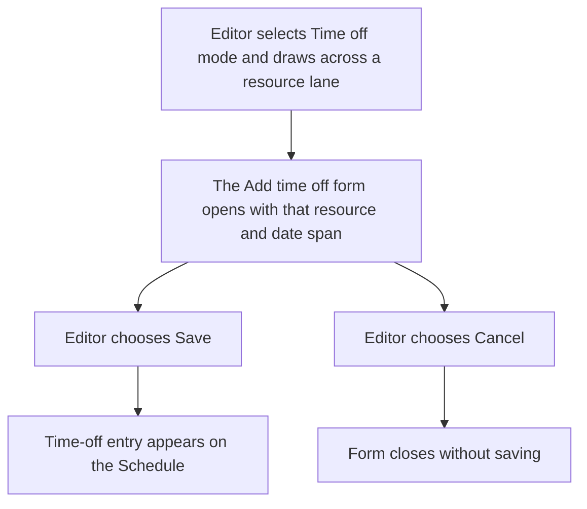
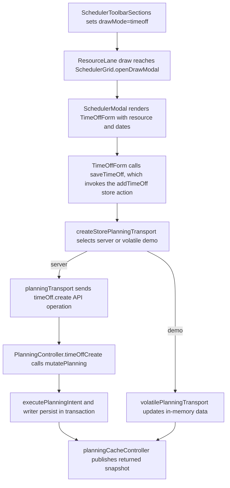

# US-SCH-03 — Draw time off directly on a lane

As an Editor, I want to draw a date range in Time off mode so that I can start a time-off entry for the resource on that lane.

**Status:** Current

**Access:** Editor, Admin or Owner

**Entry:** Schedule (`/`)

**Documentation:** [schedule-work.md](../../docs-src/using/schedule-work.md)

**Source:** [SchedulerGrid.tsx](../../apps/frontend/src/components/scheduler/SchedulerGrid.tsx)

## Acceptance criteria

- In Time off mode, drawing on a resource lane opens a prefilled time-off form.
- The lane’s work bars do not intercept the time-off draw.

## User flow

## Code flow

**Code references:** [SchedulerToolbarSections.tsx](../../apps/frontend/src/components/scheduler/SchedulerToolbarSections.tsx), [SchedulerGrid.tsx](../../apps/frontend/src/components/scheduler/SchedulerGrid.tsx), [ResourceLane.tsx](../../apps/frontend/src/components/scheduler/ResourceLane.tsx), [useResourceLaneInteraction.ts](../../apps/frontend/src/components/scheduler/useResourceLaneInteraction.ts), [TimeOffForm.tsx](../../apps/frontend/src/components/timeoff/TimeOffForm.tsx), [timeOffFormSubmission.ts](../../apps/frontend/src/components/timeoff/timeOffFormSubmission.ts), [typedPlanningActions.ts](../../apps/frontend/src/store/typedPlanningActions.ts), [allocationSlice.ts](../../apps/frontend/src/store/slices/allocationSlice.ts), [planningCacheController.ts](../../apps/frontend/src/data/planning/planningCacheController.ts), [storePlanningTransport.ts](../../apps/frontend/src/data/planning/storePlanningTransport.ts), [planningTransport.ts](../../apps/frontend/src/data/planning/planningTransport.ts), [volatilePlanningTransport.ts](../../apps/frontend/src/data/planning/volatilePlanningTransport.ts), [planning_controller.ts](../../apps/backend/app/controllers/planning_controller.ts), [planning.ts](../../apps/backend/app/services/planning.ts), [execute.ts](../../apps/backend/app/services/planning/execute.ts), [writer.ts](../../apps/backend/app/services/planning/writer.ts)
