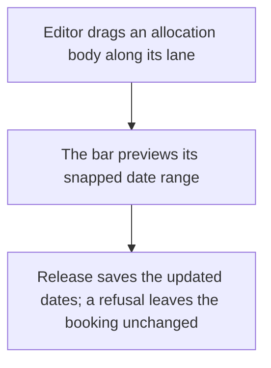
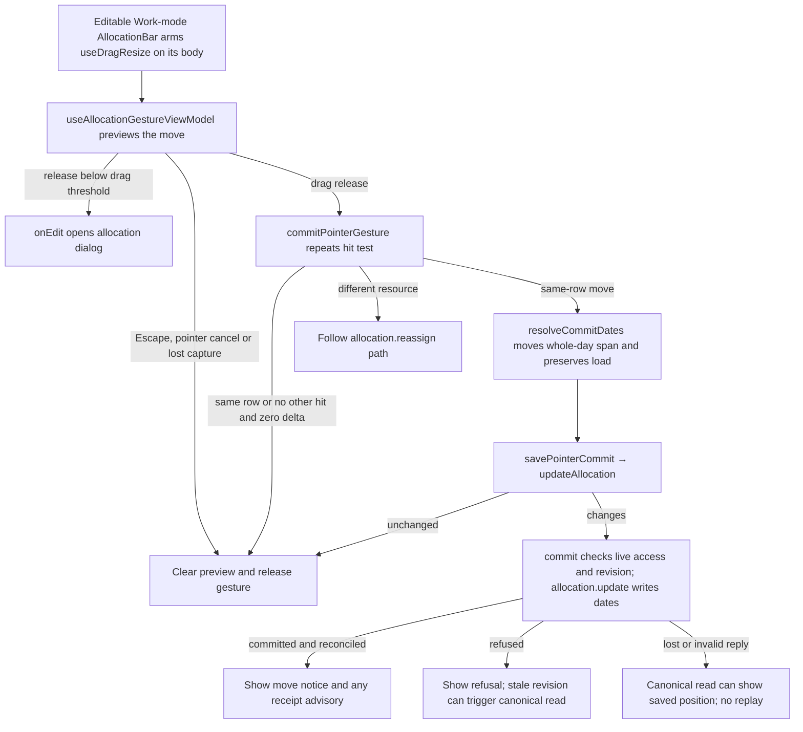

# US-SCH-04 — Move an allocation by dragging its body

As an Editor, I want to drag an allocation along its lane so that I can change its dates without changing its assignee.

**Status:** Current

**Access:** Editor, Admin or Owner

**Entry:** Schedule (`/`)

**Documentation:** [schedule-work.md](../../docs-src/using/schedule-work.md)

**Source:** [SchedulerGrid.tsx](../../apps/frontend/src/components/scheduler/SchedulerGrid.tsx)

## Acceptance criteria

- Dragging an allocation body moves it by whole days on the same resource. Unless Ignore working days is set, a moved start that falls on a non-working day moves on to the next working day in the drag direction, and the allocation keeps its working-day length.
- The resulting bar shows the updated dates.

## User flow

## Code flow

The slide math uses literal calendar movement for Ignore working days or zero measured duration. The same-row branch keeps the assignee and its existing placement exceptions. [US-SCH-06](US-SCH-06-reassign-drag.md) owns the cross-row branch.

**Code references:**

- [AllocationBar.tsx](../../apps/frontend/src/components/scheduler/AllocationBar.tsx#L193)
- [useDragResize.ts](../../apps/frontend/src/hooks/useDragResize.ts#L99)
- [useDragResize.ts](../../apps/frontend/src/hooks/useDragResize.ts#L126)
- [useAllocationGestureViewModel.ts](../../apps/frontend/src/components/scheduler/useAllocationGestureViewModel.ts#L200)
- [useAllocationGestureViewModel.ts](../../apps/frontend/src/components/scheduler/useAllocationGestureViewModel.ts#L240)
- [useAllocationGestureViewModel.ts](../../apps/frontend/src/components/scheduler/useAllocationGestureViewModel.ts#L374)
- [allocationDrag.ts](../../apps/frontend/src/components/scheduler/allocationDrag.ts#L40)
- [gestureMath.ts](../../apps/frontend/src/lib/gestureMath.ts#L110)
- [allocationSlice.ts](../../apps/frontend/src/store/slices/allocationSlice.ts#L138)
- [planning_execution_service.ts](../../apps/backend/app/services/planning/planning_execution_service.ts#L182)
- [planning_mutations_controller.ts](../../apps/backend/app/controllers/planning_mutations_controller.ts#L9)
- [planning_service.ts](../../apps/backend/app/services/planning_service.ts#L222)
- [planningCache.ts](../../apps/frontend/src/data/planning/planningCache.ts#L471)
