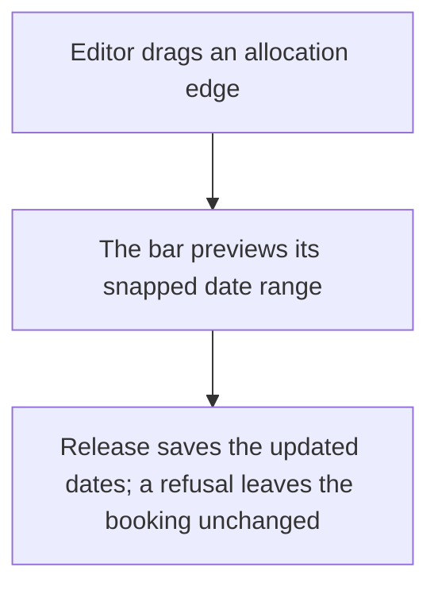
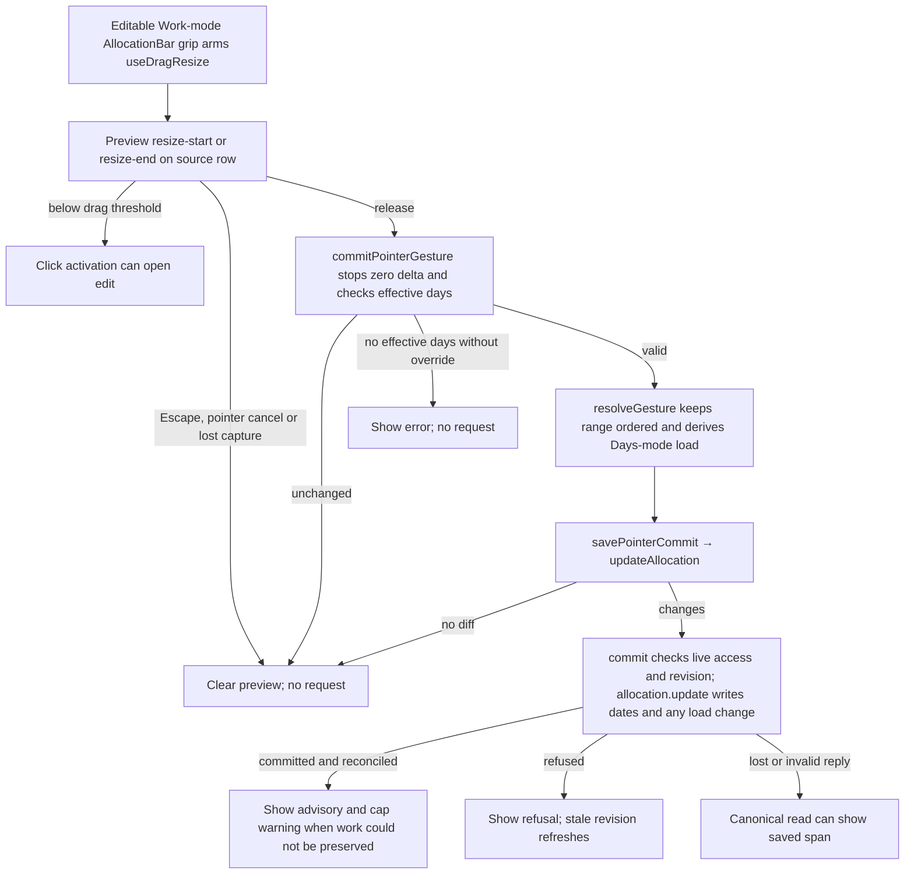

# US-SCH-05 — Resize an allocation with its grip handles

As an Editor, I want to resize an allocation by its edge so that I can change its date range directly on the Schedule.

**Status:** Current

**Access:** Editor, Admin or Owner

**Entry:** Schedule (`/`)

**Documentation:** [schedule-work.md](../../docs-src/using/schedule-work.md)

**Source:** [SchedulerGrid.tsx](../../apps/frontend/src/components/scheduler/SchedulerGrid.tsx)

## Acceptance criteria

- Dragging either edge changes the allocation date range by whole days. Unless Ignore working days is set, an edge dropped on a non-working day moves on to the next working day in the drag direction.
- The allocation remains at least one day long.

## User flow

## Code flow

The grip keeps the source row. Hours mode preserves daily load. A measured Days-mode resize can cap the derived load at 24 hours per day and show a warning after a usable receipt.

**Code references:**

- [AllocationBar.tsx](../../apps/frontend/src/components/scheduler/AllocationBar.tsx#L193)
- [useDragResize.ts](../../apps/frontend/src/hooks/useDragResize.ts#L69)
- [useDragResize.ts](../../apps/frontend/src/hooks/useDragResize.ts#L126)
- [useAllocationGesture.ts](../../apps/frontend/src/components/scheduler/useAllocationGesture.ts#L65)
- [useAllocationGesture.ts](../../apps/frontend/src/components/scheduler/useAllocationGesture.ts#L255)
- [useAllocationGesture.ts](../../apps/frontend/src/components/scheduler/useAllocationGesture.ts#L295)
- [allocationDrag.ts](../../apps/frontend/src/components/scheduler/allocationDrag.ts#L24)
- [gestureMath.ts](../../apps/frontend/src/lib/gestureMath.ts#L81)
- [planning_execution_service.ts](../../apps/backend/app/services/planning/planning_execution_service.ts#L182)
- [planning_mutations_controller.ts](../../apps/backend/app/controllers/planning_mutations_controller.ts#L9)
- [planning_service.ts](../../apps/backend/app/services/planning_service.ts#L222)
- [planningCache.ts](../../apps/frontend/src/data/planning/planningCache.ts#L471)
- [AllocationBar.resize.interaction.test.tsx](../../apps/frontend/src/components/scheduler/AllocationBar.resize.interaction.test.tsx#L155)
