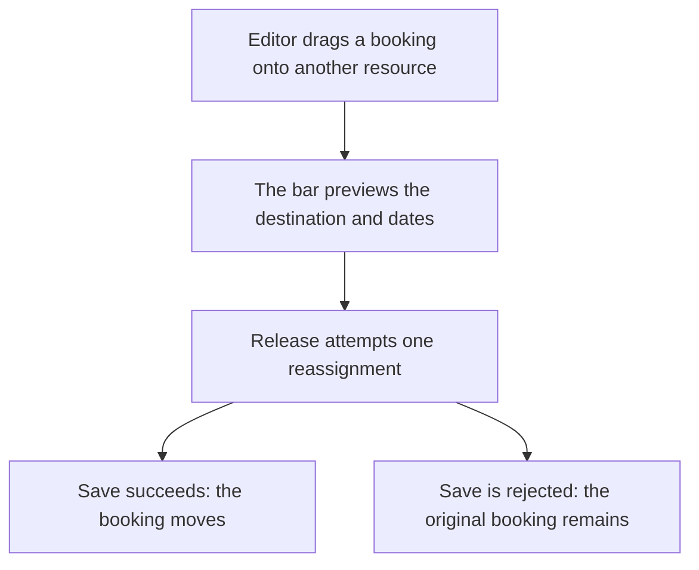
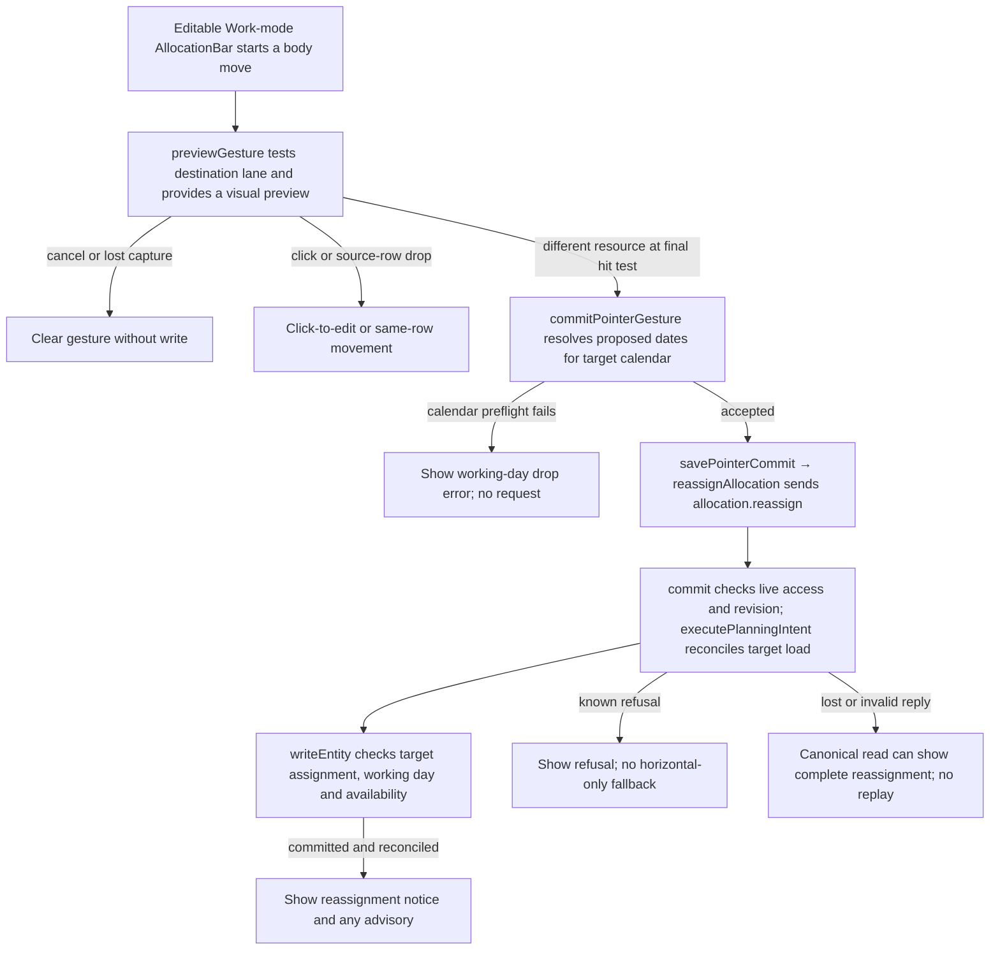

# US-SCH-06 — Reassign an allocation onto another resource

As an Editor, I want to drag an allocation onto another resource so that I can reassign work on the Schedule.

**Status:** Current

**Access:** Editor, Admin or Owner

**Entry:** Schedule (`/`)

**Documentation:** [schedule-work.md](../../docs-src/using/schedule-work.md)

**Source:** [SchedulerGrid.tsx](../../apps/frontend/src/components/scheduler/SchedulerGrid.tsx)

## Acceptance criteria

- Dragging an allocation to another resource reassigns it when valid.
- The bar appears on the destination resource row.

## User flow

## Code flow

A zero-column drop can still reassign. It offers the original start and re-places the measured source duration against the target calendar before the drop check.

**Code references:**

- [AllocationBar.tsx](../../apps/frontend/src/components/scheduler/AllocationBar.tsx#L193)
- [useDragResize.ts](../../apps/frontend/src/hooks/useDragResize.ts#L126)
- [useAllocationGestureViewModel.ts](../../apps/frontend/src/components/scheduler/useAllocationGestureViewModel.ts#L131)
- [useAllocationGestureViewModel.ts](../../apps/frontend/src/components/scheduler/useAllocationGestureViewModel.ts#L200)
- [useAllocationGestureViewModel.ts](../../apps/frontend/src/components/scheduler/useAllocationGestureViewModel.ts#L240)
- [gestureMath.ts](../../apps/frontend/src/lib/gestureMath.ts#L110)
- [allocationSlice.ts](../../apps/frontend/src/store/slices/allocationSlice.ts#L154)
- [execute.ts](../../apps/backend/app/services/planning/execute.ts#L220)
- [domain.ts](../../apps/backend/app/services/planning/entity_validation/domain.ts#L200)
- [planning_mutations_controller.ts](../../apps/backend/app/controllers/planning_mutations_controller.ts#L9)
- [planning.ts](../../apps/backend/app/services/planning.ts#L198)
- [planningCache.ts](../../apps/frontend/src/data/planning/planningCache.ts#L471)
- [AllocationBar.pointerDrag.interaction.test.tsx](../../apps/frontend/src/components/scheduler/AllocationBar.pointerDrag.interaction.test.tsx#L202)
