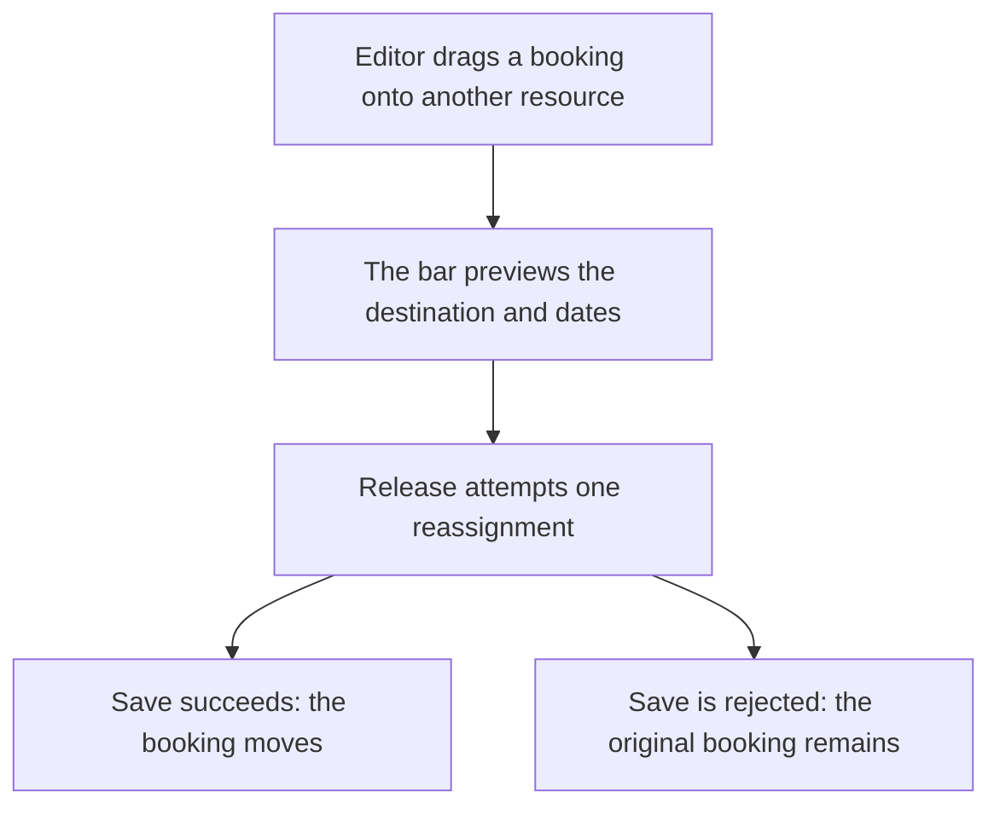
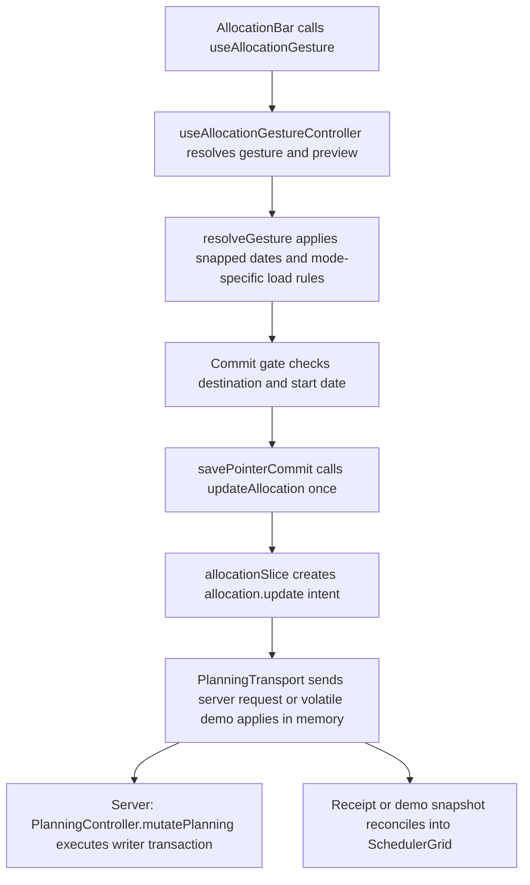

# US-SCH-06 — Reassign an allocation onto another resource

As an Editor, I want to drag an allocation onto another resource so that I can reassign work on the Schedule.

**Status:** Current

**Access:** Editor, Admin or Owner

**Entry:** Schedule (`/`)

**Documentation:** [schedule-work.md](../../docs-src/using/schedule-work.md)

**Source:** [SchedulerGrid.tsx](../../apps/frontend/src/components/scheduler/SchedulerGrid.tsx)

## Acceptance criteria

- Dragging an allocation to another resource reassigns it when valid.
- The bar appears on the destination resource row.

## User flow

## Code flow

**Code references:** [AllocationBar.tsx](../../apps/frontend/src/components/scheduler/AllocationBar.tsx), [useAllocationGesture.ts](../../apps/frontend/src/components/scheduler/useAllocationGesture.ts), [useAllocationGestureController.ts](../../apps/frontend/src/components/scheduler/useAllocationGestureController.ts), [allocationDrag.ts](../../apps/frontend/src/components/scheduler/allocationDrag.ts), [allocationSlice.ts](../../apps/frontend/src/store/slices/allocationSlice.ts), [planningCacheController.ts](../../apps/frontend/src/data/planning/planningCacheController.ts), [storePlanningTransport.ts](../../apps/frontend/src/data/planning/storePlanningTransport.ts), [planningTransport.ts](../../apps/frontend/src/data/planning/planningTransport.ts), [volatilePlanningTransport.ts](../../apps/frontend/src/data/planning/volatilePlanningTransport.ts), [planning_controller.ts](../../apps/backend/app/controllers/planning_controller.ts), [planning.ts](../../apps/backend/app/services/planning.ts), [execute.ts](../../apps/backend/app/services/planning/execute.ts), [writer.ts](../../apps/backend/app/services/planning/writer.ts)
