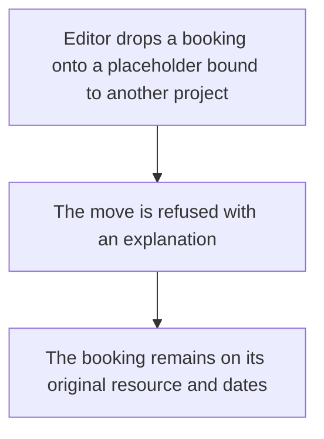
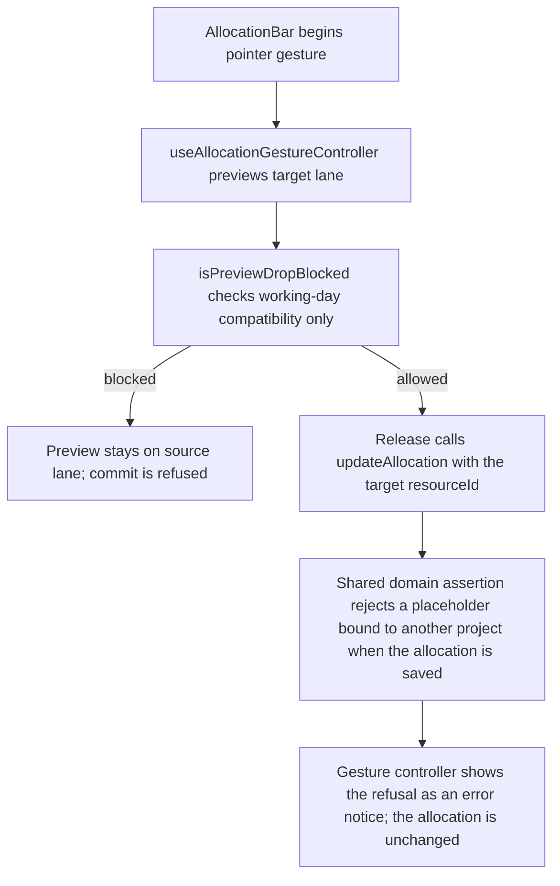

# US-SCH-07 — Reassigning onto a mismatched placeholder is rejected

As an Editor, I want a mismatched placeholder reassignment to be rejected so that work cannot drift from the placeholder’s bound project.

**Status:** Current

**Access:** Editor, Admin or Owner

**Entry:** Schedule (`/`)

**Documentation:** [schedule-work.md](../../docs-src/using/schedule-work.md)

**Source:** [SchedulerGrid.tsx](../../apps/frontend/src/components/scheduler/SchedulerGrid.tsx)

## Acceptance criteria

- A drop onto a placeholder bound to another project is rejected.
- The allocation stays unchanged and the user sees a reason.

## User flow

## Code flow

**Code references:** [AllocationBar.tsx](../../apps/frontend/src/components/scheduler/AllocationBar.tsx), [useAllocationGesture.ts](../../apps/frontend/src/components/scheduler/useAllocationGesture.ts), [useAllocationGestureController.ts](../../apps/frontend/src/components/scheduler/useAllocationGestureController.ts), [gestureWorkingWeeks.ts](../../apps/frontend/src/components/scheduler/gestureWorkingWeeks.ts), [allocationSlice.ts](../../apps/frontend/src/store/slices/allocationSlice.ts), [planningTransport.ts](../../apps/frontend/src/data/planning/planningTransport.ts), [planning_controller.ts](../../apps/backend/app/controllers/planning_controller.ts), [planning.ts](../../apps/backend/app/services/planning.ts), [execute.ts](../../apps/backend/app/services/planning/execute.ts)
