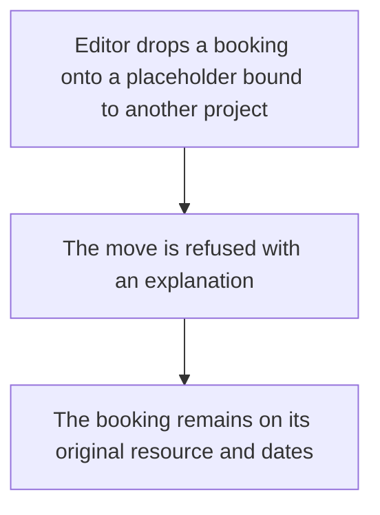
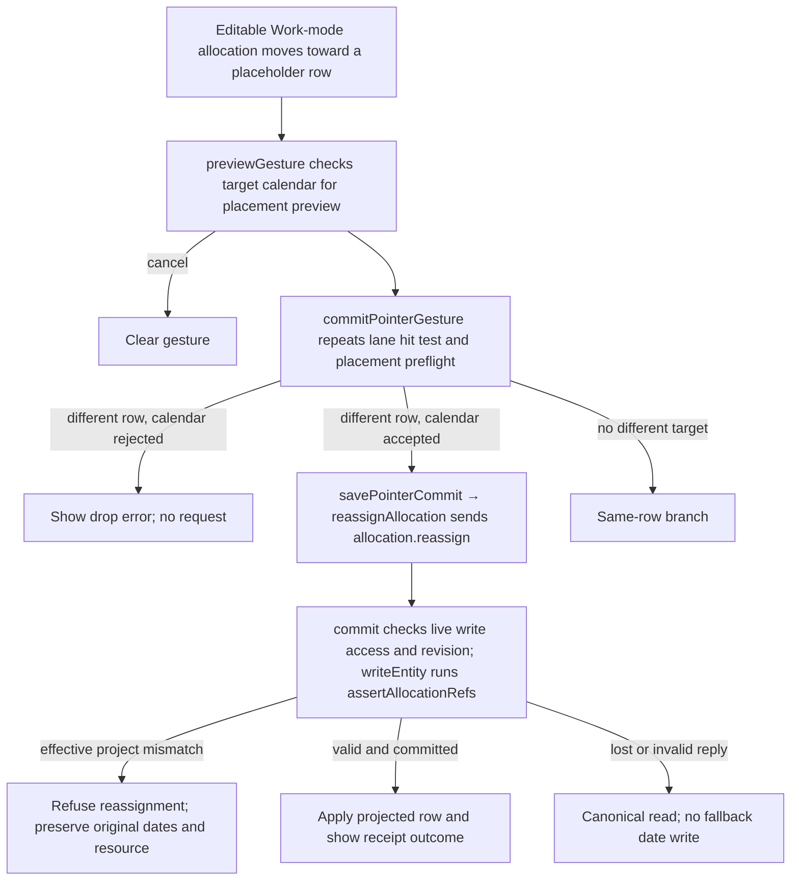

# US-SCH-07 — Reassigning onto a mismatched placeholder is rejected

As an Editor, I want a mismatched placeholder reassignment to be rejected so that work cannot drift from the placeholder’s bound project.

**Status:** Current

**Access:** Editor, Admin or Owner

**Entry:** Schedule (`/`)

**Documentation:** [schedule-work.md](../../docs-src/using/schedule-work.md)

**Source:** [SchedulerGrid.tsx](../../apps/frontend/src/components/scheduler/SchedulerGrid.tsx)

## Acceptance criteria

- A drop onto a placeholder bound to another project is rejected.
- The allocation stays unchanged and the user sees a reason.

## User flow

## Code flow

The effective project can come from a Project-specific activity or the allocation’s attribution to an All-projects activity. A stale refusal refreshes the cache.

**Code references:**

- [useAllocationGestureViewModel.ts](../../apps/frontend/src/components/scheduler/useAllocationGestureViewModel.ts#L131)
- [useAllocationGestureViewModel.ts](../../apps/frontend/src/components/scheduler/useAllocationGestureViewModel.ts#L200)
- [useAllocationGestureViewModel.ts](../../apps/frontend/src/components/scheduler/useAllocationGestureViewModel.ts#L240)
- [allocationSlice.ts](../../apps/frontend/src/store/slices/allocationSlice.ts#L154)
- [execute.ts](../../apps/backend/app/services/planning/execute.ts#L220)
- [refs.ts](../../packages/shared/src/domain/assertions/refs.ts#L366)
- [refs.ts](../../packages/shared/src/domain/assertions/refs.ts#L410)
- [planning_mutations_controller.ts](../../apps/backend/app/controllers/planning_mutations_controller.ts#L9)
- [planning.ts](../../apps/backend/app/services/planning.ts#L198)
- [planningCache.ts](../../apps/frontend/src/data/planning/planningCache.ts#L471)
- [AllocationBar.pointerDrag.interaction.test.tsx](../../apps/frontend/src/components/scheduler/AllocationBar.pointerDrag.interaction.test.tsx#L202)
