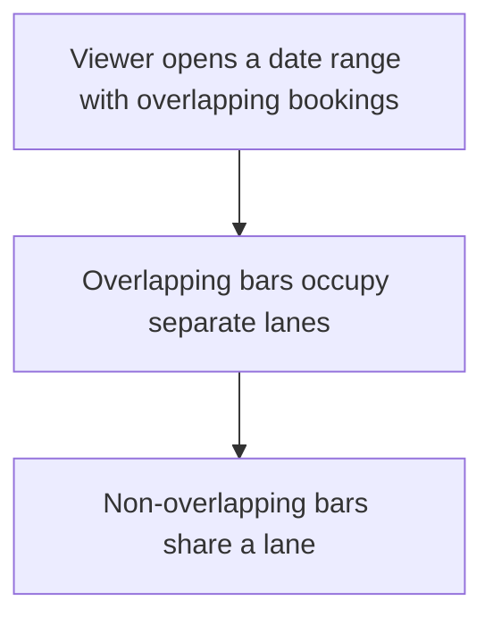
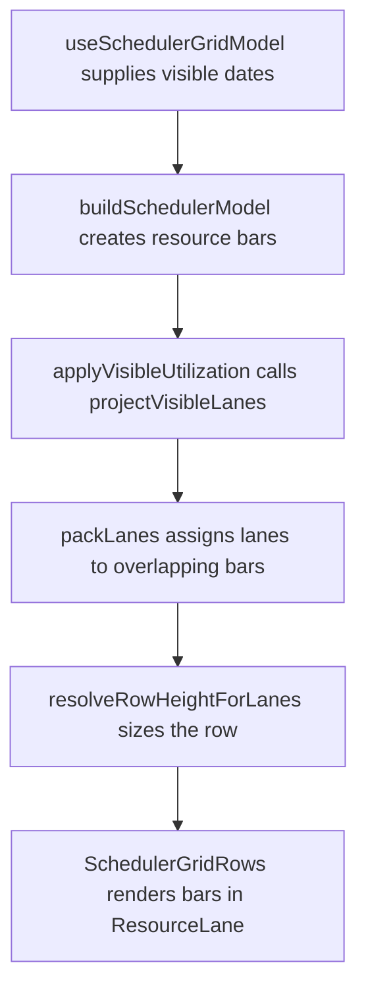

# US-SCH-08 — Overlapping allocations stack into separate lanes

As an Editor, I want overlapping allocations to appear in separate lanes so that each booking remains visible.

**Status:** Current

**Access:** Viewer, Editor, Admin or Owner; editing actions require Editor or higher

**Entry:** Schedule (`/`)

**Documentation:** [schedule-work.md](../../docs-src/using/schedule-work.md)

**Source:** [SchedulerGrid.tsx](../../apps/frontend/src/components/scheduler/SchedulerGrid.tsx)

## Acceptance criteria

- Overlapping allocations on one resource occupy separate lanes.
- Non-overlapping allocations can share a lane.

## User flow

## Code flow

**Code references:** [useSchedulerGridModel.ts](../../apps/frontend/src/components/scheduler/useSchedulerGridModel.ts), [schedulerModel.ts](../../apps/frontend/src/components/scheduler/schedulerModel.ts), [SchedulerGridRows.tsx](../../apps/frontend/src/components/scheduler/SchedulerGridRows.tsx), [ResourceLane.tsx](../../apps/frontend/src/components/scheduler/ResourceLane.tsx)
