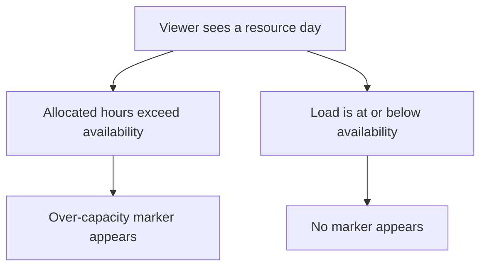
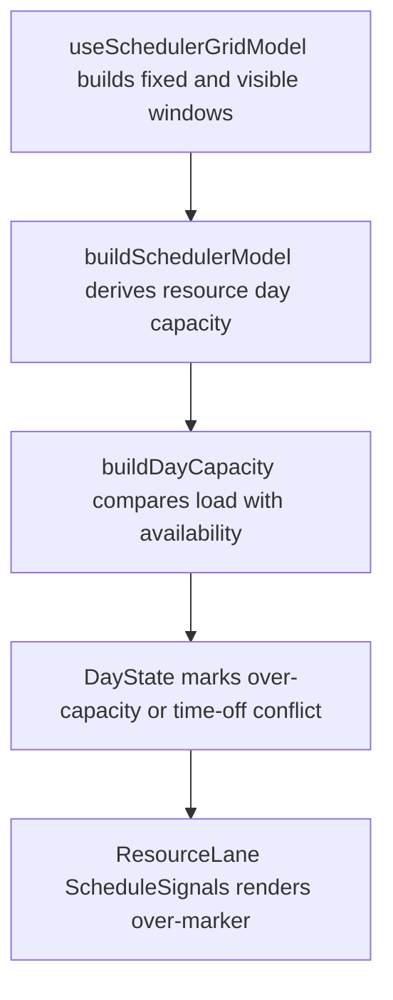

# US-SCH-09 — Over-allocated days are flagged with an over-marker

As an Editor, I want over-capacity days marked on the Schedule so that I can see when allocated hours exceed availability.

**Status:** Current

**Access:** Viewer, Editor, Admin or Owner; editing actions require Editor or higher

**Entry:** Schedule (`/`)

**Documentation:** [schedule-work.md](../../docs-src/using/schedule-work.md)

**Source:** [SchedulerGrid.tsx](../../apps/frontend/src/components/scheduler/SchedulerGrid.tsx)

## Acceptance criteria

- A day is marked over capacity only when allocated hours exceed available hours.

## User flow

## Code flow

**Code references:** [useSchedulerGridModel.ts](../../apps/frontend/src/components/scheduler/useSchedulerGridModel.ts), [schedulerModel.ts](../../apps/frontend/src/components/scheduler/schedulerModel.ts), [ResourceLane.tsx](../../apps/frontend/src/components/scheduler/ResourceLane.tsx)
