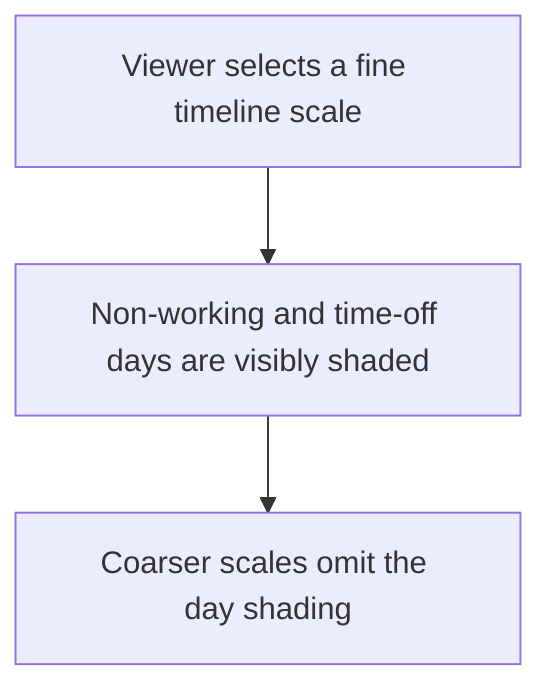
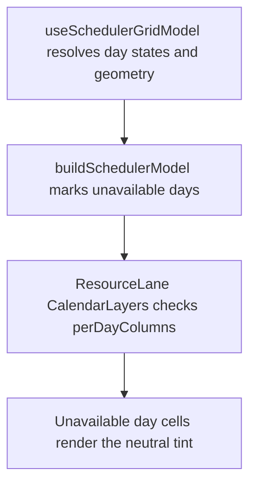

# US-SCH-10 — Unavailable days are greyed (weekends, non-working days, time off)

As an Editor, I want non-working and time-off days distinguished so that I can plan around available days.

**Status:** Current

**Access:** Viewer, Editor, Admin or Owner; editing actions require Editor or higher

**Entry:** Schedule (`/`)

**Documentation:** [schedule-work.md](../../docs-src/using/schedule-work.md)

**Source:** [SchedulerGrid.tsx](../../apps/frontend/src/components/scheduler/SchedulerGrid.tsx)

## Acceptance criteria

- Non-working days and time-off dates are visibly distinguished at fine zoom.

## User flow

## Code flow

**Code references:** [useSchedulerGridModel.ts](../../apps/frontend/src/components/scheduler/useSchedulerGridModel.ts), [schedulerModel.ts](../../apps/frontend/src/components/scheduler/schedulerModel.ts), [ResourceLane.tsx](../../apps/frontend/src/components/scheduler/ResourceLane.tsx)
