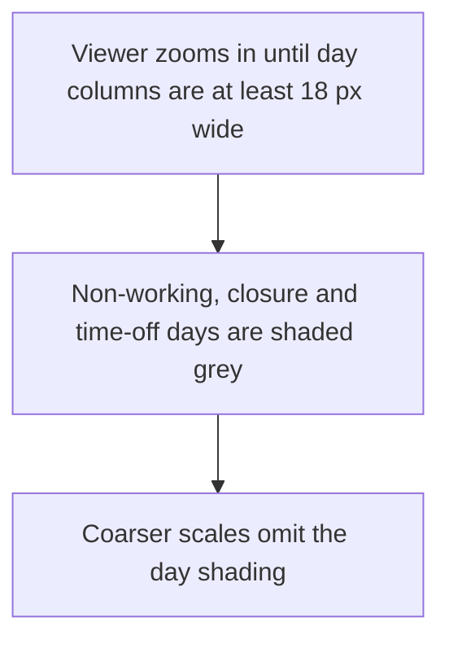
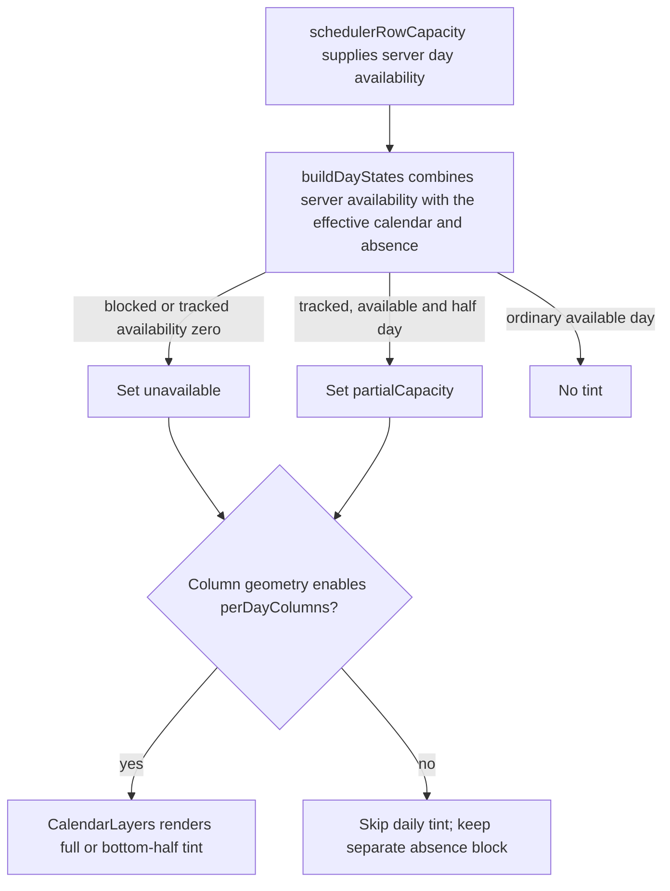

# US-SCH-10 — Unavailable days are greyed (weekends, non-working days, time off)

As an Editor, I want non-working and time-off days distinguished so that I can plan around available days.

**Status:** Current

**Access:** Viewer, Editor, Admin or Owner; editing actions require Editor or higher

**Entry:** Schedule (`/`)

**Documentation:** [schedule-work.md](../../docs-src/using/schedule-work.md)

**Source:** [SchedulerGrid.tsx](../../apps/frontend/src/components/scheduler/SchedulerGrid.tsx)

## Acceptance criteria

- When the zoom is fine enough to draw day columns (at least 18 px per day), each day a resource cannot take new work — a non-working day, a closure or a time-off day — is shaded grey on its row. A personal half day is shaded on the lower half of the row.
- At coarser zoom the day shading is omitted; time off still shows as its own block (see [US-SCH-11](US-SCH-11-time-off-block.md)).

## User flow

## Code flow

Fine-column tint starts at the 18 px base width. The local calendar and absence check supplies `creationBlocked`. External rows use the company calendar and have no personal absence or closure shading. Pointer-down draw eligibility uses `creationBlocked`.

**Code references:**

- [schedulerRowCapacity.ts](../../apps/frontend/src/components/scheduler/schedulerRowCapacity.ts#L33)
- [schedulerRowModel.ts](../../apps/frontend/src/components/scheduler/schedulerRowModel.ts#L120)
- [schedulerConfig.ts](../../apps/frontend/src/lib/schedulerConfig.ts#L20)
- [columnGeometry.ts](../../apps/frontend/src/components/scheduler/columnGeometry.ts#L232)
- [ResourceLane.tsx](../../apps/frontend/src/components/scheduler/ResourceLane.tsx#L52)
- [availability.ts](../../packages/shared/src/lib/capacity/availability.ts#L113)
