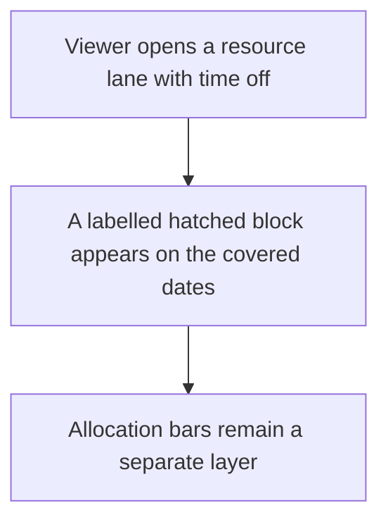
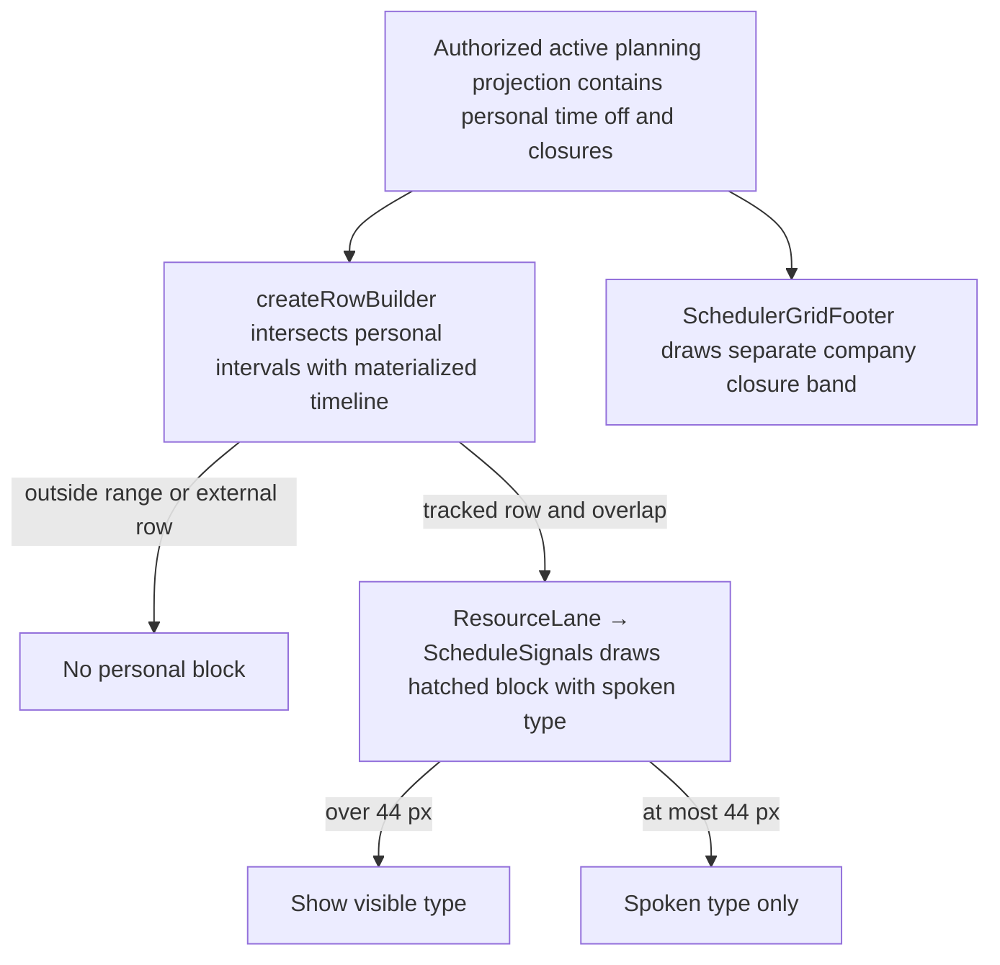

# US-SCH-11 — Time off renders as a labelled hatched block

As an Editor, I want time off shown as a labelled block so that time off is distinct from scheduled work.

**Status:** Current

**Access:** Viewer, Editor, Admin or Owner; editing actions require Editor or higher

**Entry:** Schedule (`/`)

**Documentation:** [schedule-work.md](../../docs-src/using/schedule-work.md)

**Source:** [SchedulerGrid.tsx](../../apps/frontend/src/components/scheduler/SchedulerGrid.tsx)

## Acceptance criteria

- Each time-off entry appears as a hatched block across its dates on the resource lane, behind the allocation bars. The block shows its type (Holiday, Sick, Unpaid or Other) when it is wider than 44 px; the type is always available to screen readers.

## User flow

## Code flow

Allocation bars remain a distinct layer. Company closures use the separate footer band.

**Code references:**

- [schedulerRowModel.ts](../../apps/frontend/src/components/scheduler/schedulerRowModel.ts#L44)
- [schedulerRowModel.ts](../../apps/frontend/src/components/scheduler/schedulerRowModel.ts#L193)
- [ResourceLane.tsx](../../apps/frontend/src/components/scheduler/ResourceLane.tsx#L103)
- [ResourceLane.tsx](../../apps/frontend/src/components/scheduler/ResourceLane.tsx#L167)
- [SchedulerGrid.tsx](../../apps/frontend/src/components/scheduler/SchedulerGrid.tsx#L269)
- [SchedulerGrid.test.tsx](../../apps/frontend/src/components/scheduler/SchedulerGrid.test.tsx#L238)
