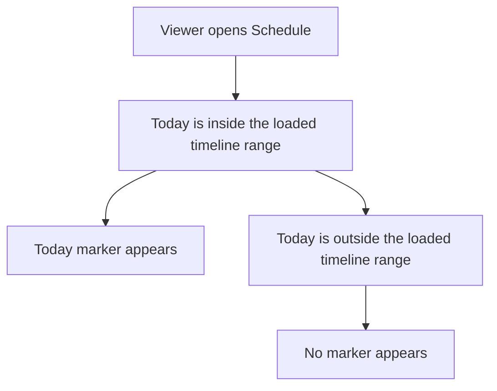
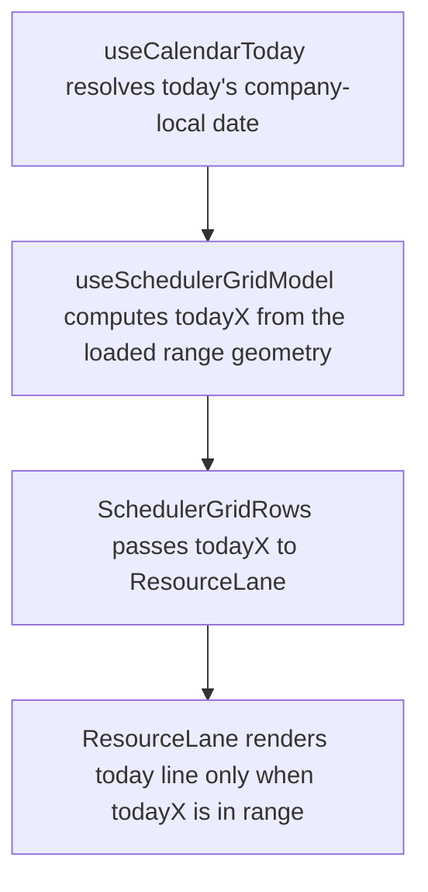

# US-SCH-12 — A vertical line marks today

As an Editor, I want today marked on the timeline so that I can orient myself within the visible date range.

**Status:** Current

**Access:** Viewer, Editor, Admin or Owner; editing actions require Editor or higher

**Entry:** Schedule (`/`)

**Documentation:** [schedule-work.md](../../docs-src/using/schedule-work.md)

**Source:** [SchedulerGrid.tsx](../../apps/frontend/src/components/scheduler/SchedulerGrid.tsx)

## Acceptance criteria

- When today, in the company time zone, falls within the loaded timeline range, a vertical line marks it on every resource row; when day columns are shown, the date header also highlights today. After navigating to a range that excludes today, neither appears.
- At midnight in the company time zone, the marker moves to the new date.

## User flow

## Code flow

**Code references:** [useCalendarToday.ts](../../apps/frontend/src/components/scheduler/useCalendarToday.ts), [useSchedulerGridModel.ts](../../apps/frontend/src/components/scheduler/useSchedulerGridModel.ts), [SchedulerGridRows.tsx](../../apps/frontend/src/components/scheduler/SchedulerGridRows.tsx), [ResourceLane.tsx](../../apps/frontend/src/components/scheduler/ResourceLane.tsx)
