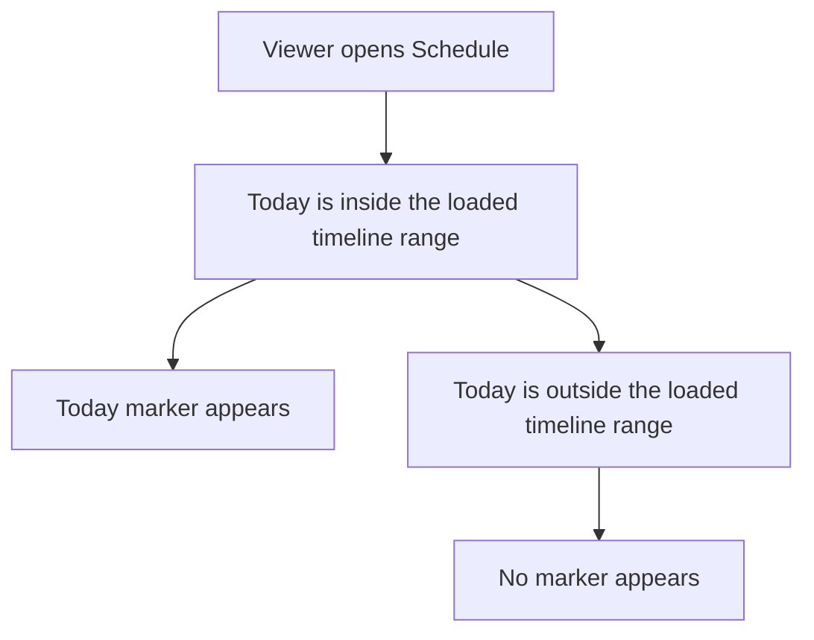
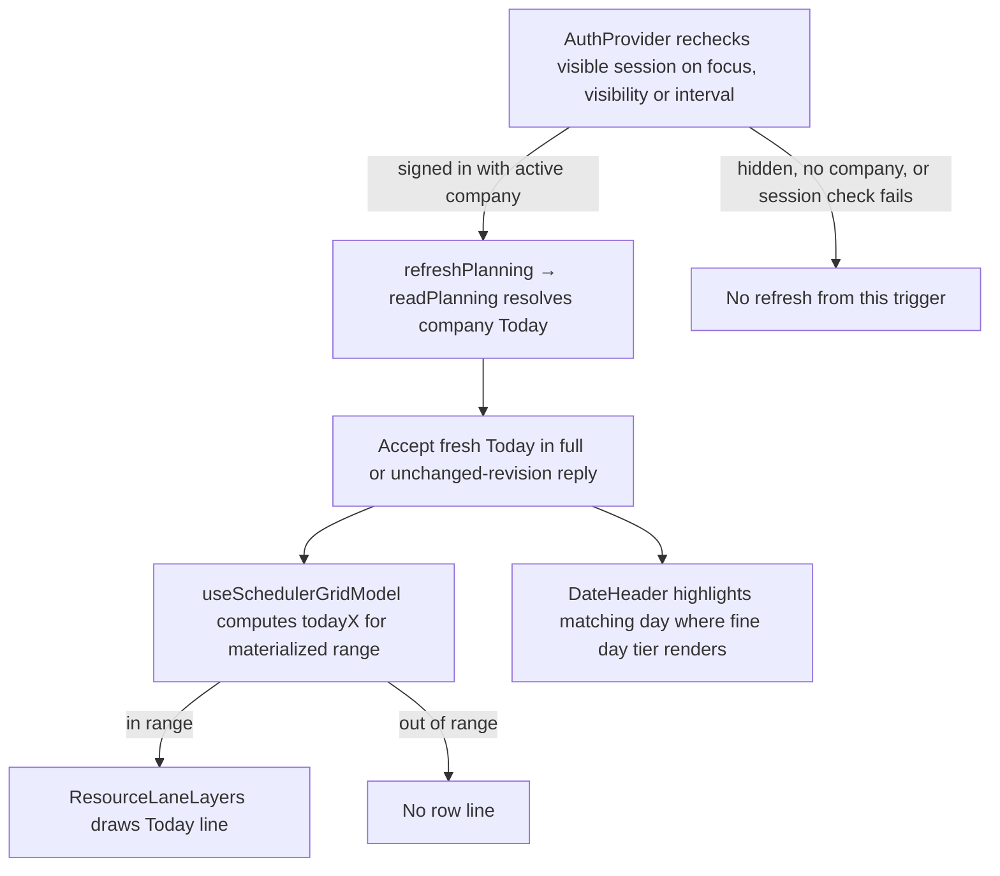

# US-SCH-12 — A vertical line marks today

As an Editor, I want today marked on the timeline so that I can orient myself within the visible date range.

**Status:** Current

**Access:** Viewer, Editor, Admin or Owner; editing actions require Editor or higher

**Entry:** Schedule (`/`)

**Documentation:** [schedule-work.md](../../docs-src/using/schedule-work.md)

**Source:** [SchedulerGrid.tsx](../../apps/frontend/src/components/scheduler/SchedulerGrid.tsx)

## Acceptance criteria

- When today, in the company time zone, falls within the loaded timeline range, a vertical line marks it on every resource row; when day columns are shown, the date header also highlights today. After navigating to a range that excludes today, neither appears.
- After midnight in the company time zone, the marker moves to the new date when the schedule next reads the company's data: within a minute while the tab is visible, or when the tab becomes visible again.

## User flow

## Code flow

On failed refresh the client has no new authoritative date to apply. The visible-tab interval is 60 seconds.

**Code references:**

- [AuthProvider.tsx](../../apps/frontend/src/auth/AuthProvider.tsx#L98)
- [planning.ts](../../apps/backend/app/services/planning.ts#L96)
- [planningCache.ts](../../apps/frontend/src/data/planning/planningCache.ts#L238)
- [useSchedulerGridModel.ts](../../apps/frontend/src/components/scheduler/useSchedulerGridModel.ts#L188)
- [DateHeader.tsx](../../apps/frontend/src/components/scheduler/DateHeader.tsx#L174)
- [ResourceLane.tsx](../../apps/frontend/src/components/scheduler/ResourceLane.tsx#L167)
- [SchedulerGrid.test.tsx](../../apps/frontend/src/components/scheduler/SchedulerGrid.test.tsx#L436)
