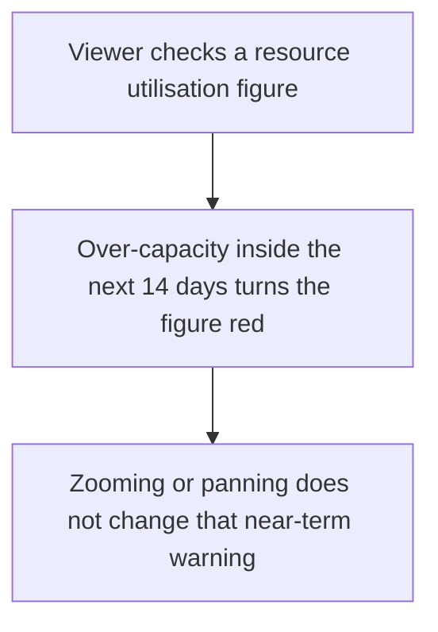
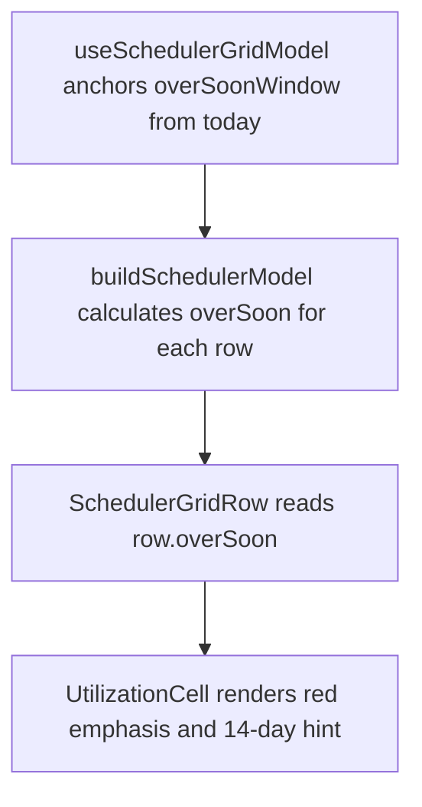

# US-SCH-13 — Per-resource near-term utilisation flag

As an Editor, I want a near-term utilisation warning so that I can see over-capacity coming within the next 14 days.

**Status:** Current

**Access:** Viewer, Editor, Admin or Owner; editing actions require Editor or higher

**Entry:** Schedule (`/`)

**Documentation:** [schedule-work.md](../../docs-src/using/schedule-work.md)

**Source:** [SchedulerGrid.tsx](../../apps/frontend/src/components/scheduler/SchedulerGrid.tsx)

## Acceptance criteria

- With Show Personal Utilisation on, a tracked resource’s row shows its utilisation percentage for the visible window.
- The percentage turns red and bold, with hover text beginning **Overbooked within the next 14 days**, when the resource is over capacity on any day in the 14 days from today.
- The red state depends only on that fixed 14-day window; changing the visible range changes the percentage, not the flag.

## User flow

## Code flow

**Code references:** [useSchedulerGridModel.ts](../../apps/frontend/src/components/scheduler/useSchedulerGridModel.ts), [schedulerModel.ts](../../apps/frontend/src/components/scheduler/schedulerModel.ts), [SchedulerGridRow.tsx](../../apps/frontend/src/components/scheduler/SchedulerGridRow.tsx)
