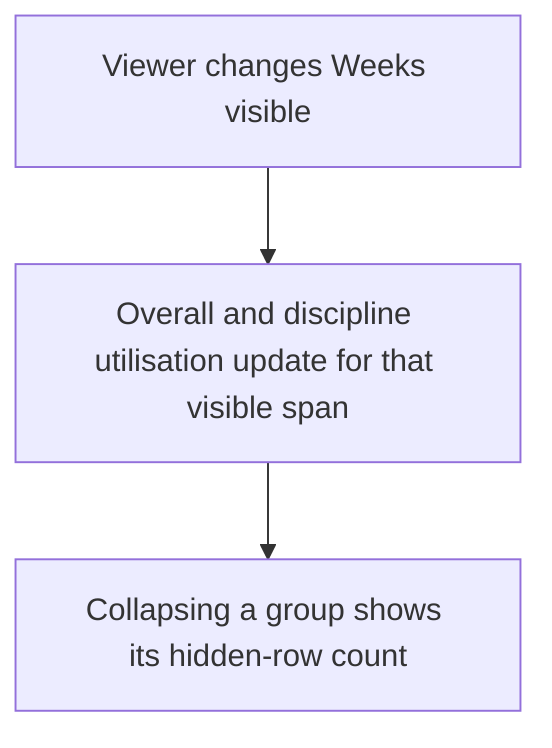
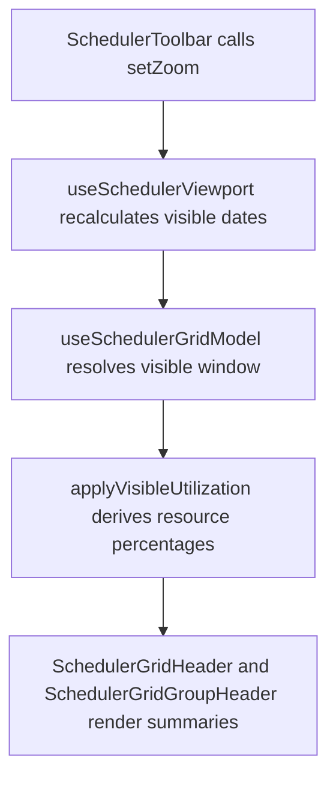

# US-SCH-14 — Overall and per-discipline utilisation summary

As an Editor, I want overall and discipline utilisation summaries so that I can compare workload across the visible period.

**Status:** Current

**Access:** Viewer, Editor, Admin or Owner; editing actions require Editor or higher

**Entry:** Schedule (`/`)

**Documentation:** [schedule-work.md](../../docs-src/using/schedule-work.md)

**Source:** [SchedulerGrid.tsx](../../apps/frontend/src/components/scheduler/SchedulerGrid.tsx)

## Acceptance criteria

- The Schedule shows overall and per-discipline utilisation for the visible window.
- Changing Weeks visible recalculates those figures.

## User flow

## Code flow

**Code references:** [SchedulerToolbar.tsx](../../apps/frontend/src/components/scheduler/SchedulerToolbar.tsx), [schedulerSlice.ts](../../apps/frontend/src/store/slices/schedulerSlice.ts), [useSchedulerViewport.ts](../../apps/frontend/src/components/scheduler/useSchedulerViewport.ts), [useSchedulerGridModel.ts](../../apps/frontend/src/components/scheduler/useSchedulerGridModel.ts), [schedulerModel.ts](../../apps/frontend/src/components/scheduler/schedulerModel.ts), [SchedulerGridHeader.tsx](../../apps/frontend/src/components/scheduler/SchedulerGridHeader.tsx), [SchedulerGridGroupHeader.tsx](../../apps/frontend/src/components/scheduler/SchedulerGridGroupHeader.tsx)
