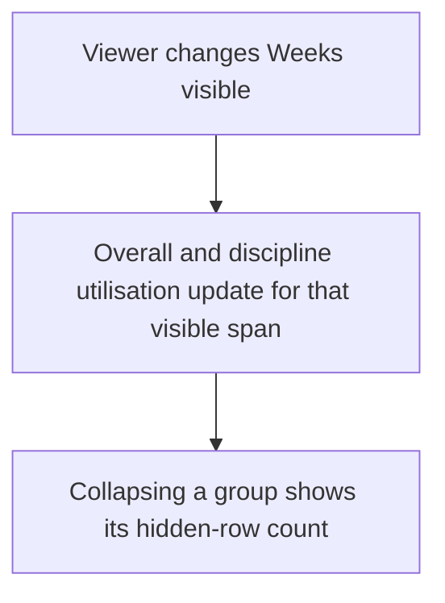
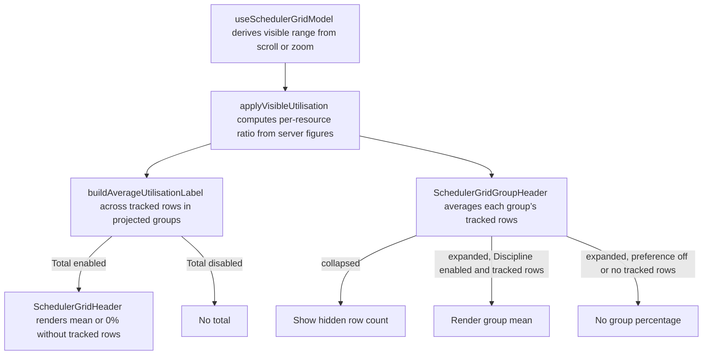

# US-SCH-14 — Overall and per-discipline utilisation summary

As an Editor, I want overall and discipline utilisation summaries so that I can compare workload across the visible period.

**Status:** Current

**Access:** Viewer, Editor, Admin or Owner; editing actions require Editor or higher

**Entry:** Schedule (`/`)

**Documentation:** [schedule-work.md](../../docs-src/using/schedule-work.md)

**Source:** [SchedulerGrid.tsx](../../apps/frontend/src/components/scheduler/SchedulerGrid.tsx)

## Acceptance criteria

- With Show Total Utilisation on, the Schedule header shows **Utilisation · {span}**, the average across tracked resources over the visible window.
- With Show Discipline Utilisation on, each group header other than External shows **{percent}% avg utilisation** for the visible window.
- Changing **Weeks visible** recalculates both figures.

## User flow

## Code flow

**Code references:**

- [useSchedulerGridModel.ts](../../apps/frontend/src/components/scheduler/useSchedulerGridModel.ts#L188)
- [useSchedulerGridModel.ts](../../apps/frontend/src/components/scheduler/useSchedulerGridModel.ts#L218)
- [schedulerModel.ts](../../apps/frontend/src/components/scheduler/schedulerModel.ts#L98)
- [schedulerGridDialog.ts](../../apps/frontend/src/components/scheduler/schedulerGridDialog.ts#L6)
- [SchedulerGridGroupHeader.tsx](../../apps/frontend/src/components/scheduler/SchedulerGridGroupHeader.tsx#L26)
- [SchedulerGridHeader.tsx](../../apps/frontend/src/components/scheduler/SchedulerGridHeader.tsx#L48)
- [SchedulerGrid.test.tsx](../../apps/frontend/src/components/scheduler/SchedulerGrid.test.tsx#L416)
