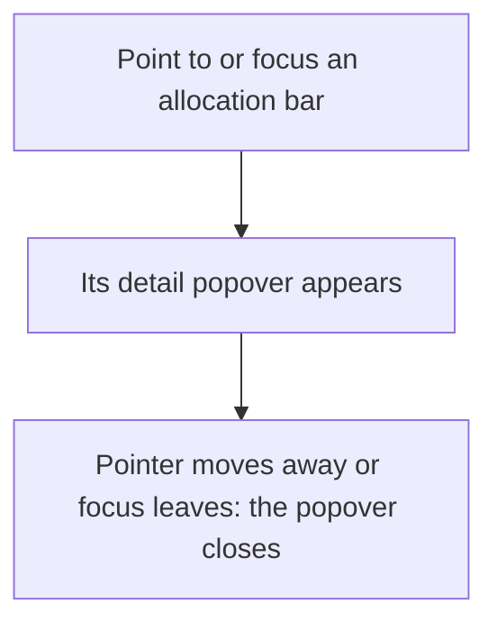
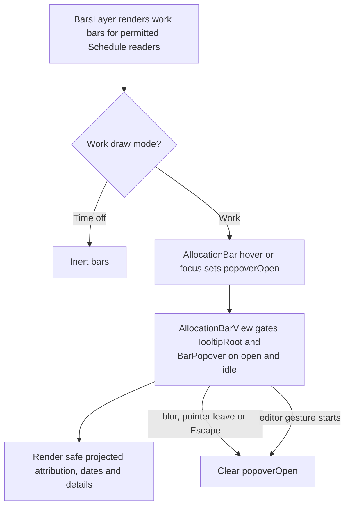

# US-SCH-15 — Allocation detail popover on hover/focus

As an Editor, I want allocation details available on hover or focus so that I can inspect a booking without opening its form.

**Status:** Current

**Access:** Viewer, Editor, Admin or Owner; editing actions require Editor or higher

**Entry:** Schedule (`/`)

**Documentation:** [schedule-work.md](../../docs-src/using/schedule-work.md)

**Source:** [SchedulerGrid.tsx](../../apps/frontend/src/components/scheduler/SchedulerGrid.tsx)

## Acceptance criteria

- Hovering over or focusing an allocation bar opens its detail popover.
- The popover shows the activity name; **{project} · {client}** when attributed; the date range; hours per day (not in Blocks mode or for external resources); **Tentative** or **Completed** when applicable; **Series through {end}** for a repeating allocation; the Task when Show task field in schedule is on; and the Note when present.

## User flow

## Code flow

Projected attribution may contain both client and project or just the one available value. The accessible name provides a separate spoken description.

**Code references:**

- [ResourceLane.tsx](../../apps/frontend/src/components/scheduler/ResourceLane.tsx#L34)
- [AllocationBar.tsx](../../apps/frontend/src/components/scheduler/AllocationBar.tsx#L96)
- [AllocationBar.tsx](../../apps/frontend/src/components/scheduler/AllocationBar.tsx#L193)
- [AllocationBarView.tsx](../../apps/frontend/src/components/scheduler/AllocationBarView.tsx#L162)
- [AllocationBarView.tsx](../../apps/frontend/src/components/scheduler/AllocationBarView.tsx#L228)
