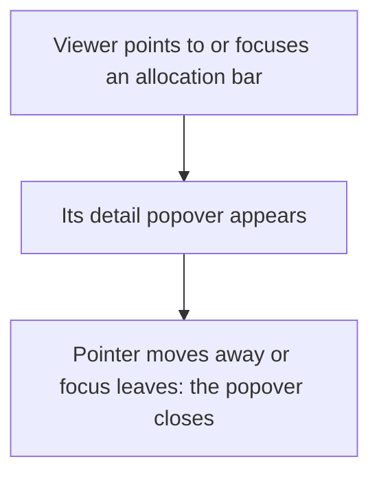
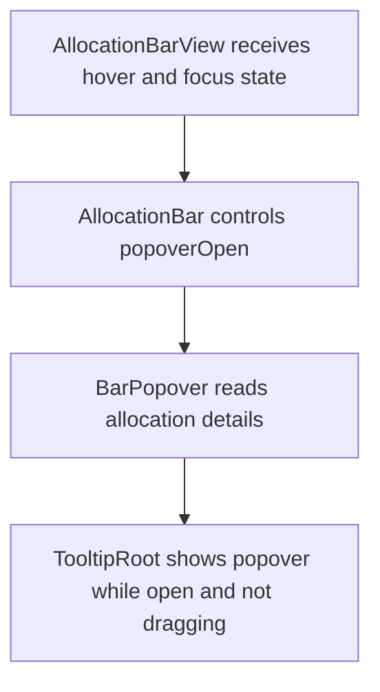

# US-SCH-15 — Allocation detail popover on hover/focus

As an Editor, I want allocation details available on hover or focus so that I can inspect a booking without opening its form.

**Status:** Current

**Access:** Viewer, Editor, Admin or Owner; editing actions require Editor or higher

**Entry:** Schedule (`/`)

**Documentation:** [schedule-work.md](../../docs-src/using/schedule-work.md)

**Source:** [SchedulerGrid.tsx](../../apps/frontend/src/components/scheduler/SchedulerGrid.tsx)

## Acceptance criteria

- Hovering or focusing an allocation opens its detail popover.
- The popover includes the allocation’s available dates, status and notes.

## User flow

## Code flow

**Code references:** [AllocationBar.tsx](../../apps/frontend/src/components/scheduler/AllocationBar.tsx), [AllocationBarView.tsx](../../apps/frontend/src/components/scheduler/AllocationBarView.tsx)
