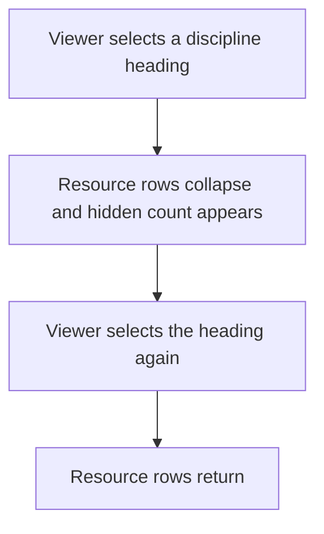
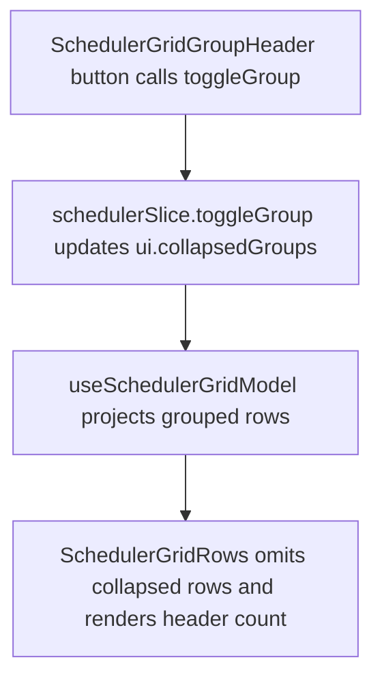

# US-SCH-16 — Collapse and expand a discipline group

As an Editor, I want to collapse and expand discipline groups so that I can focus the Schedule on selected teams.

**Status:** Current

**Access:** Viewer, Editor, Admin or Owner; editing actions require Editor or higher

**Entry:** Schedule (`/`)

**Documentation:** [schedule-work.md](../../docs-src/using/schedule-work.md)

**Source:** [SchedulerGrid.tsx](../../apps/frontend/src/components/scheduler/SchedulerGrid.tsx)

## Acceptance criteria

- Selecting a discipline header collapses its resource rows and shows a hidden-row count.
- Selecting it again restores the rows.

## User flow

## Code flow

**Code references:** [SchedulerGridGroupHeader.tsx](../../apps/frontend/src/components/scheduler/SchedulerGridGroupHeader.tsx), [schedulerSlice.ts](../../apps/frontend/src/store/slices/schedulerSlice.ts), [useSchedulerGridModel.ts](../../apps/frontend/src/components/scheduler/useSchedulerGridModel.ts), [SchedulerGridRows.tsx](../../apps/frontend/src/components/scheduler/SchedulerGridRows.tsx)
