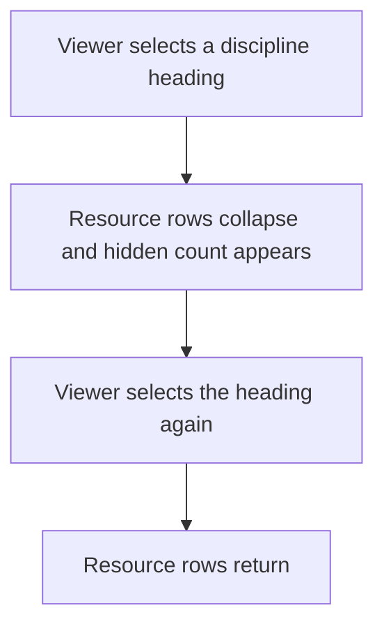
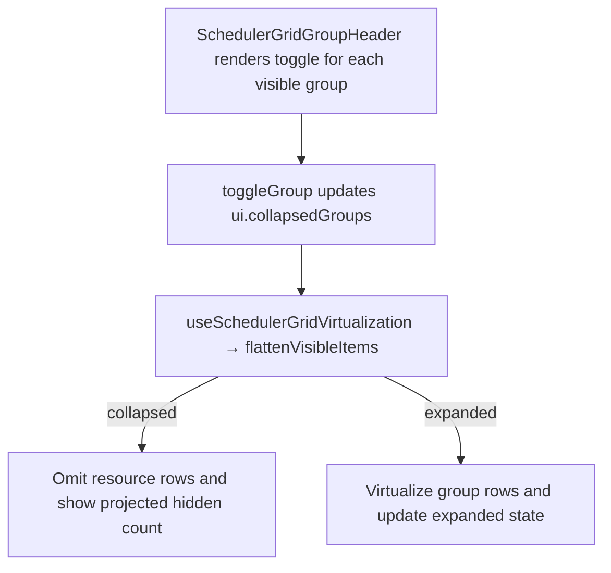

# US-SCH-16 — Collapse and expand a discipline group

As an Editor, I want to collapse and expand discipline groups so that I can focus the Schedule on selected teams.

**Status:** Current

**Access:** Viewer, Editor, Admin or Owner; editing actions require Editor or higher

**Entry:** Schedule (`/`)

**Documentation:** [schedule-work.md](../../docs-src/using/schedule-work.md)

**Source:** [SchedulerGrid.tsx](../../apps/frontend/src/components/scheduler/SchedulerGrid.tsx)

## Acceptance criteria

- Selecting a group header collapses its resource rows and shows **{count} hidden**.
- Selecting it again restores the rows.

## User flow

## Code flow

This is a view action available to Schedule readers. The same toggle re-expands the group.

**Code references:**

- [SchedulerGridGroupHeader.tsx](../../apps/frontend/src/components/scheduler/SchedulerGridGroupHeader.tsx#L26)
- [schedulerSlice.ts](../../apps/frontend/src/store/slices/schedulerSlice.ts#L222)
- [useSchedulerGridVirtualization.ts](../../apps/frontend/src/components/scheduler/useSchedulerGridVirtualization.ts#L25)
